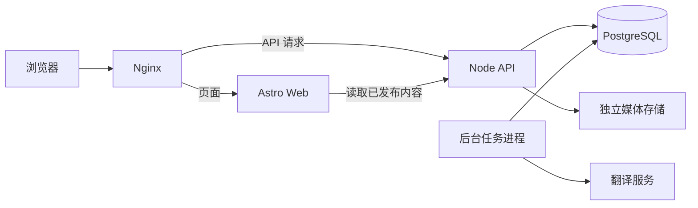
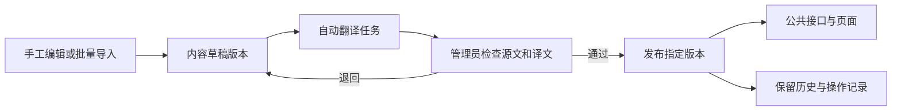

# Plotstay 架构方案与取舍

日期：2026 年 10 月 6 日。状态：**基础架构已获用户确认，作为后续实施依据。** 用户在方案比较后明确表示“可以的，我同意这个计划。我们继续”。后续进一步明确：先将讨论结论写入文档并 commit、push，再统一进入开发；已开始的工程内容保留。产品要求见[当前产品计划](plan.md)，确认经过见[决策记录](decisions.md)。

## 已确认的架构

采用 **Astro 按需渲染公开内容页 + 独立 Node.js / TypeScript API + PostgreSQL + 后台翻译任务**。固定说明页可以预生成，静态资源使用缓存。先把内容更新与代码部署各自的流程做好，再根据实际访问量决定是否增加公开 HTML 缓存。

浏览页面仍由服务器返回完整 HTML，只给筛选、图库、预订和编辑等交互增加必要的客户端代码。首页与详情通过 API 读取已发布内容，新增世界、修改文字、审核评价和发布译文都通过数据库生效，无须枚举所有条目重新生成整个站点。

沿用 Tomodachi 的“新版本构建完成并检查通过后再上线”机制，为常驻服务补上健康检查和流量切换。前后端可放在同一个仓库、部署在同一台服务器，由 Nginx 在同一域名下分发页面与 `/api` 请求。

| 决策 | 当前状态 |
| --- | --- |
| 前后端分离，现在建立真实后端与数据库 | 用户已确认 |
| 固定字段、手写及批量导入、自动翻译、审核、历史与共同编辑 | 用户已确认 |
| 世界管理员可审核发布，网站管理员可介入下架 | 用户已确认 |
| 游客可预订，后端保存，未来绑定账号 | 用户已确认 |
| Astro 按需渲染、独立 Node API、PostgreSQL | 用户已同意方案 |
| 单仓库、同域名、单机起步、独立后台任务进程 | 采用方案中的起步结构；生产部署参数在上线前确定 |
| 共同编辑先采用版本冲突检测 | 采用方案中的首期做法；实时协作后续细化 |
| 翻译接口与任务机制先实现，服务和密钥稍后配置 | 用户后续明确确认 |

以下方案比较保留决策理由。未选方案作为历史参考，不代表基础技术栈仍待选择；具体接口、表结构及部署参数在实施时细化。

## 已有项目提供的依据

### Tomodachi

已核对 `/data/apps/tomodachi`，以下描述对应检查时的代码：

| 位置 | 实际情况 | 对 Plotstay 的影响 |
| --- | --- | --- |
| [Astro 配置](/data/apps/tomodachi/astro.config.mjs:6) | `output: 'static'`；本地已安装 Astro 5.18.1 | 当前使用构建时生成页面的方式 |
| [详情路由](/data/apps/tomodachi/src/pages/[lang]/patterns/[slug].astro:25) | `getStaticPaths()` 遍历全部已发布内容与所有语言，页面从数据库取数 | 构建工作随内容及语言增加；页面间还有关联推荐依赖 |
| [管理服务](/data/apps/tomodachi/scripts/admin-server.mjs:1326) | 独立 Express 服务；发布入口先运行翻译脚本，再执行 build | 后端与内容库经验可借鉴；翻译任务应脱离代码发布流程 |
| [构建脚本](/data/apps/tomodachi/scripts/build-atomic.mjs:448) | 新建 release，验证产物及资源，安装共享哈希资源，原子替换 `current`，保留旧 release | 保留失败不切换、旧版本可退回、旧资源继续可用的原则 |
| [部署记录](/data/apps/tomodachi/docs/moonmistvalley-deployment.md:21) | Nginx 服务静态产物，另有管理 API；Cloudflare 配置公开页面缓存 | 可复用运维方式；Plotstay 的动态路由和缓存规则需要重新配置 |

以上没有测量真实构建耗时，也没有修改或部署 Tomodachi。这里的判断依据是取数、渲染和发布方式。

### Cocoons

已检查 [skins.js](/data/apps/cocoons-web/assets/colony/skins.js)、[layout.css](/data/apps/cocoons-web/assets/colony/layout.css)、[lime.css](/data/apps/cocoons-web/assets/colony/lime.css) 和[设计约束](/data/apps/cocoons-web/docs/design-alignment.md:3)。已有实现共用业务与数据，通过根元素的 `data-colony-skin` 属性选择皮肤；切换皮肤保留页面状态。

Plotstay 沿用业务、布局、皮肤分开的结构。皮肤包括窗框、图标、纹理和控件外观；世界记录保存 `themeId`。首期全部使用 Lime。阶段 3 最新布局已确认普通滚动、旅行平台式顶栏 / 背景搜索与发现栏目，详细设计见[首页方案](phase-3-discovery.md)。世界的背景、促销和栏目配置经 API 提供，后续世界管理界面复用这份配置；阶段 3 已通过不可变 world_home_revisions / world_home_publications 与独立发布指针完成持久化和草稿隔离，完整可视化编辑器后续接入。

## 渲染方式比较

| 方案 | 内容发布后的工作 | 优点 | 代价与适用范围 |
| --- | --- | --- | --- |
| Astro 全站静态生成 | 完成构建后切换新静态产物 | 最接近现有发布脚本；页面服务简单 | 小规模、低频更新可用；审核、翻译与评价更新仍需要构建或集中发布 |
| 静态页面壳 + 浏览器请求 API | 更新数据库，浏览器取新数据 | 正文更新不需要构建 | 初始 HTML 不含完整作品内容；首屏、分享摘要和搜索抓取需要额外处理 |
| **Astro 按需渲染** | 更新数据库，后续请求读取新发布版本；若启用 HTML 缓存则同步失效 | 保留 Astro；返回完整 HTML；内容变更不需全站构建 | 需要常驻 Node 服务；可用性依赖 Web、API 与数据库 |
| 增量静态构建 | 触发构建，复用未变化页面，再切换产物 | 有机会减少生成工作，保持静态服务 | 需要维护内容与依赖的缓存键；仍有构建发布流程；当前官方功能是实验性能力 |

Astro 官方支持给部分路由启用按需渲染，也支持 `output: 'server'` 后为稳定页面单独设置预生成。Node adapter 提供独立服务器模式和中间件模式。本方案倾向独立 Web 进程调用独立业务 API。[按需渲染文档](https://docs.astro.build/en/guides/on-demand-rendering/)、[Node adapter 文档](https://docs.astro.build/en/guides/integrations-guide/node/)

需要区分本机版本与现行文档：官方当前将增量静态构建列为 **Astro 7.2.0 起的实验功能**，依赖明确的页面 `cacheKey`，并有失效限制。Tomodachi 本机的 5.18.1 无法直接启用这项新功能。它可以作为未来优化既有静态项目的研究方向；Plotstay 首期的内容发布不建议依赖它。[增量构建文档](https://docs.astro.build/en/reference/experimental-flags/incremental-build/)

推荐按需渲染的主要依据是内容会持续经过编辑、翻译、审核和发布。初期内容少时，全站静态构建也完全可以接受；随着上述工作流增加，让内容更新直接经过后端会更顺畅。

## 服务与代码边界



建议目录边界：

```text
apps/web/              Astro 页面、交互、管理员界面
apps/api/              认证、权限、内容、审核、预订、媒体接口
apps/worker/           自动翻译和批量任务的执行入口
packages/contracts/   API 字段、校验规则、错误格式
packages/domain/      API 与 worker 共用的业务规则
packages/database/    数据库访问、迁移、seed
packages/themes/      主题定义、CSS 与资源
```

前端只依赖接口契约，不导入数据库模块。Web 服务通过内部 HTTP 地址访问 API，浏览器通过同域名 `/api` 访问；管理员权限由 API 检查。API 与 worker 共用业务代码，避免任务进程绕过内容状态约束。

这些模块可在一个仓库中统一构建和发布。初期一个数据库和一个后台任务进程即可，任务队列可先用数据库表承担，暂不需要增加消息中间件。具体 HTTP 框架、数据库访问库及交互组件库在方案确定后选择兼容版本。

dummy data 通过 seed 或导入写入真实数据库。首页、详情和管理页使用正式 API。种子包含长短文案、缺图、草稿、不同语言和第二世界等情况，以检查组件及权限边界；不将占位文案写死在页面中。

## 数据库取舍

| 选择 | 好处 | 需要承担的工作 |
| --- | --- | --- |
| SQLite | 熟悉，单文件，初期部署与备份容易 | 写事务需保持短小；多个写入来源要处理排队和忙等待；扩展到多应用节点时重新评估 |
| **PostgreSQL** | 适合多个进程共同读写；便于组织权限、版本、任务与预订的事务 | 多维护一项常驻服务，需要迁移、备份与恢复流程 |

SQLite 足以服务很多网站，多个编辑者也不意味着一定无法使用它。其关键边界是每个数据库同一时刻只有一个写入者。PostgreSQL 则提供基于 MVCC 的并发控制。[SQLite 适用场景](https://www.sqlite.org/whentouse.html)、[PostgreSQL 并发控制](https://www.postgresql.org/docs/current/mvcc-intro.html)

已选择 PostgreSQL，依据是编辑、审核、翻译任务和预订会成为多个写入来源，以及未来世界与用户关系会增长。上表保留 SQLite 作为比较时的备选及其取舍；当前实施使用 PostgreSQL。

核心身份、归属、关联关系和发布引用使用明确的表及约束。固定字段正文可以按内容类型保存在版本记录中，并以 schema 校验；翻译以“版本 + locale”组织。避免把中英文做成永远固定的两组列。

## 内容从创建到发布



实现建议：

1. **内容身份稳定。** 世界、住宿、活动、评价和角色都有自己的 ID。内容版本另行保存，公开接口只读取明确发布的版本。
2. **公开版本与编辑版本分开。** 保存修改产生新版本。审核绑定具体版本及译文，审核期间继续修改会形成新草稿，不能偷换已审核的正文。
3. **发布在事务内完成。** 检查权限、世界及内容是否被网站限制、版本和翻译是否满足要求，然后切换发布引用，留下审核与发布记录。对网站强制下架的内容，世界管理员不能自行解除限制。
4. **历史可回退。** 管理员选择历史版本形成一次有记录的恢复发布；普通编辑不能修改或清除历史。代码 release 回退与内容版本恢复分别操作。
5. **协作先检测冲突。** 保存携带编辑开始时的版本号；版本已变化时返回冲突，保留输入供用户比较处理。多人实时输入和自动合并不是已确认的首期要求。
6. **批量导入有预览与结果。** 先校验字段与引用、展示错误，再写入草稿。用来源标识与批次记录处理重复导入，逐项报告成功与失败；批量生成的文字也要经过审核。

首期提供满足上述流程的管理员界面。未来的用户工作台调用相同业务接口，根据权限展示不同操作。

### 世界与角色权限

真实用户拥有世界成员角色和内容编辑权限；虚拟游客、房东、向导是叙事身份。一个真实用户可拥有多个角色，切换角色不会增加审核或管理权限。评价保留真实作者及显示角色，房源作者与其他作者都可创作。

世界所有者可以管理世界并授权协作者；世界管理员可以审核发布本世界内容；网站管理员可以介入下架。所有写接口核对世界归属，关联的地点、房源、活动和评价必须属于允许的范围。未来付费创建世界通过能力限制接入，收费系统后续再设计。

当前不开放复制或 fork 他人作品。旅馆、多房型以及角色 profile 的具体字段可以后续扩展，首期不需要增加对应的公开管理页面。

### 自动翻译

翻译任务绑定源内容版本、源语言、目标语言、术语表版本与生成配置。源文保存完成后排队执行，按变化内容重译，失败重试；旧任务完成时只能写回其所属版本。人工校订生成新的译文记录，自动任务不能静默覆盖。

首期中英齐全后发布；译文与源文共同接受审核。语言回退只使用该公开版本已有的已审核文本。翻译供应商通过接口适配，现有翻译脚本中的术语处理和错误重试可以评估复用。

用户已明确选择“先完成接口，服务和密钥稍后配置”。本阶段实现任务队列、适配器契约、状态与重试、版本约束；外部翻译调用在配置前保持禁用，不自动复用其他项目的密钥。页面使用手工双语 dummy data，任务机制可通过测试适配器验证。真实供应商、模型、费用及密钥稍后确定，接入后再完成真实翻译联调；首次接入术语表时核定其版本。

后台任务必须保存进度、重试次数和失败信息，重启可恢复。内容保存、审核页面和网站代码发布不等待整批翻译完成。

## 游客预订与长期记录

首期游客直接预订。后端创建游客身份，浏览器使用受保护的 Cookie 持有凭证；预订成功后保存服务端记录，并返回用于绘制凭条的数据。未来登录后验证游客凭证，再将允许认领的记录绑定到账号。丢失凭证不能只凭可见的凭条编号认领记录。

后端在确认时检查内容仍可预订，并以请求幂等键防止重复写入。记录保存当时的内容发布版本、显示名称、世界、虚构价格、语言及可选的角色快照。修改房源、翻译或角色 profile 不会改写已签发凭条。

解锁内容、参加活动或获得评价资格时，以后端记录和业务规则判断。本地存储可用于恢复界面，不能成为资格依据。公开旅行主页、账户同步和玩法规则以后再做。

### 阶段 5 实现

三类详情进入 `/{locale}/booking/{contentId}`，经 `/api/bookings/quote` 获取后端报价，确认后 POST `/api/bookings`，成功到 `/{locale}/receipts/{id}`。独立 `plotstay_guest` Cookie（Path=/api、HttpOnly、SameSite=Strict、线上 Secure、180 天）保存随机令牌，数据库仅保存 SHA-256。管理登录不替换游客身份。凭条页先返回不含个人数据的页面骨架，再经同源 API 携 Cookie 读取；所有身份查询不共享缓存。

请求契约严格区分住宿日期／房间、活动场次／人数、服务场次／数量；报价和最终保存复用同一领域计价函数。发布内容和世界行锁覆盖可见性检查到插入；报价摘要包含发布版本、世界地点、语言和价格，确认时变化返回 QUOTE_CHANGED。按游客行串行化并保留数据库幂等唯一索引；同一幂等键的成功记录优先于新的日期和可见性检查。URL 中的 attempt 和 sessionStorage 中的原始提交参数支持刷新及失联恢复，不能代替游客凭证。

`006_booking_history.sql` 仅新增 bookings 防 UPDATE / DELETE 触发器，旧表和旧数据不变。新快照保存行程、单价、乘数、总额、零附加费、UTC 起止时间、发布引用、签发语言及正文语言、虚构旅客和签发时间。正文、翻译、世界、地点后续变化不改历史。PNG 直接由已授权读取的快照绘制，不依赖远程图片，也不把 Cookie 加入图片或链接。

详情的最近凭条恢复入口调用 `/api/bookings/latest?contentId=…`，仅返回当前游客的最近编号；凭条本身仍需原 Cookie。未增加订单列表、我的旅行、公开认领或跨设备同步。产品规则与验证见[阶段 5 方案](phase-5-booking.md)。

## 渲染、缓存与内容生效

### 多语言 URL 与 SEO 边界

临时阶段 2.5 的详细规则见[修复项目](i18n-seo-remediation.md)。语言配置区分数据库 / API 的内部键、公开路径前缀与标准语言标记：现有中文键 `zh-CN` 映射到 `/zh` 和 `zh-Hans`，英文为 `en`。Web 使用统一映射，不为路径调整改写不可变译文与发布历史；必要结构变化使用增量迁移。

公开内容及其实际发布语言由 API 提供，Web 负责 SSR 元数据和动态 sitemap，不能绕过 API 直接查询数据库。canonical、hreflang、sitemap 共用配置的公开站点地址、URL 生成和可索引规则；公开站点地址与管理写请求的 Origin 配置分别承担各自用途。源文回退可阅读，但不能声明成独立译文；预览默认关闭索引，不依赖 `NODE_ENV` 判断。阶段 2.5 已通过 `004_locale_urls.sql`、共享契约、SSR 元数据、`/api/discovery` 与动态 sitemap / robots 实施并验收，运行配置与证据见开发交接。

### 按需渲染与缓存

阶段 4 新增 `GET /api/worlds/:world/:kind/:slug/detail?locale=…&notesPage=…`。领域 `publishedDetail` 在 REPEATABLE READ / READ ONLY 事务内读取主条目、手记总数及当前页、同世界关联内容；继续使用统一 `publicSelect` 发布与可见性规则。手记每页 6 条，关联最多 6 条，同地点优先，然后按发布时间 / ID 排序，排除自身与手记。缺主条目及越界手记页返回 404，服务异常由 Web 返回 503；关联查询不截取旧的 50 条列表再筛选。

正文 JSON 新增 `highlights / included / serviceItems`，与既有字段共用校验、管理表单、译文任务和不可变发布流程。旧正文只在读取时补空数组；不修改历史行，不需要数据库迁移。导入兼容阶段 2 无 tags 与阶段 3 无详情新字段的原始哈希，仅当新增字段全空时接受旧哈希。非空新文字仍报告冲突。

住宿完整性修复另加可选 `text.stay`（分段介绍、亮点、睡眠安排、设施状态、地区、房东、三组须知）、`text.review`（旅客姓名 / 来源 / 时长）、`attributes.stay`（规格、房东演示统计）和 `attributes.reviewRatings`（六项评分）。未提供时保持旧快照兼容，前台栏目仍渲染明确占位。管理表单可保留 / 编辑嵌套 JSON，翻译任务传递完整正文，公开内容仍取已审译文。`publishedDetail` 从同一公开手记集合计算总评分、五档分布、各分项平均值及关键词去重计数；统计跨页，不纳入草稿、下架或隐藏父条目的手记。

`scripts/seed-stay-details.ts` 是显式的演示追加入口，默认只输出计划。仅处理既有九个演示房源白名单，跳过未发布编辑和不可见条目，经过正常新草稿 / 提交 / 审核流程追加。会话锁防止并发重复，稳定 slug 避免重复手记，不重写旧历史。若中途人工留下草稿，脚本保留而不自动审核；不在启动时执行。新增资料不需要 SQL 迁移，已应用的 `001`–`005` 不变。

详情 SSR 复用 Base、Card、Trip；图库、类型模块、人物卡、手记及标题栏组件位于 `components/detail/`，几何样式独立于首页 CSS。人物介绍使用正文版本中的名字 / 简介，真实作者身份仍由 contents.author_id 保存，未增加角色权限。图库以图片链接逐步增强为原生 dialog，支持焦点循环、Escape 和焦点恢复；无 JavaScript 时仍能阅读完整正文、打开图片及沿链接翻页。

`notesPage` 为详情内部状态，不传给关联内容或返回列表；分页链接保留白名单 browse 状态，语言链接保留手记页码。手记第 2 页及以后为 noindex / follow，不新增 canonical / hreflang 或 sitemap 条目；主详情的既有语言与 SEO 规则不变。

可变页面采用按需渲染，包括发现首页、搜索结果、住宿详情和活动详情。站点地图也从已发布内容生成，避免新增内容后仍需构建才能更新发现入口。固定说明页按需要预生成。

首版可先缓存带哈希的 CSS、JS 和版本化媒体，公开 HTML 直接读取当前发布内容。这在内容及访问量尚小时，能减少审核后仍展示旧内容的状态组合。后续按测量结果增加页面缓存：

- 缓存区分语言、世界、路由、筛选条件及主题版本。
- 发布、译文更新、回退或下架时，失效受影响详情、世界列表、关联推荐和站点地图；需要处理失效失败及重试。
- 草稿预览、管理页面、身份接口和个人凭条不进入共享缓存；个性化响应不得混入公共 HTML。
- 紧急下架需要明确的缓存清除路径，不能仅等待长时间 TTL 到期。

现行 Astro 文档提供路由缓存能力，标注从 7.0.0 加入；部分 CDN 集成仍为实验性能力。采用哪个缓存层应随所选版本和部署环境验证，数据库更新本身不会自动使所有缓存失效。[Astro 缓存文档](https://docs.astro.build/en/guides/caching/)

Tomodachi 的长时间公开 HTML 缓存规则不能直接照搬。Plotstay 先给动态路由配置明确的缓存策略，语言跳转和带身份响应也需要单独处理。

## 保留稳定发布机制

代码发布建议继续使用 release 目录、完整性检查、共享哈希资源和保留上一版的方式。常驻服务需要额外步骤：

1. 在新 release 中构建 Web、API 与 worker，检查产物和静态资源。
2. 执行与旧服务兼容的数据库迁移；数据库、媒体和任务状态位于 release 目录之外。
3. 在备用端口启动新 Web 和 API，验证健康状态、数据库兼容性、代表性页面及 API。
4. 检查通过后切换 Nginx 流量和当前 release 指向，保留旧进程直至已有请求处理完成。
5. worker 按任务协议兼容性有序切换，防止任务丢失或重复产生副作用；保留旧版本资源以服务仍被缓存的 HTML。
6. 失败时让旧服务继续工作；必要时切回上一组兼容的应用进程。

**仅替换 `current` 软链接不会替换已经运行的 Node 代码。** 流量切换必须与新进程启动、健康检查配套。应用版本回退不自动恢复数据库快照，不应抹掉发布后新产生的预订或编辑。破坏性的数据库结构修改要另行设计迁移与恢复步骤。

| 变化 | 生效途径 |
| --- | --- |
| 房源、活动、评价、译文 | 审核后更新发布引用；有缓存时使相关缓存失效 |
| 世界选择已有主题 | 更新已审核的世界配置及相关缓存 |
| CSS、页面组件、接口逻辑、新主题资源 | 构建新应用 release，检查并切换服务 |
| 数据库结构 | 执行迁移，考虑新旧服务并存及回退兼容性 |

## 实施顺序与当前状态

先将产品计划、架构及后续确认事项写入文档，完成独立的文档 commit 与 push，再统一进入开发。随后细化表结构、API 契约与首个可运行的内容流程；首页布局在进入首页开发时与用户讨论。

阶段 1 已在原有工作区草稿上完成并提交推送：数据库迁移、可重复双语 seed、独立 API、Astro 按需渲染及语言路由已连通，并通过权限、草稿隔离、版本边界和内容更新无需重建的验收。阶段 2 的内容管理与发布已验收，实现已提交为 `f03cbef`；没有生产部署。阶段 2.5 多语言 URL 与 SEO 修复也已完成本地验收。阶段 3 已确认旅行平台式首页、独立 Services、只记录意向的日期 / 数量与现有账号管理入口；普通滚动、地点自动分组与分页 SEO 要求保持有效。阶段 3 已按[发现首页方案](phase-3-discovery.md)完成实现与验收；新增服务沿用既有版本、翻译和审核边界，行程意向不引入库存系统。公开完整列表采用 24 条 SSR 分页，API 在 REPEATABLE READ 事务内读取配置、总数、分页和发现栏目，Web 仍只依赖 API。

基础方案文档已在 `af32393` 提交并推送。用户确认按既定阶段开发，并将在新 session 接续；最新阶段状态、已核实的环境及具体缺口统一记录在[开发顺序、进度与交接](development-status.md)。

已确认的世界管理员审核权限、游客预订和未来账号绑定已并入设计。实时协作、付费规则、更多媒体、房型层级与角色 profile 细节可以在相应功能阶段展开。

架构实现时优先验证五件事：草稿隔离及世界权限、内容发布无须全站构建、版本冲突与历史回退、翻译任务不会覆盖新内容、代码切换失败不影响正常服务。性能数据在运行后测量，再决定缓存或服务拆分的必要性。


## 阶段 5.5 管理与详情配置

`007_detail_management.sql` 新增 detail_settings、detail_setting_revisions、detail_setting_publications 和不可变事件表。内容继续使用原版本体系；共享资料保留稳定实体 ID，由独立审核发布事务更新原公开投影，公开读取不接触草稿。分类名称仍属于 world_home_revisions 的原始权威配置，新增审核绑定引用及恢复操作，不复制分类名称。

共用文案以限定注册键及中英文本保存；类型差异和共用键分开。正文新增可选 map 和 clearedFields，前者承载地图叙事，后者区分旧默认与作者主动清空；历史快照不改写。普通表单使用契约驱动的结构化状态，文本列表按语言独立，图片以 ID 关联；跨语言数字和日期只存一份。内容保存与界面审核携带 revision 和 draft token。

公开详情与后台预览复用 DetailBody。预览页面置于 `/api/admin/preview/`，沿用 Path=/api 的后台 Cookie；SSR 只向固定内部 API 转发 Cookie，API 校验权限与明确的内容／配置版本。预览禁用预订，API 仍只接受公开内容计价。配置与条目历史独立恢复；既有预订只读取不可变快照。

初始化为显式 `db:init:details`，默认只读，仅 `--apply` 创建缺失资料与原值历史，不在启动时运行，不重跑 seed。实现、字段来源、权限、测试与数据保留见阶段 5.5 文档。

## 阶段 5.6 角色评价设计交接（尚未实现）

用户确认以账号拥有的跨世界角色创作评价，普通账号通过用户入口操作，不需要后台内容编辑权限；不要求模拟预订。同角色同条目一篇评价，每篇一条提供者回复，修改需重审。角色保存后即可写草稿，首次发表将角色资料和评价一同送审，各自权限及获批版本分别校验。发布保存角色名字、头像等展示快照，后续角色修改不会重写旧署名。

具体数据契约、增量迁移、普通用户 API、既有 persona 资料与提供者绑定兼容方式在 56-01 核对；不得把原后台接口或可选 persona 字段视为完整用户流程。六项规则、工作包、测试及新 session 启动约定见[5.6 实施方案](phase-5-6-persona-reviews.md)。本节仅记录待实现设计，不改变阶段 5.5 的现有运行状态。

## 阶段 5.6 实现补充（2026-10-08）

角色资料统一复用 `detail_settings`，新增不可变 `persona_revision_decisions` 固定批准对象。普通用户角色评价复用 `contents(kind=review)` 与原版本、译文、发布表；`one_persona_review` 索引保证同角色同条目唯一。用户保存／提交走独立权限入口，不授予世界编辑权；后台旧编辑和译文 API 不得绕过新角色评价流程。

`review_signatures` 固定评价版本的资料版本和署名图像；回复使用 `review_replies/reply_revisions/reply_publications/reply_events`，唯一父评价与不可变版本独立于评分。`provider_bindings` 明确指定条目提供者，绑定事件留档，角色所有者与世界审核权限分别检查。历史凭条及原发布快照不改写。字段来源和兼容策略见[5.6 字段清单](phase-5-6-field-inventory.md)。
