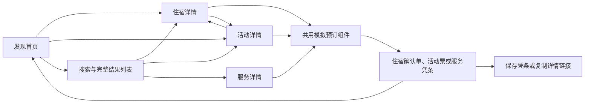

# Plotstay 当前产品计划

Plotstay 是以虚构旅行网站为界面的 fandom 网页游戏。玩家在不同世界浏览住宿、当地活动和服务，阅读角色口吻的游客评价，完成模拟预订，得到一张可以保存的旅行凭条。房间、活动、服务与评价共同构成这个世界的生活片段。

首期围绕《战锤 40,000》的 **Lathe Worlds（拉斯世界）** 制作，提供中文和英语。面向游客依阶段完成 **发现首页与完整结果列表、住宿 / 活动 / 服务详情，以及共用模拟预订组件**。用户已确认阶段 3 增加独立 Services 类型及基础详情；日期与数量保存为行程条件，暂不筛选余量。内容由管理员先维护，现有账号可登录管理，成为房东入口先提供创作说明；公开注册与申请后续开放。使用真实后端和数据库，以 dummy data 填充页面；管理员需要手工编辑、批量导入、审核和版本回退能力。

更新日期：2026 年 10 月 8 日。阶段 1、2、2.5、3 已完成；阶段 4 首轮缺漏已转为[住宿完整性修复](phase-4-stay-remediation.md)。用户要求十组栏目和对应样式完整、缺文可占位，覆盖旧的住宿空模块隐藏策略。住宿已实现并通过技术检查，活动已按指定体验页完成八组栏目及评分评论修复、用户已授权提交当前版本，服务尚待参考对照；不自动进入阶段 5、6。首页中英文案、美术和字体保持既有审定版本。技术架构沿用 Astro、独立 API、PostgreSQL 和后台翻译任务。

同日用户查看修复后的住宿页，确认当前结果合格并授权提交推送；该认可对应本轮住宿修复，不扩大为活动 / 服务已经完成参考验收。

执行顺序：先将讨论结论写入文档并 commit、push，再统一进入开发。已经开始的工程内容保留，后续按本计划继续检查和完善。确认经过与尚待细化的事项见[决策记录](decisions.md)。

## 已确认的决策

| 事项 | 当前决定 | 依据 |
| --- | --- | --- |
| 项目名称 | 仓库与包名为 `plotstay`，首页品牌展示为 `PlotStay`；既有文档标题中的 Plotstay 指同一项目 | 用户命名及最新首页品牌要求 |
| 产品形态 | 响应式 Web，以旅行浏览和模拟消费承载 fandom 创作 | 原讨论及本次说明 |
| 世界结构 | 平台支持多个世界，每个世界有自己的住宿、活动、服务和虚构评价 | 原范围及阶段 3 Services 确认 |
| 首个世界 | 《战锤 40,000》的 Lathe Worlds，中文名“拉斯世界” | 用户确认世界及中文名 |
| 首期范围 | 浏览住宿、活动与服务、阅读内容、模拟预订 / 预约、保存凭条；按阶段交付 | [原讨论收敛](sources/chatgpt-discussion-2026-10-06.md#消息-36-助手回答)及阶段 3 Services 扩展 |
| 首期内容维护 | 管理员先维护内容；支持手工编辑和批量导入，用户自助投稿后续开放 | 用户回答 3 及此前范围确认 |
| 内容编辑 | 先支持介绍、设施、须知、图片等固定字段；自由排版之后再说 | 用户回答 1 |
| 语言 | 中文和英语都完整支持，英文略优先；结构支持继续增加语言 | 用户回答 15 及此前说明 |
| 内容翻译 | 自动翻译，接入已有术语表；先完成接口与任务队列，服务和密钥稍后配置 | 用户回答 5 及后续追问确认 |
| 美术方向 | 使用 `/data/apps/cocoons-web` 中的 digi-tech Lime 风格；首页采用普通网页滚动，保留窗口式边框和标题栏 | 用户补充确认及阶段 3 对齐 |
| 首页结构 | Expedia 式顶栏与背景搜索区，Airbnb 式发现栏目；促销、分类图标、活动、住宿、按地点的 Stay in 栏目和三项卖点 | 阶段 3 最新方案获用户同意 |
| 首页分组与列表 | 地点栏目按已有地点自动生成；搜索和查看全部进入完整结果列表，SSR 分页由列表承担 | 保留地点分组与 SEO 整改，并按最新首页结构调整 |
| Services | 独立类型，阶段 3 支持管理、搜索和基础详情；完整详情、预约与凭条衔接阶段 4 / 5 | 阶段 3 Q1 选择 A |
| 行程条件 | 保存日期、人数与房间数，带到详情，暂不按容量或余量筛选 | 阶段 3 Q2 选择 A |
| 账户与房东入口 | 现有账号可登录管理；成为房东先展示创作说明，公开注册和申请后续开放 | 阶段 3 Q3 选择 A |
| 架构与占位内容 | 前后端分离，现在建立真实后端和数据库，先录入 dummy data | 用户回答 2 及此前说明 |
| 技术选型 | Astro 按需渲染、独立 Node.js / TypeScript API、PostgreSQL、后台翻译任务；沿用先检查新版本再切换上线的发布方式 | 架构比较后，用户明确同意计划 |
| 中文术语 | 使用已有翻译表；具体表格与内容稍后接入 | 用户补充确认 |
| 模拟预订记录 | 长期用于旅行记录、内容解锁、活动参与及评价资格，须保存为后端记录 | 用户回答 6 |
| 预订身份 | 首期允许游客直接预订，未来支持绑定账号；丢失游客凭证后不保证能找回 | 后续追问确认 |
| 世界创建 | 未来允许用户创建世界，可能作为付费能力；创建者管理本世界并遵守网站规则 | 用户回答 7 |
| 共同编辑 | 需要共同编辑；首期通过保存时检查版本避免互相覆盖，实时协作以后细化 | 用户回答 8 及后续架构确认 |
| 房间层级 | 未来可能需要旅馆下的多个房间或房型，首期优先级低 | 用户回答 9 |
| 评价与虚构身份 | 作者和其他用户均可创作评价；同一用户可有多个虚拟游客身份，可能编辑其 profile | 用户回答 10 |
| 审核发布 | 所有内容审核通过后才公开；世界管理员可以审核发布，网站管理员可以介入下架 | 用户回答 11 及后续追问确认 |
| 内容历史 | 需要版本历史与回退 | 用户回答 12 |
| 扩展内容 | 允许后续丰富内容和媒体形式，首期编辑仍以固定字段为范围 | 用户回答 13 与回答 1 |
| 复制与改编 | 暂不提供复制或 fork 他人作品的功能 | 用户回答 14 |
| 世界主题 | 未来允许各世界选择主题，首期全站统一 digi-tech Lime | 用户回答 16 |

原讨论从豪华酒店与房间放置，逐步转向 fandom 旅行，再收缩到三个核心页面。早期八页面方案、列车叙事、ASMR 和创作者系统保留为后续参考。当前范围以本次确认和讨论末尾的收敛为准。[完整原文](sources/chatgpt-discussion-2026-10-06.md)

## 产品体验

主要路径是：**选世界 → 逛住宿、活动与服务 → 读详情和游客手记 → 假装预订 → 拿到凭条 → 继续浏览或分享**。

首期要验证的是：用户是否喜欢以游客身份阅读一个熟悉世界里的生活细节，愿不愿意多看几条内容，以及是否想把房源、活动或凭条分享出去。

管理员和未来的创作者负责把世界观写进旅游商品：房间景观、设施、当地向导、行程、包含项目、注意事项和游客抱怨。页面用认真经营旅游业务的口吻，幽默由这些内容自然产生。评价也是可独立创作的短篇内容。

英文产品说明可暂用原讨论中的 “Stays and experiences in fictional worlds.”，宣传语 “Book the impossible.” 作为候选，最终展示文案随 UI 一起确定。

## 首期页面与组件

| 页面或组件 | 要完成的事情 | 必需内容 |
| --- | --- | --- |
| 发现首页 | 在当前世界发现住宿、活动和服务 | 品牌与世界切换、账户菜单、背景搜索、四类标签、促销、分类图标、内容横排、地点栏目和三项卖点 |
| 完整结果列表 | 搜索或查看全部并进入所有公开条目 | 紧凑搜索、条件与结果概况、内容卡片、SSR 分页、返回状态；与首页共用语言路由，区分页面状态 |
| 住宿详情 | 了解一间虚构房间并决定预订 | 图库、名称与地点、介绍、住宿亮点、设施、房东介绍、入住须知、游客手记、虚构价格、预订入口、同世界关联内容 |
| 活动详情 | 了解一个当地体验并决定预约 | 图库、名称与地点、活动类别、向导、时长、行程、包含项目、参与须知、游客手记、虚构价格、预约入口、同世界关联内容 |
| 服务详情 | 了解一项当地服务及提供者 | 阶段 3 先提供名称、地点、图片、介绍、类别、提供者、基础报价和返回入口；完整专有模块阶段 4 完成，预约阶段 5 接入 |
| 共用预订组件 | 完成一次简短的模拟消费 | 所选内容摘要、虚构账单、默认虚拟礼宾卡、确认动作，以及成功凭条 |
| 凭条与分享操作 | 给这次旅行一个可保存的结果 | 住宿确认单、活动票或服务凭条、保存图片、复制详情链接、继续浏览 |

### 发现首页

首页采用用户最新确认的旅行平台结构：Expedia 式头部与带世界背景图的搜索面板，接 Airbnb 式内容发现栏目。普通网页滚动，大区块保留 Lime 窗口式边框和细标题栏。首屏优先展示品牌、世界与搜索，不再要求首屏必须出现条目卡片；完整栏目、搜索字段、已答问题与后续细化项及验收规则见[阶段 3 开发方案](phase-3-discovery.md)。

顶栏为图标 + PlotStay、Lathe Worlds 下拉入口，右侧是成为房东、用户图标和小菜单。菜单放语言、帮助、成为房东、按权限显示的内容 / 世界管理及登录后的退出。首发世界菜单只有 Lathe Worlds，未来支持搜索世界；开发用第二世界用于隔离验证。图标沿荒诞的飞行 / 导航箭头方向探索，最终图稿与幽默文案后补。

搜索区之后依次为虚构促销、附近活动分类图标、世界热门活动、热门住宿、按已有地点自动生成的 Stay in 栏目、组合优惠 / 丰富选择 / 会员权益三项卖点。世界背景、横幅、栏目及卖点通过配置提供，后续世界管理界面可维护。日期、折扣数字、示例英文句子与梗均不是最终文案，也不自动引入积分或优惠结算系统。

住宿卡展示封面、名称、地点、短卖点、标签和每晚虚构价格；活动卡复用骨架，展示类别、时长和每人虚构价格。首页按横排浏览内容，“查看全部”和搜索进入共用的完整结果列表，由列表提供 SSR 分页。每页 24 条与三 / 二 / 一列只作为完整列表的初始建议。

搜索标签为 All / Homes / Experiences / Services，按类型展示目的地、日期、人数和房间数等字段。关键词覆盖名称、地点、简介、正文和标签；日期与数量保存为行程意向，带到详情，暂不参与容量 / 可订筛选。Services 表达“请人替你做什么”，作为独立内容类型支持管理、搜索与基础详情。All 同时包含住宿、活动和服务；筛选与行程状态写入网址，翻页、语言切换和往返详情时保留。地图和复杂排序仍留后续。

### 住宿、活动与服务详情

图库、标题、地点、人物介绍、手记、价格摘要与关联卡片可以复用。住宿的设施与入住须知、活动的行程与参与须知、服务的项目说明与接受服务须知使用各自的字段和模块。Services 在阶段 3 先有基础详情，阶段 4 补齐完整展示；服务报价初始建议为每次，具体计价与预约字段在阶段 5 前细化。

人物介绍卡分别呈现虚构房东、向导或服务提供者；实际创作者署名单独保存。首期人物卡只负责介绍，无须建立人物主页。

阶段 4 已确认：标题 / 地点与图库在顶部；桌面住宿内容与价格摘要双栏，下方评价、位置、房东及三组须知全宽，手机单列。图库支持缩略图、大图、键盘与 Escape。原数组和人物字段保留，新增可选的版本化住宿及手记 JSON。住宿所有栏目必须渲染，空字段显示占位；本地九个演示住宿通过新版本补充，旧正文和发布历史保留。活动现已按指定体验页补齐八组栏目、五步图文流程和评分评论，用户已授权提交当前版本，详见[活动修复记录](phase-4-experience-remediation.md)；服务仍沿用首轮基础实现，须另行对照验收。联系房东入口仅打开演示说明，不新增真实消息、人物主页或创作者权限。

关联内容先按同一世界、同一地点组织。只有 Lathe Worlds 时也通过这些关系取数，避免将首发内容写进页面组件。切换世界后，详情和关联内容都必须属于正确的世界。

### 模拟预订与凭条

预订组件依次经历“确认内容 → 生成凭条 → 保存或继续浏览”。住宿、活动与服务使用共用流程，凭条的标题、单位和叙事小字由内容类型决定。

金额和确认动作附近明确说明“模拟预订，不会真实扣款”。虚拟礼宾卡是游戏元素，无须输入银行卡、真实姓名或联系方式。原首期计价建议为每次一晚住宿、一个活动名额；现已确认增加日期 / 数量意向与 Services，在阶段 5 前细化三类内容的计价单位、数量和凭条快照，不能把用户选定的行程静默折算为固定一晚或一人。

成功后停留在凭条上。凭条至少包含编号、世界与地点、条目名称、虚构金额、签发时间和一段符合设定的说明。主要操作为“保存凭条”“继续浏览”，分享操作复制对应详情页链接。

预订由后端创建并保存，凭条引用这条记录。每次确认有独立的幂等标识，网络重试、刷新或重复点击不会意外生成另一笔记录；用户主动再次预订仍可创建新记录。后端核对条目已发布，并保存当时的内容版本、名称、世界、虚构金额与时间，后续编辑不会改写历史凭条。

首期允许游客直接预订。建议以受保护的浏览器 Cookie 关联后端游客身份，未来通过验证该身份绑定账号。当前设备可恢复其记录，但清除或丢失游客凭证后不保证能找回。本地缓存仅辅助显示，旅行记录、解锁和评价资格以后都以服务端数据为依据。

公开分享先指向详情页，个人凭条以下载图片的方式分享；跨设备同步和“我的旅行”页面后续再做。

## 世界与内容结构

产品中的“世界”是可以独立浏览和经营内容的范围，可以对应一个完整原创世界，也可以对应某个 fandom 中的具体区域。Lathe Worlds 作为首个世界，其所属 fandom 为 Warhammer 40,000。

建议保留三层关系：**Fandom → World → Place**。其中 Place 表示世界内的具体地点，实际地名在整理首批内容时再确定。关系从首期就存入数据库，占位数据通过可重复的导入过程建立。

| 数据对象 | 关键内容 | 关系与边界 |
| --- | --- | --- |
| Fandom | 稳定 ID、各语言名称 | 一个 fandom 可以有多个世界；原创世界可不关联既有 fandom |
| World | ID、稳定 slug、fandomId、创建者、名称、简介、封面、术语、虚构货币、themeId | 同一套页面读取任意世界；首发为 `lathe-worlds`；原创世界可不关联 fandom |
| WorldMember | worldId、真实用户 ID、角色及权限 | 区分世界所有者、管理员与协作者；网站管理权限覆盖世界范围 |
| Place | ID、worldId、名称与简短介绍 | 住宿、活动和服务可关联同一地点，用于分组与附近推荐 |
| Stay | ID、worldId、placeId、slug、图片、价格、介绍、设施、须知、房东 | 一条房源对应一个明确的房间作品；旅馆名可先作为其属性 |
| Experience | ID、worldId、placeId、slug、图片、价格、介绍、类别、时长、行程、向导 | 与住宿并列的内容类型；各自保留专有字段 |
| Service | ID、worldId、placeId、slug、图片、报价及单位、介绍、类别、提供者、可选时长 | 阶段 3 增加的独立内容类型；管理、翻译与发布复用既有流程，完整详情和预约按后续阶段交付 |
| NarrativeReview | ID、所属条目类型与 ID、虚构旅客、正文、叙事评分、实际作者、来源 | 作为世界内手记展示；世界由所属条目确定 |
| User 与 Persona | 真实账号、角色所有者、虚构房东／向导／旅客及其介绍 | 一个真实用户可以拥有多个虚构身份；权限归真实账号，故事署名可用角色 |
| ContentRevision 与 Publication | 内容 ID、版本、编辑者、固定字段、审核信息、已发布版本引用 | 保存历史；草稿变化不影响当前公开版本；住宿、活动、服务和评价采用一致的审核规则 |
| ContentTranslation | 内容版本、locale、源语言、术语表版本、译文和状态 | 自动翻译与人工修订都关联明确的源版本 |
| Media | 文件引用、媒体类型、用途、图片说明、署名与来源 | 首期展示图片，结构支持后续媒体；说明可以翻译，文件独立存储 |
| Booking 与 Receipt | 编号、游客／用户身份、可选角色、worldId、条目与发布版本、快照、虚构金额、时间、语言 | 预订首期即存后端，凭条是其展示结果；未来承接旅行与资格判断 |
| ImportBatch 与 TranslationJob | 导入来源、批次、任务状态、失败信息、幂等标识 | 手写与批量内容共用校验和审核，自动翻译可重试 |

这些是内容模型的边界，具体表结构和接口字段在已确认架构下细化；其中 Service 已在阶段 3 实施。前端通过接口读取世界、住宿、活动、服务和手记，后端负责数据库、权限、版本、发布与预订；dummy data 与正式内容采用同一套字段和接口。使用真实后端和 PostgreSQL 数据库，页面正文不固化在前端组件中。生产域名与实际部署参数稍后确定。

内容具备稳定 ID、源语言及独立的版本记录。编辑产生草稿，提交后进入审核，退回后继续修改，审核通过的指定版本才可发布。条目指向当前公开版本；下架是独立的可见性操作，保留内容与历史。版本回退由有权限的管理员操作并留下记录。

### 编辑、审核与世界权限

首期使用管理员维护入口，支持固定字段编辑、批量导入、译文检查、审核、发布、下架和历史回退；阶段 3 将同样的流程扩展到独立服务类型。面向游客提供发现首页、完整列表、三类详情和共用预订组件。手写和批量生成的数据都先成为草稿，导入动作不自动发布。

世界创建者拥有本世界管理权限，可以邀请协作者。世界管理员可审核发布本世界内容；网站管理员可以介入下架。网站施加的下架限制必须优先于世界管理员的发布操作，不能通过重新提交版本绕过。

共同编辑首期采用“保存时检查版本”：后保存者若基于旧版本编辑，系统提示冲突并保留其输入，避免静默覆盖另一人的工作。是否需要多人实时光标、逐段合并等协作体验另行讨论。

用户自助创建世界、邀请成员和投稿的公开入口后续开放。现在建立世界权限边界、真实作者归属和版本机制；付费创建世界只预留能力限制的接入位置，收费方式尚未确定。

### 虚构评价的处理

这里的“伪造游客评价”指角色内的创作：作者扮演曾经到访的旅客，为住宿、活动或服务补充故事。展示栏目可以叫“游客手记”或“旅客评价”，在栏目说明中交代其虚构性质。

每条手记保留实际作者与虚构旅客身份；内容来源区分管理员编写、批量导入和未来的用户投稿。房源作者与其他用户都可以创作虚构评价，每个用户可有多个虚拟游客身份。首期由管理员添加与审核，游客侧暂不开放评价提交和角色编辑入口。

如果出现星级，它表示角色在故事中的评分。一个很好笑的“一星差评”可能恰好是好内容，因此首期不把这些星级汇总为作品质量排名，也不标注为真实的“已验证入住”。

## 多语言方案

首期完整支持简体中文和英语，英文略优先。公开路径采用 `/zh` 和 `/en`，HTML 语言与 `hreflang` 分别使用 `zh-Hans` 和 `en`；现有数据库与 API 的 `zh-CN` / `en` 保留为兼容内部键，通过集中语言配置映射。此规则已在临时阶段 2.5 实施并验收，详见[多语言 URL 与 SEO 修复](i18n-seo-remediation.md)。源内容允许使用其中任一语言；英文优先不意味着强制所有作者以英文创作。新增语言通过语言配置和翻译数据接入，组件不固定写成“中文字段＋英文字段”两套分支。

| 层次 | 处理方式 |
| --- | --- |
| 界面文案 | 导航、按钮、表单、空状态、错误提示、凭条模板使用翻译键 |
| 作品内容 | 世界、地点、房源、活动、服务、人物介绍和游客手记按 locale 保存翻译 |
| 身份与关系 | ID、worldId、所属条目、图片引用和数字价格与语言独立 |
| 显示格式 | 日期、数值和价格单位按语言展示；虚构货币名称由世界提供翻译 |
| 术语 | 接入用户已有的中英翻译表；Lathe Worlds 固定译为“拉斯世界”，其他名词稍后核对 |
| 分享信息 | 各语言页面有对应标题、描述和分享封面文字 |

翻译数据按语言扩展，例如接口中的 `translations[locale]`，并记录 `sourceLocale`、源内容版本、术语表版本与译文状态。房源只有一个稳定 ID，中文版和英文版是同一作品的两种表达。

自动翻译作为后端任务执行，草稿保存后可排队翻译，失败可以重试；翻译不阻塞保存，也不和网站代码构建绑定。源文修改后只更新受影响的翻译，晚完成的旧任务不能覆盖新版本，人工修订也不能被自动任务静默覆盖。自动译文经管理员检查后随对应内容版本发布。

当前先完成翻译接口、版本约束、任务状态与重试机制，外部服务及密钥由用户稍后配置。配置完成前，用手工准备的双语 dummy data 验证页面，以测试适配器验证任务行为；不将这些测试结果当作真实自动翻译已经接通。已有翻译表也在正式内容阶段接入。

缺少完整的已审核译文时，以该已发布版本的已审核源文整条回退，并提示“此内容暂以原文展示”；界面仍保持用户选择的语言。首批正式内容以中英齐全为交付目标。是否允许后续作品只发布一种语言，可在开放投稿时再定。

语言切换保持当前世界、详情条目和内容类型，不把用户送回首页。首页的搜索词先原样保留。切换语言不改变价格、归属世界或已生成凭条的编号。

幽默文案按各语言的自然表达改写，尤其关注严肃旅游话术中的异常小字；名称和关键设定遵循术语表。

## 路由建议

现有浏览路由与两类详情保持兼容；阶段 3 区分发现首页与完整结果列表，并增加独立服务基础详情。世界选择仍保存在页面状态中，详情路径直接带上世界。

| 页面 | 路由示例 |
| --- | --- |
| 发现首页 | `/{locale}`，非默认世界使用 `world` 参数 |
| 完整列表与搜索（阶段 3 建议） | `/{locale}?view=results&type=stays&q=关键词&page=2`，可带世界、地点和类别条件 |
| 住宿详情 | `/{locale}/worlds/{worldSlug}/stays/{staySlug}` |
| 活动详情 | `/{locale}/worlds/{worldSlug}/experiences/{experienceSlug}` |
| 服务详情（阶段 3 新增） | `/{locale}/worlds/{worldSlug}/services/{serviceSlug}` |

路径中的 `locale` 指公开语言前缀，首期取 `zh` 或 `en`，不直接等于数据库语言键；现有 `type` 为 `all / stays / experiences`，界面 Homes 对应 stays。阶段 3 增加 `services` 和只记录意向的行程参数，旧 `world/type/q` 链接保持可访问。例如 `/zh/worlds/lathe-worlds/stays/example-room`，其中房源 slug 只是结构示例。阶段 2.5 已将旧 `/zh-CN` 路径重定向至对应新地址，并统一大小写、末尾斜线及搜索元数据规则。

默认首页展示首发世界；添加第二个世界后沿用同一套首页筛选和详情模板。slug 先在中英间保持一致，页面显示名称分别翻译。

详情页支持直接访问和刷新。无效语言、未知世界、未发布条目和不存在的内容要有明确的跳转或未找到状态。独立世界介绍页可在内容规模需要时增加。

## UI 与内容准备

美术严格以 [digi-tech-lime 原始模板](/data/apps/cocoons-web/digi-tech-lime.html)、[原版样式](/data/apps/cocoons-web/assets/digi-tech-lime.css) 与 [digi-tech-lime-desktop 截图](/data/apps/cocoons-web/docs/previews/digi-tech-lime-desktop.png) 为基准。用户明确指出 `colony-skin-lime-desktop` 已偏移，不能作为美术依据。原版的字体层级、字距、点阵字标、方点窗框、灰黑网格和分格控件都要落实。仅品牌字标采用点阵镂空；首页大标题使用原版正文字体；当前插画保留。现有功能及模块顺序保持；按用户后续要求，发现栏目统一采用顶部窗口标题栏，并依据其 Airbnb 参考包调整分类图标、封面尺寸、间距和响应式列数。细节与审定状态见[视觉校准记录](phase-3-visual-alignment.md)。

已检查 Cocoons 的换肤结构：[皮肤控制器](/data/apps/cocoons-web/assets/colony/skins.js) 通过根元素属性选择皮肤，[布局样式](/data/apps/cocoons-web/assets/colony/layout.css) 与 [Lime 皮肤](/data/apps/cocoons-web/assets/colony/lime.css) 分开，业务与数据共用。Plotstay 沿用这一分层思路，将世界的 `themeId` 映射到皮肤资源；颜色、窗框、图标、纹理和控件外观均可随主题变化。首期所有世界使用 Lime，后续切换主题应保留表单、预订和浏览状态。

首页参考分工以最新确认为准：Expedia 的顶栏与背景搜索，Airbnb 的发现栏目；原讨论中的 Aman 空间展示、HotelTonight 短卖点，以及携程 / Expedia 确认流程继续供详情和预订阶段参考。[原讨论](sources/chatgpt-discussion-2026-10-06.md#消息-34-助手回答)

框架阶段以一个世界、少量住宿 / 活动及游客手记起步。阶段 3 的演示数据增加服务与多个地点，数量须能检查卡片横排、自动地点栏目及三类详情；超过 50 条的分页验收使用隔离测试数据，不覆盖已编辑内容。

先整理现有图片适合放在哪些模块：卡片封面、详情图库、房东与向导头像、凭条装饰。首批只需要静态图片即可。占位地名、房源和活动在内容审定前标记为草稿。

拉斯世界的首批正式内容和已有翻译表稍后接入。架构与页面阶段先使用可替换的 dummy data，涵盖不同文本长度、语言和内容类型。

## 开发顺序与交付标准

基础架构和以下开发顺序已获用户确认。基础方案文档曾在 `af32393` 提交并推送。**阶段 1 已提交推送，阶段 2 已完成功能验收并提交为 `f03cbef`；用户要求临时插入阶段 2.5，先完善多语言 URL 与 SEO 规范，再进入首页阶段。** 阶段 2.5 已完成实现与全部本地验收；详细进度、代码缺口和接手步骤见[开发交接](development-status.md)。基础能力服务于已确认的审核、协作和长期玩法，公开创作者功能分阶段开放。

| 阶段 | 交付内容 | 完成标准 |
| --- | --- | --- |
| 1 内容结构与基础框架 | 真实后端和数据库、接口契约、世界权限与版本基础、语言配置、dummy seed | 页面经接口读取数据，草稿隔离，世界与语言可扩展 |
| 2 管理与内容流转 | 固定字段维护、批量导入、翻译接口与任务队列、审核发布、下架、历史回退、编辑冲突提示 | 能走完草稿到发布及回退；修改草稿不影响线上；验证翻译任务失败与过期结果处理，外部翻译服务待配置后联调 |
| 2.5 多语言 URL 与 SEO 规范修复 | 临时插入；集中语言映射、规范路径与兼容跳转、canonical / hreflang、动态 sitemap、索引与回退规则 | [修复项目验收清单](i18n-seo-remediation.md#验收清单)通过；已完成并验收 |
| 3 发现首页 | 顶栏与背景搜索、四类标签、促销、分类与内容横排、地点栏目、三项卖点、世界配置、完整列表及 SSR 分页；独立服务管理 / 基础详情、行程保留、现有账号入口，详见[实施方案](phase-3-discovery.md) | 所有入口有效，搜索及行程可复现，三类条目可浏览，手机和桌面可用；分页与内部链接验收通过 |
| 4 三类内容详情 | 住宿、活动和服务的图库、类型专有信息、人物卡、手记、关联内容 | 三类内容可独立访问；可在同世界内容间继续浏览 |
| 5 模拟预订与预约 | 游客身份、后端记录、共用确认组件、三类内容的凭条、保存和分享；实施前细化日期 / 数量 / 服务单位的计价与快照 | 三类内容能确认、下载凭条、继续浏览；重试不重复创建；历史快照稳定 |
| 6 首发内容与上线验证 | 接入正式素材和术语表、补齐中英内容、完成发布与回退检查 | 下列验收条件通过；代码发布失败不替换正常服务 |

### 阶段 3 必做：分页与内部链接

阶段 2–2.5 的 SEO review 发现：当前首页受 API 默认 50 条限制，没有分页入口。隔离验证中，同一世界的 55 条已发布住宿 / 活动仅有 50 条可从首页进入；`?page=2` 仍返回第一页。阶段 3 已完成此整改，禁用 JavaScript 从首页遍历 73 条公开内容无遗漏或重复；以下清单均已通过本地验收。

- [x] 从发现首页提供完整世界列表入口，列表增加真实 SSR 分页与 `<a href>` 上一页 / 下一页；关闭 JavaScript 后仍能逐页进入所有已发布住宿、活动和服务。API 返回足够的分页信息，并采用稳定排序，避免翻页遗漏或重复。
- [x] 明确 `page` 参数的校验、第一页规范化及越界行为；翻页保留语言、世界、类型和搜索词，改变世界或筛选条件时回到第一页。
- [x] 发现首页与完整列表分别使用自己的规范地址；可索引列表的第 2 页及以后保留结果状态与页码，不统一指向首页或列表第一页；同步调整 `homeSeo` 的参数规则。语言切换及 hreflang 保留对应页面角色和页码，只关联实际可索引的语言页；搜索与类型 / 地点 / 类别 / 行程条件结果遵循 noindex 规则。非空关键词搜索切换语言保留搜索词并回到第一页，避免匹配集合变化造成越界。
- [x] 在同一世界准备至少 55 条双语已发布内容，从首页沿 SSR 链接遍历分页，确认全部条目可达且无重复；覆盖非默认世界、筛选、语言切换和越界页，并检查 canonical / hreflang 与 sitemap 中对应 URL 的一致性。此项须在正式开放索引前完成。

### 首期验收

首期验收条件：

- 首页能发现住宿、活动和服务，按名称、地点或关键词搜索，切换分类后结果正确；超过 50 条内容仍可通过 SSR 分页和内部链接完整浏览，日期 / 数量作为行程意向保留。
- 三类详情都能直接打开、刷新和分享，返回首页或列表能恢复浏览状态。
- 详情完整展示各自的信息，关联条目属于正确的世界，草稿不会公开显示。
- 手工编辑与批量导入都遵循版本和审核流程；通过审核的新版本才会替换公开版本，支持查阅历史和回退。
- 世界管理员只能管理授权世界；网站下架限制不能被世界发布操作绕过；同时编辑不会静默覆盖。
- 住宿、活动与服务共用模拟预订 / 预约流程，价格单位、行程快照和凭条类型正确。
- 游客预订记录存入后端，重复请求幂等，修改房源与角色资料不会改写已经签发的凭条快照。
- 用户知道预订是虚构游戏行为，确认成功后可以保存凭条或继续浏览。
- 中英界面和首批内容齐全，缺译时有明确回退；语言切换保留当前条目。
- 语言路径、canonical、实际公开译文的 hreflang 和动态站点地图一致；旧中文链接保持兼容，回退与预览页面遵循索引规则；内容发布与下架不需重建站点地图。
- 翻译接口及任务按内容版本执行，可重试；过期任务不会覆盖新版，未审译文不会公开。真实服务与密钥接入后另行完成外部翻译联调；当前可先验证接口与任务机制。
- 手机和桌面均能完成浏览、确认和保存；弹层可用键盘关闭并正确恢复焦点。
- 图片缺失、搜索无结果、条目不存在、预订请求失败和凭条下载失败时都有可理解的反馈。
- 用少量开发测试数据检查第二个世界和第三种语言的接入，不需要复制页面或改写核心组件。
- 内容与媒体存储独立于代码发布目录；新代码通过检查再切换，代码回退不覆盖用户新产生的数据。

首期主要观察详情打开、继续浏览关联条目、预订确认、下载凭条和分享行为。数据采集方式在实现时选定，也可以先通过人工试用观察。模拟订单数量与虚构金额只描述玩法参与情况。

## 后续版本

| 方向 | 后续内容 | 与首期的衔接 |
| --- | --- | --- |
| 用户创作 | 公开账号、作者主页、工作台、住宿与活动投稿、多游客身份及 profile 编辑 | 沿用首期内容版本、作者身份、权限、自动翻译与审核流程 |
| 世界经营 | 用户自助创建世界、邀请协作者、世界管理界面、可能的付费创建能力 | 使用世界权限模型；世界管理员审核发布，网站管理员可以介入 |
| 旅行记录 | 账号绑定、收藏、我的旅行、跨设备同步、解锁内容与评价资格 | 使用首期服务端游客身份、预订记录及历史快照 |
| 可进入的场景 | 房间页、场景播放、环境声、客房服务 | 详情与凭条在实际场景可用后增加进入入口 |
| 活动玩法 | 图文游览、简单选择、纪念品、与房间联动 | 在已有活动详情和凭条之后延伸 |
| 更多世界与主题 | 同 fandom 的其他地区、其他 fandom、原创世界及世界独立主题 | 复用世界配置、语言结构、页面模板和皮肤分层 |
| 更多内容形式 | 富媒体、更多结构化模块、旅馆与多房型 | 扩展固定字段及媒体类型，不要求首期建立自由页面编辑器 |

首期包含实用的管理员维护与审核能力。面向创作者的公开工作台、自由页面编辑器、世界创建入口、角色资料页、房间播放器、“我的旅行”、账户同步、真人社交、AI 对话和真实支付按后续需求推进。复制或 fork 他人作品当前不开放。

## 下一步需要补齐的信息

1. **实际部署配置。** Astro 按需渲染、独立 Node API、PostgreSQL 和先检查再切换的发布方式已确认；生产环境、域名、媒体存储与备份参数在上线前细化。
2. **翻译服务与协作细节。** 先完成翻译接口，服务和密钥稍后配置；实时协作、角色资料的具体范围等到相关功能阶段细化。
3. **首页布局与素材。** 旅行平台式结构和 Q1–Q3 均已确认，见[阶段 3 方案](phase-3-discovery.md)。桌面 / 手机运行预览和原创 SVG 已完成；正式素材与文案继续细化，计价规则在阶段 5 前细化。地点组织、普通滚动与分页 SEO 要求保持有效。
4. **已有翻译表与正式内容。** 拉斯世界中文名已确定，详细术语和内容稍后接入。
5. **实际域名。** 品牌已定为 Plotstay；原讨论中提到同名 `.com` 已被注册，最终域名尚未选定。

游客侧按发现首页、完整结果列表、三类内容详情和共用预订组件组织。基础工程、内容流转及阶段 2.5 多语言 URL 与 SEO 修复已验收；阶段 3 已完成。阶段 4 当前实施状态见[详情方案](phase-4-details.md)；模拟预订 / 凭条与正式内容 / 上线仍留在阶段 5、6。
