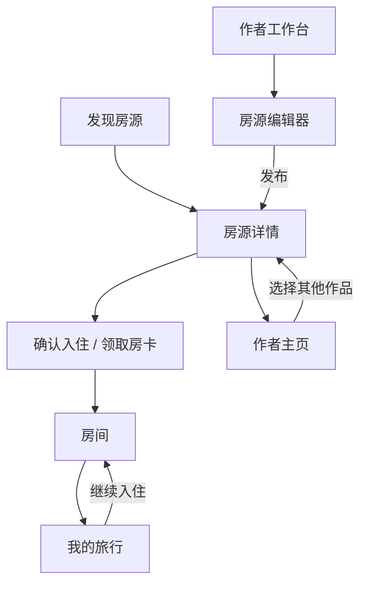

# Plotstay 项目讨论原文

来源：[产品构想评估](https://chatgpt.com/share/6ac4b779-86ac-83ec-b60c-faaac3f70716)。抓取时间：2026-10-06T09:00:16+00:00。

完整收录分享快照中的 10 条用户消息、10 条最终回答和 25 条过程说明，共 45 条可见文字消息，按对话顺序排列。页面内的 306 个节点已按父子链核对，当前分享分支没有遗漏节点。

阅读版只把网页引用标记还原为原始来源链接，并将消息内部标题下移一级；不删减或改写正文。原始文字、引用和附件元数据见同名 JSON，原始 HTML 压缩快照也已保留。旧方案与当前方案有差异，执行时以 [当前计划](../plan.md) 为准。

**附件缺口：**第 1 条消息有两张 PNG 截图。公开附件接口均返回 HTTP 401，图片文件未下载；文件名、尺寸、大小和原始引用已保留。文字归档完整，图片归档尚不完整。

## 讨论索引

| 主题 | 用户消息 | 最终回答 |
| --- | --- | --- |
| 虚拟酒店与豪华列车构想 | [01](#消息-01-用户) | [05](#消息-05-助手回答) |
| Remote Café 与付费动机调研 | [06](#消息-06-用户) | [10](#消息-10-助手回答) |
| 酒店原型范围与素材问题 | [11](#消息-11-用户) | [15](#消息-15-助手回答) |
| 订房网站参考与中英界面 | [16](#消息-16-用户) | [20](#消息-20-助手回答) |
| fandom 房间与用户创作 | [21](#消息-21-用户) | [25](#消息-25-助手回答) |
| 早期八页面方案 | [26](#消息-26-用户) | [30](#消息-30-助手回答) |
| Airbnb 式首页与当地活动 | [31](#消息-31-用户) | [34](#消息-34-助手回答) |
| 收缩为三个页面与共用预订组件 | [35](#消息-35-用户) | [36](#消息-36-助手回答) |
| 英文品牌命名 | [37](#消息-37-用户) | [41](#消息-41-助手回答) |
| 域名与备选名称 | [42](#消息-42-用户) | [45](#消息-45-助手回答) |

## 消息 01 用户

时间：2026-10-06T06:55:16.036000+00:00。

> 附件：`d3092e21dad40512864887ccb418d6a9_720.png`，944 × 2048，1,559,624 字节。下载返回 HTTP 401；原始附件引用见同名 JSON。

> 附件：`901b49f7c7f55c0bddb88f69e00cabd8_720.png`，944 × 2048，1,478,355 字节。下载返回 HTTP 401；原始附件引用见同名 JSON。

我看到product hunt和小红书上有人做了这样一个产品，这让我产生了一些灵感。我觉得可以试着考虑打造这样的产品：一个虚拟的高消费但是不需要付钱的页面，比如展现类似booking之类网站的页面，你可以假装自己是富豪随便付钱去一家看起来很高档的酒店入住，然后得到房间号码和信息，进入到一个虚拟的房间中（可以做一个类似酒店窗口和内景的视频页面，播放ASMR等等音乐，供玩家放置），还可以点外卖和大餐。有点类似这个产品的模式加上前段时间流行的韩式多巴胺下单游戏模式。你怎么看？我还想过可以做一个豪华列车，然后你可能邂逅到一些路人（可能是真人、AI或者写好的故事？）。

## 消息 02 助手过程说明

时间：2026-10-06T06:55:51.311546+00:00。

我会先看你附的产品截图，再查一下相关产品和“多巴胺下单”玩法，重点判断这套体验为什么会吸引人，以及酒店和豪华列车分别适合做成什么。

## 消息 03 助手过程说明

时间：2026-10-06T06:57:39.810150+00:00。

看完截图，我觉得你加上的“预订后真的能入住、点的东西会送进房间”很值得保留：它让挑选和下单有了持续可见的结果。

我也查到《Spirit City》已经做了列车窗景和专注功能。因此，你的列车方案更值得深入的是旅客身份、服务体验和旅途中遇见的人，这些能决定它自己的特色。

## 消息 04 助手过程说明

时间：2026-10-06T06:59:56.000761+00:00。

韩国的虚拟点单产品我也找到了：它已经有配送追踪和订单记录，另外还有模拟购买奢侈品的应用。你的想法可以再往前走一步，把购买结果变成能停留、能回访的空间。

我正在整理酒店与列车的取舍。其中一个关键问题是：挑选下单需要玩家主动操作，放置休息需要安静，故事又需要注意力；这三段体验怎样衔接，会比功能数量更重要。

## 消息 05 助手回答

时间：2026-10-06T07:00:40.803988+00:00。

**我觉得这个构想值得试。它最有价值的地方，是让“虚拟消费”产生一个可以继续享受的结果：我选了这间套房，完成预订，然后真的能住进去，在里面度过一段时间。**

这把几种体验接在了一起：挑选时的期待、下单时的满足、入住后的安定，以及旅途中可能发生的故事。它们各自提供了不同的使用理由。

我的初步判断是：**酒店适合先验证“预订—入住—享受服务”这条体验；豪华列车更适合发展成一个有作者气质、让人惦记的作品。**尤其考虑到你对叙事和人物的兴趣，我觉得列车很值得继续往下想。

### 一、这个想法最吸引我的，是“我今晚住在这里”

你截图里的 Remote Café，已经通过城市名称、窗景、声音和界面营造出一种“我在某个地方”的感觉。作者的官方说明也明确把它设计成“选一家咖啡馆，开始计时，然后工作”的仪式。([coding-collie.dev](https://www.coding-collie.dev/blog/remote-cafe-web-launch-en?utm_source=chatgpt.com))

你加上的酒店预订、房号、送餐，则能让这个地方进一步变成**“与我发生了关系的地方”**。

可以想象这样一段体验——以下都是设计示例：

你在一个虚构的旅行网站上，看到一间标价 ¥28,800 的雪山全景套房。选好房间，使用自己的虚拟黑卡结账。系统给出一张入住卡：**1703，房间已经准备好了。**

推门进去，窗外在下雪，房内亮着一盏暖灯。你点了一份晚餐，又选了一壶茶。过一会儿，桌上出现餐盘，茶壶冒着热气。你把音乐调低，打开壁炉声，开始做自己的事情。

二十分钟后，你看一眼屏幕，依然是这间房。第二天回来，它记得你昨天选的灯光和茶。

这里有几个设计作用：

| 设计细节 | 我认为它可能提供的感受 |
|---|---|
| 浏览房型、景色和服务 | 对即将发生的体验产生期待 |
| 价格与虚拟付款 | 暂时获得“我可以随意选择”的自由 |
| 房号、入住卡、欢迎信息 | 确认自己在这个地方的身份 |
| 打开房门、看见预订的景色 | 前面的选择得到了兑现 |
| 点餐后桌面发生变化 | 感觉这个空间会回应自己 |
| 再次回来时保留偏好 | 形成连续性和熟悉感 |

这些是需要验证的设计假设，但逻辑上是连贯的。

**酒店这个题材尤其适合表达“我已经被妥善安排好了，可以安心享受”。**豪华感可以来自昂贵的标价，也可以来自一些很小的服务细节：餐具已经摆好、浴袍已经放好、你喜欢的灯已经开了、没有人催你退房。

我会保留你说的“假装富豪”这个直接而有趣的入口，同时把后续体验做得更具体：**玩家实际获得的是一段被款待的生活。**

### 二、相邻产品已经存在，但你的组合仍然有值得验证的部分

我查到了几个很相关的现有产品。它们也提醒我们，不能简单把差异概括成“别人只能看，我能点东西”。

| 产品 | 已经做到的部分 | 对你的构想有什么启发 |
|---|---|---|
| **Remote Café** | 城市咖啡馆场景、环境声、音乐、番茄钟；部分场景免费，Pro 扩展地点和声音 | 一个有明确场所感的页面，可以承载日常使用 |
| **음식만안와요**，近似“只有食物不会来” | 虚拟选菜、规格调整、下单、配送追踪、订单记录和成就 | 下单的完整过程本身已经被做成产品 |
| **살래말래 / Faux Haul** | 虚构奢侈品购物、假结账、物流通知、购买物品的持有与交易 | “假装消费昂贵商品”也已有直接先例 |
| **Spirit City: All Aboard!** | 可自定义的列车车厢、移动窗景、调速，以及和专注时段结合的停站 | 列车加环境陪伴已经有比较完整的实现 |

以上功能分别来自作者说明和官方商店页面。([coding-collie.dev](https://www.coding-collie.dev/blog/remote-cafe-web-launch-en?utm_source=chatgpt.com), [apps.apple.com](https://apps.apple.com/kr/app/%EC%9D%8C%EC%8B%9D%EB%A7%8C%EC%95%88%EC%99%80%EC%9A%94/id6805903190?utm_source=chatgpt.com), [apps.apple.com](https://apps.apple.com/kr/app/%EC%82%B4%EB%9E%98%EB%A7%90%EB%9E%98-%ED%83%9D%EB%B0%B0%EC%95%88%EC%99%80%EC%9A%94-%EB%AA%85%ED%92%88-%EA%B0%80%EC%83%81%EC%87%BC%ED%95%91-%EB%8C%80%EB%A6%AC%EB%A7%8C%EC%A1%B1-%EA%B0%80%EC%83%81%EB%B0%B0%EB%8B%AC/id6804422728?utm_source=chatgpt.com), [store.steampowered.com](https://store.steampowered.com/app/3815280/Spirit_City_Lofi_Sessions__All_Aboard_DLC/?utm_source=chatgpt.com))

所以，我会把你的差异化押在一个更具体的地方：

**让预订、消费和服务，持续改变玩家正在居住的空间，并逐渐留下个人经历。**

例如：

- 预订“面海套房”，进入后就有对应的海景和声音。
- 选了晚餐，餐桌就成为房间的一部分。
- 要了一份报纸，里面可以出现当地消息和故事线索。
- 第二次入住，前台知道你来过。
- 旅行结束后，留下房卡、菜单、明信片或者旅程记录。

酒店和列车在这方面有一个适合屏幕媒介的特点：**你确实可以交付一段视听环境、一种空间氛围，以及与它相连的互动。**这让“消费之后的享受”有了实际内容。

不过，现有产品只能说明这些形态已经有人做。截图里的付费自述，以及商店里存在收费项目，都还不足以判断留存、利润，或者你的组合能有多大市场。这里最值得做的，是验证用户是否愿意反复回来。

### 三、免费高消费要持续有趣，选择就需要体现不同的生活方式

我认为这是整个设计里最需要提前想清楚的机制。

钱无限以后，“更贵”主要承担的是叙事作用：它告诉玩家，这是一种平时可能舍不得选择的待遇。可是当玩家已经连续买过几次最贵的东西，价格数字就很难继续支撑体验。

之后的选择，需要落在**“我今天想怎么过”**上。

例如三间同样豪华、但气质不同的房间：

- **城市高层套房**：雨夜、霓虹、远处交通声、深夜客房送餐。
- **雪山酒店**：壁炉、落雪、厚窗帘、热茶和安静的阅读角。
- **海边别墅**：晨光、海风、露台早餐、轻薄的白色窗纱。

这样，即使三间都住得起，玩家仍然有选择理由。今天想要都市感，明天想看雪，周末想去海边。

点餐也一样。食物可以承担几种不同作用：

| 服务 | 可以怎样体现在场景里 |
|---|---|
| 一壶热茶 | 茶壶、杯子、热气，以及轻微杯碟声 |
| 正式晚餐 | 桌布、餐盘、烛光，房间进入晚餐氛围 |
| 深夜外卖 | 包装袋、纸盒、电视背景音，更随意的生活感 |
| 早餐 | 窗帘打开，晨光进入，桌上出现咖啡和面包 |

**我会优先做少量能够明显改变体验的服务。**菜单可以慢慢扩充，但购买结果需要容易被感知。

这里还有一个很有意思的细节：一个人住在昂贵套房里，依然可以点普通炸鸡或者泡面。这种选择反而可能让空间更像“我的生活”。奢华提供自由，玩家自己的偏好决定如何使用它。

因此，我不建议通过攒币、每日任务来作为第一版的主要驱动力。你当前最有吸引力的承诺，就是可以轻松享受；回访的动力可以先来自不同的景色、服务、人物和心情。

### 四、酒店与豪华列车，会把产品带向两种不同的重心

我会这样比较：

| 维度 | 豪华酒店 | 豪华列车 |
|---|---|---|
| 主要感受 | 我在喜欢的地方安顿下来 | 我被舒适地带往另一个地方 |
| 预订的趣味 | 选酒店、房型、景观和服务 | 选线路、包厢、座位和餐饮 |
| 放置体验 | 稳定、私密，可以长时间保持同一氛围 | 窗外持续变化，自带旅程感 |
| 人物相遇 | 前台、餐厅、酒吧、公共区域 | 餐车、走廊、观景车、沿途车站 |
| 叙事结构 | 回访、熟客、某个地方的秘密 | 出发、途中、停靠、告别 |
| 内容制作压力 | 主要在房间和服务的质量 | 还需要沿途变化与旅程节奏 |
| 最容易失去的东西 | 入住之后缺少继续关注的理由 | 过多事件打扰原本舒适的旅程 |

#### 酒店更容易验证“住进去”是否成立

一家虚构精品酒店，三种房间，就能形成比较完整的体验。

玩家已经熟悉酒店预订的基本结构。你可以借用房型介绍、服务选项、价签、确认单这些信息形式。进入房间后，界面自然收起，只留下环境和少量服务入口。

这也能很清楚地测试：**预订仪式，究竟为同一个房间增加了多少价值？**

#### 豪华列车更适合发挥你的叙事能力

列车最吸引我的，是它自带一套很有用的叙事条件：

**有限的空间、共同经历的一段时间、各自不同的目的地。**

一个乘客可以在前三站与你同车，第四站就下车。你们可能只聊过一次，也可能一起吃过两顿饭。他有自己的行程，你只参与其中的一小部分。

这对人物设计很有帮助。每个角色都可以有：

- 为什么上车；
- 要去哪里；
- 愿意谈什么、暂时不愿意谈什么；
- 在哪一站离开；
- 与玩家的短暂相遇会留下什么。

例如，一位旅客一直带着一个很旧的蛋糕盒。第一次你们只聊了天气，第二次在餐车碰面，他才说自己在去参加一场迟了很多年的庆祝。下车时，他留下一张沿途小城的明信片。

这样一个人物，不需要很长的对话，也可以有余味。

**而且，列车允许故事拥有明确的结束。**旅客会下车，一段相遇会收束。对于 AI 参与的叙事，这种边界也很好用：角色知道自己为什么在这里，以及什么时候应该离开。

如果你发现自己最想做的是这些短暂相遇，那么完全可以直接从“一条线路、一间包厢、一节餐车”开始，让列车成为作品的核心。

### 五、真人、AI、写好的故事，我会先选择“有状态的预写人物”

这三种方案提供的价值不同。

| 方案 | 最值得利用的地方 | 需要承担的主要成本 |
|---|---|---|
| **预写人物与故事** | 语气、节奏、伏笔和结尾可以精细控制 | 持续创作与内容分支的成本 |
| **AI 人物** | 能回应玩家未被选项覆盖的话，表达更个性化 | 事实一致性、角色边界、对话质量与运行成本 |
| **真人旅客** | 确实有人与你共同经历了这段时间 | 在线匹配、互动质量，以及真实的社交负担 |

我的建议是，先做**“人物有自己的行程，故事根据状态发生”**。

比如，某个人今天是否在餐车，取决于当前旅程阶段；他会不会主动提起一件事，取决于上一次聊过什么；玩家做了一个选择，之后房间里会出现相应的信件。

这些已经足够让人物显得连续、有生活。

如果加入 AI，可以沿用你之前偏好的分工：**规则记录已经发生的事情，作者决定人物与故事的边界，AI 补充玩家主动发起的自由交流。**

例如，作者已经确定：

- 这位旅客明天在雪松站下车；
- 他正在准备一次重逢；
- 玩家是否帮他挑过礼物；
- 这次聊天有哪些信息可以透露。

AI 可以在这些事实内交流，而后续事件仍然有稳定依据。这样你能保留写作上的节奏，也有一定自由度。

相邻产品里，《Chill with You: Lo-Fi Story》已经把环境声、窗景、专注活动与逐渐展开的人物故事结合起来。它的官方介绍明确将“相处中逐渐熟悉，故事随之推进”作为体验的一部分。这说明环境陪伴与人物叙事可以共存，但具体如何安排注意力，仍需要你自己的设计。([nestopi.co.jp](https://www.nestopi.co.jp/chillwithyou/?utm_source=chatgpt.com))

至于真人，我觉得最适合先试的是**轻量、可选择的共同在场**：

- 看见这节车厢里还有几位旅客；
- 自愿去公共餐车坐一会儿；
- 给沿途车站留一张明信片；
- 读到其他人留下的旅途感想。

这些足以测试“真实的人”是否给体验增加价值。实时长聊会把产品带向更明确的社交方向，可以等这个需求出现后再判断。

### 六、最关键的设计难点，是让“下单、休息、故事”轮流占用注意力

这三件事对玩家的要求其实差异很大：

**下单需要选择，休息需要安静，故事需要理解和回应。**

我会把一次使用设计成几个自然衔接的阶段。

#### 入住前：允许玩家享受挑选

第一次可以认真看房型、选餐饮、拿房卡。购买动画、确认音、票券细节，都可以放在这里。

这里很适合保留你说的“多巴胺下单”感。购物车里出现东西、按下确认、订单完成，都是清楚的反馈。

#### 入住后：环境成为主体

进入房间以后，房型列表和菜单都收起来。声音可以分成几层，分别调整：

- 持续的环境声：雨、风、海浪、列车行进；
- 少量生活声：杯碟、门锁、翻书；
- 可选的音乐。

服务与环境最好存在联系。例如开窗后雨声更近，关窗后只留下隔着玻璃的闷响；点茶之后，桌边出现杯子。

这样，房间的反应就能支撑“我住在这里”的感觉。

#### 想参与时：主动走进一小段故事

玩家点击“去餐车坐一会儿”，才进入一段两三分钟的相遇。结束后可以自然回到包厢。

我会采用一条明确的规则：

**世界可以留下东西，玩家决定什么时候回应。**

有人送来的信可以放在桌上。餐车发生过的小事，可以通过一张便条让玩家之后知道。如果错过了一次见面，也可以用对方留下的明信片来收束，维持旅程的连续性。

另外，第二次打开产品时，应当可以直接回到房间。完整预订流程适合“我今晚想换个地方”的时候。这样，仪式会成为玩家主动选择的乐趣。

### 七、如果试做，我最想验证三个问题

第一版可以很小，但需要把一段体验交付完整。我会设想：

- 一家虚构酒店，三种氛围不同的房间；
- 一段简短的预订与入住过程；
- 每间房一个窗景和一组声音；
- 几种能改变桌面或房间氛围的服务；
- 一个人物、一段可选的小故事；
- 再次回来时，保留房间和偏好。

如果直接选择列车，则换成一条线路、少量旅程阶段、一间包厢和一节餐车。

然后观察三个问题。

**第一，哪一刻让玩家感觉自己“住进来了”？**

可能是房卡，可能是打开门，也可能是点的晚餐出现在桌上。找到这个瞬间，才能知道下一笔美术和交互投入应该放在哪里。

**第二，挑选和预订，是否增加了停留与回访的意愿？**

可以让一部分体验者直接进入房间，另一部分先预订。早期主要观察动机和障碍：他们是否觉得房间更属于自己，是否愿意下次再来，还是觉得预订过程有些繁琐。

这能回答一个非常核心的问题：你设想中的消费仪式，究竟给氛围体验增加了什么。

**第三，用户回来，是为了什么？**

不同答案会指向不同的发展方向：

| 回来的理由 | 值得优先投入的部分 |
|---|---|
| “这间房的声音很舒服，我想继续开着” | 场景、音频、长期使用体验 |
| “我想再挑一家，换个地方住” | 目的地、房型、服务和预订过程 |
| “我想知道那位乘客后来怎么样了” | 人物、故事和旅程连续性 |
| “我想再碰到上次一起坐车的人” | 共同在场与社交 |

对这种产品，后台开着本来就可能是正常用途。因此，播放时长有意义，但最好结合主动回访和用户反馈看。单纯的页面打开时长，很难告诉你酒店身份、下单过程或人物故事是否产生了额外价值。

商业化也可以沿着这些真实动机再决定。游戏内随意享受豪华服务，与以后为新目的地、精细制作的场景或人物章节收费，可以兼容。关键是让付费内容对应明确的新增体验。

---

**我个人最想看到的版本，是一列可以让人暂时放下日常事务的豪华夜行列车：有自己的包厢，想吃什么就点什么，窗外慢慢经过不同的地方，偶尔在餐车遇见一个有自己人生的旅客。**

你的写作能力，在“为什么想再见这个人”“为什么记得这一站”“为什么喜欢回到这间房”上，很可能比增加更多功能更有价值。

而这个构想最值得尽早做出来的瞬间，就是：**玩家完成预订，打开房门，看见自己刚刚选择的生活已经在里面等着。**

## 消息 06 用户

时间：2026-10-06T07:03:36.955000+00:00。

我觉得这里最重要的是搞清楚用户为什么付费。比如图上这个，你能调研出来对方的产品名字，以及宣传、用户反馈，还有付费情况吗？

## 消息 07 助手过程说明

时间：2026-10-06T07:03:57.095415+00:00。

我会围绕截图里的 Remote Café 查它的收费方案、作者的宣传重点、公开用户评价，以及能核实到的付费数据，重点看用户为什么愿意付钱。

## 消息 08 助手过程说明

时间：2026-10-06T07:06:12.056340+00:00。

发现一个会影响结论的细节：截图对应的是它的在线像素咖啡馆页面，而作者的 Pro 宣传还包括另一组场景和声音。我正在核对具体的收费边界，避免把“用户喜欢截图里的画面”和“用户为这部分付费”混为一谈。

## 消息 09 助手过程说明

时间：2026-10-06T07:09:26.539954+00:00。

收费入口已经查到更具体的结构：单人模式的公开目录有 24 个场景，其中 2 个标为免费，其余由 Pro 解锁；截图里的在线像素馆使用的是另一个入口。

用户反馈这边还没有找到能确认付费身份、并说明购买理由的评价。我会据此区分“作者提供了什么付费权益”和“买家实际为什么买”，也继续核实结账价格。

## 消息 10 助手回答

时间：2026-10-06T07:10:36.229827+00:00。

**产品已经确认，叫 Remote Café，开发者是 Kai Kang，个人博客品牌是 Coding Collie。进一步查下来，可以确认它的宣传定位、部分收费规则，以及作者“已经有人付款”的自述；但目前公开证据还不足以确定真实买家的购买动机、收入规模和续费情况。**

另外，我查到一个会影响判断的细节：**截图里的在线像素咖啡馆，与它用 Pro 收费的单人场景库，是两个不同的使用入口。**因此，不能直接从这张截图推断“用户就是为像素咖啡馆里的某项功能付费”。

上一条我对酒店、列车的分析主要是设计推演。你现在问的商业问题，需要用下面这些更具体的证据来判断。

*以下是截至 2026 年 10 月 6 日的核验结果。*

### 1. 产品身份和入口已经确认

| 项目 | 核验结果 |
|---|---|
| 产品名 | **Remote Café**；部分 App Store 描述仍使用 **RemoteCoffee** 这个名称 |
| 开发者 | **Kai Kang** |
| 作者品牌 | **Coding Collie**，作者解释 Collie 指自己的狗 Archie |
| 官网 | [remotecafe.app](https://www.remotecafe.app/) |
| 截图对应的在线咖啡馆 | [remotecafe.app/online](https://www.remotecafe.app/online) |
| iOS 应用 | [Remote Café — App Store](https://apps.apple.com/gb/app/remote-caf%C3%A9/id6762588506) |
| 作者博客 | [Coding Collie](https://www.coding-collie.dev/) |

作者的项目页同时链接官网和对应的 App Store 应用，可以交叉确认它们属于同一个产品。作者首页对 Archie 的说明，也与截图里的“边牧 archie”线索相符。([coding-collie.dev](https://www.coding-collie.dev/projects?utm_source=chatgpt.com), [coding-collie.dev](https://www.coding-collie.dev/?utm_source=chatgpt.com), [apps.apple.com](https://apps.apple.com/gb/app/remote-caf%C3%A9/id6762588506?utm_source=chatgpt.com))

官网还直接链接到[作者的小红书主页](https://www.xiaohongshu.com/user/profile/5afb8ec111be101c650270d2)。不过，本次公开访问会跳到登录页面，没能读取他的完整笔记列表和评论。([xiaohongshu.com](https://www.xiaohongshu.com/user/profile/5afb8ec111be101c650270d2?utm_source=chatgpt.com))

**Product Hunt 这一部分尚未确认。**我按产品名、旧名称、域名和作者名交叉检索，没有找到能明确对应这个开发者和域名的正式发布页。因此，我目前不能提供它的 PH 票数、排名或评论，也不能据此断言它没有发布过。

### 2. 它怎样宣传：核心是“让工作更容易开始，也更舒服”

从官方文案来看，它的定位相当明确：**有咖啡馆氛围的专注工具**。

#### 面向谁、在什么情况下使用

App Store 直接列出的目标人群是远程工作者、学生和创作者。它将一次专注时段包装成到某座城市的咖啡馆坐一会儿，同时提供计时、环境音，以及完成专注后获得饮料、点心收藏的反馈。([apps.apple.com](https://apps.apple.com/gb/app/remote-caf%C3%A9/id6762588506?utm_source=chatgpt.com))

作者自己的使用场景则更具体：他在开放办公空间工作时使用它，用计时器划出一段专注时间，用环境音减弱周围的干扰。**这是作者自用的陈述，能够解释设计出发点，但不能当成独立客户评价。**([coding-collie.dev](https://www.coding-collie.dev/blog/remote-cafe-launch-post-en?utm_source=chatgpt.com))

网页版的宣传强调三件事：

- 可以根据心情选择不同城市的咖啡馆。
- 在实际工作的电脑上，打开网页就能开始。
- 适合学习、居家办公，或者在繁忙办公室里获得一点安静。

作者把操作过程概括为选择咖啡馆、启动计时器、开始工作；网页版于 **2026 年 8 月 8 日**推出。([coding-collie.dev](https://www.coding-collie.dev/blog/remote-cafe-web-launch?utm_source=chatgpt.com), [coding-collie.dev](https://www.coding-collie.dev/blog/remote-cafe-launch-post-en?utm_source=chatgpt.com))

#### 截图中的在线版本，又增加了一种卖点

[在线咖啡馆页面](https://www.remotecafe.app/online)的标题强调“一起专注”。公开页面包含实时生成的 Lofi，以及雨声、黑胶、鼓、旋律、室内底噪的分层控制，还有和弦编辑和聊天入口。([remotecafe.app](https://www.remotecafe.app/online?utm_source=chatgpt.com))

所以，从宣传中能归纳出三种价值主张：

| 价值主张 | 对应的产品内容 |
|---|---|
| 帮助开始并维持一段工作 | 番茄钟、环境音、完成后的收藏 |
| 让工作环境符合自己的心情 | 城市、窗景、天气、视觉氛围 |
| 增加共同在场的感觉 | 在线人数、城市咖啡馆、聊天入口 |

**这能说明作者希望用户因为什么而来，尚不能说明实际付款者被哪一项说服。**

### 3. 收费情况：已经查到具体的内容限制，价格仍未核实

这部分我进一步检查了官网当前公开的页面资源，因为搜索引擎没有完整呈现动态收费界面。

#### 能确认的收费结构

官网单人模式的当前公开目录包含：

- **10 个城市，24 个场景。**
- 明确标记为免费的两个场景：北京的 **BJ Morning**，以及 **Tokyo Street**。
- 其余场景默认归入 **Pro**。
- 点击尚未解锁的场景，会进入注册／登录及升级流程；已有登录状态的用户会进入结账入口。

这是根据官网当前公开的场景目录和权限配置核对的结果；可以在[官网](https://www.remotecafe.app/)及其[公开前端资源](https://www.remotecafe.app/_next/static/chunks/733-9fb4a2bd4e2d59d5.js)中追溯。它与作者公告中“部分场景免费，Pro 解锁更多地点、声音和沉浸式多层场景”的说明一致。([coding-collie.dev](https://www.coding-collie.dev/blog/remote-cafe-web-launch?utm_source=chatgpt.com))

**也就是说，它有一个相当具体的付费触发点：用户看中某个免费范围以外的场景，想进入它，于是遇到升级入口。**

这比笼统的“付钱支持一个好看的页面”更接近实际产品机制。

#### 截图里的在线像素馆，与这个收费目录需要分别看

主站将在线模式嵌入 `/online` 页面；我检查到的在线入口没有使用上述单人场景的 Pro 限制。它的公开页面也能匿名读取到播放、声音分层、计时和聊天界面。([remotecafe.app](https://www.remotecafe.app/online?utm_source=chatgpt.com))

因此，目前较准确的说法是：

> **截图展示了它吸引用户的一部分体验；已确认的 Pro 收费点，主要落在另一套场景选择与解锁上。**

截图中的付款者究竟买了哪部分权益，公开资料还没有把两者对应起来。

#### 价格、计费周期，核验到了哪一步

| 项目 | 本次结果 |
|---|---|
| 是否有付费产品 | **有，Remote Café Pro** |
| 是否使用 Stripe | 官网结账流程明确接入 Stripe；与你截图中的作者自述吻合 |
| 是否存在月订阅设计 | 前端商品标识为 `pro_monthly`，提供了月订阅的线索 |
| 当前具体金额 | **未核实** |
| 实际结账周期与条款 | **未取得最终报价，不能只凭商品标识下结论** |
| iOS 下载价格 | 本次读取的 App Store 页面显示免费；不能由此推断 Web Pro 也免费 |

我访问了[结账入口](https://www.remotecafe.app/checkout)，但实际取得 Stripe 报价需要登录；匿名请求返回“Authentication required”。所以，我没有把一个猜测的美元价格填进报告。App Store 的免费状态则可以直接核实。([apps.apple.com](https://apps.apple.com/gb/app/remote-caf%C3%A9/id6762588506?utm_source=chatgpt.com))

### 4. 用户反馈：目前没有找到能解释购买动机的买家自述

这是本次调研最明显的证据缺口。

我检索了产品名、域名、作者名，以及 `review`、`paid`、`Pro` 等组合，也查了 App Store、Product Hunt、Reddit 和公开社交索引。**目前没有取得可确认属于这个产品的“我购买了 Pro，因为……”一类发言。**

#### App Store 的情况

我亲自读取的英国、日本、台湾页面，都显示评分或评论不足以展示概览，没有获得具体的用户评论正文。([apps.apple.com](https://apps.apple.com/gb/app/remote-caf%C3%A9/id6762588506?utm_source=chatgpt.com), [apps.apple.com](https://apps.apple.com/jp/app/remote-caf%C3%A9/id6762588506?utm_source=chatgpt.com), [apps.apple.com](https://apps.apple.com/tw/app/remote-caf%C3%A9/id6762588506?utm_source=chatgpt.com))

这只能说明：**这些地区的公开商店页面没有给我们足够的反馈样本。**

它不能用于估算下载量，也不能推断 Web 版有没有付费用户。尤其是截图发生在网页产品上，iOS 评论只是旁证。

#### 小红书截图能提供什么

你提供的第一张截图中，可以直接看到：

- 作者说有人访问他做的像素咖啡馆，并在 Stripe 上付款。
- 笔记有 **22 个赞、6 个收藏、1 条评论**。
- 截图没有展示评论正文，也没有展示支付后台。

这里面的互动数是**宣传笔记的互动量**。我们不知道点赞者是否使用过产品，也不知道那条评论是否来自付款者。

因此，本次公开资料没有回答以下问题：

- 用户最喜欢、最常用的是哪个场景？
- 用户用了多久才决定付费？
- 用户是否觉得免费范围太少？
- 用户升级后是否持续使用？
- 用户为什么取消订阅或不愿意付费？

**我不会把“看起来很舒服”“应该有人愿意买”这类推测，写成它的用户反馈。**

### 5. 它到底赚到钱了吗？目前只有作者的定性自述

你的截图中，最关键的一句是：

> “还在 stripe 上付费了。”

这是有价值的早期信号。它意味着**作者声称已经观察到付款行为**。但截图没有提供足够信息继续向下推算。

| 商业问题 | 当前证据 |
|---|---|
| 作者是否说有人付款 | **是，截图可见** |
| 是否公开了付款金额 | 本次未找到 |
| 是否公开了付费人数、订单数 | 本次未找到 |
| 是否知道付款购买了哪项权益 | 不知道 |
| 是否有月收入、MRR 数据 | 本次未找到 |
| 是否有续费、留存、退款数据 | 本次未找到 |
| 是否已经盈利 | 无法判断 |

我也检索了作者官网、相关中英文发布文章，以及截图标题“把东西发布出去然后就等人来”和正文中的 Supabase／Stripe 片段，没有找到可公开读取的完整原帖或后续收入披露。

**因此，我会把它记录为“有收费机制，且作者自报已经出现付款的早期产品”。它距离一个可用于推断稳定需求和收入的商业案例，还缺少数据。**

### 6. 关于“用户为什么付费”，现在最有依据的假设是什么？

根据实际收费结构，**最有依据的假设是：部分用户愿意为自己更喜欢、或者想反复使用的工作氛围付费。**

这个假设的依据很具体：作者将更多地点和场景放在 Pro 内，升级流程也直接由选择锁定场景触发。它卖出的增量，与审美偏好、环境选择有关。

但还存在几种无法排除的购买动机：

| 可能的动机 | 目前的依据 | 还缺什么 |
|---|---|---|
| 特别喜欢某个付费场景 | 场景解锁是明确的付费触发点 | 购买前点击记录，或买家自述 |
| 已经形成使用习惯，希望增加选择 | 产品围绕重复的专注时段设计 | 付费前使用频次、付费后回访 |
| 觉得整套体验省心，愿意长期使用 | 计时、声音、场景被放在一起 | 与替代方案比较后的购买理由 |
| 支持作者、支持独立开发 | 截图本身是独立开发分享 | 付款者与作者的关系、付款留言 |

前三项是基于产品结构提出的假设，第四项也不能凭空排除。**目前没有证据支持给它们排序成“实际用户付费原因排行榜”。**

这也会影响我们怎样使用这个案例来判断你的构想：Remote Café 当前最清楚的商业假设，围绕的是**反复使用的工作氛围与场景选择**。你的酒店和列车构想还加入了预订仪式、消费幻想、服务和人物相遇；这些新增部分能不能提高付费意愿，需要另外验证。

如果继续追这个案例，最有价值的补充会是三个具体答案：

1. **那些付款者买的是什么套餐、多少钱，是否续费？**
2. **他们付费前实际用了什么，在哪个入口决定升级？**
3. **有没有付款者亲自说过，免费体验中的哪一点让他愿意掏钱？**

你手头的 Product Hunt 发布链接或小红书原帖链接，会是最有用的下一条线索，尤其是评论区。**现阶段能查明的是作者把什么设为收费权益；真实买家为什么购买，公开材料还没有给出答案。**

## 消息 11 用户

时间：2026-10-06T07:15:25.447000+00:00。

明白，我也感觉数据不足，很难判断用户真实付费需求是怎样的。如果是番茄钟放置ASMR，我觉得去油管搜索一个视频，可能能更低成本满足此类诉求。我初步判断下来，我自己这个产品，如果想要短时间内低成本迅速出效果放量探查市场，可能做豪华奢侈酒店买单+房间放置更加合适，先避免掉一些叙事开发的成本（虽然火车上邂逅不同的人和故事在我看来更加有趣）。我也在思考用户的心理，怎样的人会玩，我自己是个低欲望消费，但是我会好奇那些每天晚上几千美元的房间是怎样的，估计也有不少公开素材，可以让AI制作类似的体验视频，这里的另一个可能的问题是，我如果想要逼真体验，可能需要参考booking之类网站的页面，或者是某个著名酒店的体验视频，这里可能还有版权问题。你会如何建议？

## 消息 12 助手过程说明

时间：2026-10-06T07:15:37.108787+00:00。

我会重点查两件事：酒店原型怎样用较小成本测到需求，以及参考预订网站、酒店照片和体验视频时，哪些素材使用方式比较稳妥。也会结合你说的“对昂贵房间的好奇”，重新判断第一版该把体验做在哪里。

## 消息 13 助手过程说明

时间：2026-10-06T07:18:19.578306+00:00。

这里有个关键区别：你对“真实昂贵套房到底怎样”的好奇，和“在虚构酒店里享受一次奢华入住”，是两种需求。采用 AI 原创房间有助于控制素材成本，但测到的主要会是后者。

素材许可也确实需要细看。例如，有些免费素材允许用于一般商业作品，却限制把素材本身做成壁纸或环境内容产品；加上播放器和菜单，未必就自动符合授权。

## 消息 14 助手过程说明

时间：2026-10-06T07:21:02.159638+00:00。

我更倾向于把第一版的“逼真”放在服务细节和前后连贯上：选的房型就是进入的房间，点的餐会出现在桌上，回来仍保留上次的状态。这样可以用少量原创画面，检验“入住”过程是否比直接播放视频多一层价值。版权方面，也找到了可执行的边界：通用订房流程可以借鉴，具体页面、照片、视频和音轨则要分别核对。

## 消息 15 助手回答

时间：2026-10-06T07:22:51.590436+00:00。

**我赞成先做“豪华酒店选房、模拟买单、进入房间”的小产品。** 对你现在“低成本做出效果、尽快接触市场”的目标，它的范围更容易控制，也能直接检验你感兴趣的消费仪式。

我会把第一版定为：**一个虚构但可信的豪华酒店体验，用原创场景和连贯的服务细节，让人完成一次入住。** 不过，你提到的“想看看现实中每晚几千美元的房间”，需要单独验证。它和“在虚构酒店里体验奢华生活”可以重叠，但不能相互证明。

版权方面，我查了中国的相关法律、Booking 的条款，以及几个素材平台的官方许可。可以找到相对清晰的制作路径，不必因为担心版权就放弃这个题材。

### 一、你自己的好奇心很有价值，但它指向了两种不同的需求

你消费欲望低，却对昂贵酒店好奇，这完全不矛盾。**想了解一种生活，与想花钱购买这种生活，是两回事。**

关键在于，你好奇的是哪部分：

- **事实上的好奇：**“这家真实酒店的套房到底长什么样？为什么值这么多钱？有哪些服务？”
- **体验上的好奇：**“让我坐在这样的窗边、点一顿晚餐、享受一会儿，会是什么感觉？”

第一种需要可信的真实资料。第二种有机会被虚构空间满足。

因此，AI 原创房间既是素材方案，也会改变产品正在验证的问题。如果宣传承诺的是“带你看看真实的顶级套房”，结果交付的是想象出来的空间，就没有回答用户最初的问题；如果一开始就说清楚“这是一家可以随意入住的虚构豪华酒店”，实验会干净得多。

我会按已有行为来找第一批体验者，而不是先猜他们的年龄、性别或消费能力。下面这些都是**待验证的需求假设**：

| 可能来玩的人 | 他们想得到什么 | 产品需要提供什么，才可能值得付费 |
|---|---|---|
| 经常看豪宅、酒店探房的人 | 了解平时接触不到的生活和空间 | 可信的独家细节、空间感或探索方式；纯虚构画面未必满足 |
| 喜欢模拟下单、装饰、生活类游戏的人 | 做选择、下订单、看到结果 | 点的东西真的出现，选择真的改变体验 |
| 想短暂休息、喜欢酒店服务感的人 | 有人替自己安排好一切，暂时不用操心 | 顺畅的入住、细致的回应、属于自己的房间 |
| 经常播放环境视频的人 | 找一个舒服、稳定、容易进入的背景环境 | 足够喜欢的场景、方便的控制、状态保存和返回体验 |

这里面，我最想先验证的是中间两类。因为它们更接近你的创意，也更能解释“为什么用户要打开你的页面”。

但不要提前把“获得款待”“掌控感”“自我犒赏”当成已经确认的心理机制。它们目前只是帮助设计实验的解释。体验者也可能告诉你：“我就是觉得刷那一下很有意思，玩一次就够了。”这同样是有效答案。

### 二、第一版的真实感，我会优先做在“我的选择被兑现”上

我建议把真实感分成三个层次：

1. **画面可信：**空间、材质、灯光、声音让人觉得舒服。
2. **过程可信：**选房、确认、得到房号、进房、送餐，前后能对上。
3. **事实准确：**它确实对应某家真实酒店的某个房型。

第一版可以集中做前两层。第三层会增加素材核验和授权成本，也容易把产品带向真实酒店导览。

例如，一段很小的体验就可以是：

用户选中“雨夜城市顶层套房”，浏览房间照片和菜单，用虚拟账户完成一笔很夸张的消费，得到一张带有昵称与房号的入住卡。进入房间后，看到的就是刚才选中的那扇窗和那张桌子。点一份夜宵，门铃响一下，餐盘出现在桌上。调暗灯光，拉开窗帘，开始播放雨声。第二天回来，房间还保留着上次的设置。

**这段体验最值得检验的部分，是“从我挑选的一间房，变成我正在住的房间”。**

如果用户只是点了十次菜单，每次都弹出一个“下单成功”，最后进入的仍然是同一条视频，那么下单和房间实际上没有建立关系。你会很难知道他们喜欢的是模拟消费，还是那张好看的图。

#### 我会把首版限制到这个规模

| 部分 | 首版范围 | 值得做好的地方 |
|---|---|---|
| 房间 | 两间差异明显、能够完整进入的房间 | 例如雨夜城市和清晨海景，能让选择体现偏好 |
| 预订 | 房型信息、简短确认、入住卡 | 首次有仪式，之后可以直接回房 |
| 房内操作 | 灯光、窗帘、两三种餐饮 | 每个操作都有可见或可听的结果 |
| 放置 | 少量环境声音、稳定的画面 | 音量舒服，循环自然，操作容易 |
| 返回 | 保存房间和偏好 | 用户回来时能认出“这是我上次住的地方” |

房型多、菜单多、按钮多，都可以以后增加。**首版每增加一个选项，我会先问：用户选它以后，体验有没有变化？**

还有一个产品上的矛盾需要提前处理：你想让人体验“不必考虑钱”，真实收费如果频繁出现在模拟消费过程中，会打断这个承诺。因此，我更倾向于：

- 在虚拟酒店内，点餐、升级、使用服务都可以尽情操作。
- 真正收费的是新的目的地、房间或完整主题体验。
- 真实购买数字内容的入口，与虚拟酒店账单清楚区分。

这样比较容易保留“进来以后随便享受”的感觉。

### 三、低成本制作：先做一个稳定的房间，再让它轻微动起来

我不会一开始就做完整的 AI 酒店漫游视频。对于你要验证的内容，**一张完成度高的房间主图，加几处恰当的局部变化，就已经可以承载很多体验。**

我会按这个顺序制作：

**先确定房间的主视角。**  
比如坐在沙发上，可以同时看到窗景、茶几、床的一部分。这个构图要预留餐盘和饮品的位置，也要让灯光、窗帘的变化有意义。

**再从同一个空间生成所有展示素材。**  
房型卡片、预订页大图、进入后的房间，尽量来自同一张主图或同一套受控素材。不要分别生成三张“豪华套房”，导致窗户、家具、布局全变了。

**最后只让少数元素运动。**  
窗外雨滴、远处灯光、轻微窗帘、杯中蒸汽，任选适合场景的几项。声音也从雨声、空调声、海浪、门铃、杯碟声这样的少量组成部分开始。

这是一个制作取舍：先保证空间一致、选择有回应，再决定完整视频是否值得投入。

“豪华感”本身也可以作为美术假设来测试。你可以比较两种表达：一种强调夸张的大额账单和昂贵陈设，另一种强调安静、私密、视野和被细心照顾。你自己对后者是否更有感觉，也可以帮助提出问题，但最终仍然要看体验者如何选择。

从成本上，我会记录的是**做出一间达到发布质量的房间，实际花了多少时间和钱**。一次生成调用便宜，并不代表可用成品便宜；选片、修图、保持一致性，都应计入这一轮的制作成本。

### 四、参考 Booking 可以，但要区分流程、页面表达和素材

下面按面向公众、可能收费的网页产品来讨论；法律部分以中国规则为例，具体使用仍要结合发布地区和素材许可。

#### 1. 通用订房流程，可以作为交互参考

“筛选—查看房型—选择套餐—确认—收到房号”这类操作逻辑，可以作为你自行设计和实现的基础。中国《计算机软件保护条例》第六条明确，软件著作权保护不延及思想、处理过程、操作方法等。与此同时，最高人民法院发布的案例也说明，网页的素材选择、表现形式和内容编排达到独创性要求时，整体可能受到保护。**所以，通用流程与某个网站具体页面的整套表达，需要分开判断。**([ipc.court.gov.cn](https://ipc.court.gov.cn/zh-cn/news/view-407.html?utm_source=chatgpt.com), [court.gov.cn](https://www.court.gov.cn/zixun/xiangqing/112611.html?utm_source=chatgpt.com))

实践上，我会这样做：

- 自己起平台和酒店名字，写房型、菜单、入住消息。
- 自己设计页面的配色、排版、卡片、图标和视觉组合。
- 保留用户熟悉的房型参数、入住时间、偏好选择、订单确认。
- 用自己制作或有许可的图片和声音。

你不必为了原创，故意把订房流程做得陌生。可以通过“房间面积、楼层、景观、晚餐、开夜床服务、房号”等细节建立熟悉感。

Booking 当前条款还明确涉及平台内容、商标、页面观感等权利，并限制未经许可的自动访问、复制和抓取。因此，我不会把 Booking 当成可直接抓取照片、文案和价格数据的素材库；这与借鉴一般订房逻辑是两个问题。([booking.com](https://www.booking.com/content/terms.html?utm_source=chatgpt.com))

#### 2. 真实酒店名字，不是只要出现就一定侵权

客观介绍某家酒店，与把它的名字、标志用于你自己的虚拟酒店服务，或让人以为存在官方合作，性质不同。中国现行《反不正当竞争法》第七条涉及有一定影响的名称、网页、应用名称或图标等造成来源或关联混淆的情形。([samr.gov.cn](https://www.samr.gov.cn/zw/zfxxgk/fdzdgknr/fgs/art/2023/art_3737890d856a4e44a8ea07c50c90c116.html?utm_source=chatgpt.com))

对你的首版，我建议用虚构品牌，表达“海岛水上套房”“雪山温泉旅馆”“城市顶层公寓”这样的体验类型。这样可以减少品牌关系的核验工作，也让你有自由改造空间。

页面明确说明“虚构酒店、模拟入住”，有助于表达清楚；它不能代替图片、视频或音乐的使用许可。

### 五、公开视频可以拿来研究，拿来做产品素材则要另看许可

**“网上能看到”并不等于“可以放进自己的产品”。** 照片、视频、音乐涉及不同的权利；中国著作权法中的个人学习、研究、欣赏等例外也有适用条件。一个公开网页即使暂时免费，也不能仅凭“免费测试”就自动获得使用他人作品的权利。([ncac.gov.cn](https://www.ncac.gov.cn/xxfb/flfg/flfg_532/202103/t20210309_50530.html?utm_source=chatgpt.com))

对于你说的“让 AI 制作类似体验视频”，我会区分两种做法：

**比较适合首版的做法：**看一些酒店介绍，研究空间尺度、灯光、视野和服务细节，再用自己的文字描述和构图，创作一个独立的虚构空间。

**需要单独核查的做法：**下载某位博主的视频，截取他的画面，上传给 AI 做图生视频、换风格、延长镜头，最后把它作为你的房间背景。

后者是否可以使用，要看原素材许可、输入用途和输出保留了哪些具体表达。**AI 处理不会自动赋予你对原作品的使用权。** 中国著作权法第十三条也明确，改编产生的新作品在行使权利时，仍不得侵犯原作品的著作权。([ncac.gov.cn](https://www.ncac.gov.cn/xxfb/flfg/flfg_532/202103/t20210309_50530.html?utm_source=chatgpt.com))

同样，模型服务允许你商业使用生成结果，也不能替原摄影师、视频作者或音乐权利人作出授权。

#### “免费商用素材”也要看是否覆盖你的产品形态

这次查许可，有几条特别适合你提前知道：

| 来源或方式 | 官方许可中的关键边界 | 对这个产品的影响 |
|---|---|---|
| **Pexels 图片、视频** | 禁止以基本保持原样的独立素材形式销售或分发；仅裁剪、缩放、加滤镜不够。官方明确提到此类壁纸应用不被允许。 | 不能仅凭加了房号、播放器和菜单，就认定把素材做成付费房间一定符合许可。([help.pexels.com](https://help.pexels.com/hc/en-us/articles/900005880463-What-are-the-Terms-and-Conditions?utm_source=chatgpt.com)) |
| **Mixkit 音乐、音效** | 免费音乐许可明确不允许用于电子游戏；音效许可允许用于游戏等成品，但需要成为更大、不同性质作品的一部分，不能独立再分发。 | 同一个网站的音乐与音效，也不能按一套“免费商用”规则处理。([mixkit.co](https://mixkit.co/license/modal/musicFree/?utm_source=chatgpt.com), [mixkit.co](https://mixkit.co/license/modal/sfxFree/?utm_source=chatgpt.com)) |
| **YouTube 官方嵌入** | 可以通过官方播放器展示视频，但这不授予脱离平台独立使用的权利；API 政策也禁止向用户收费观看内嵌视频。 | 可用于合规的参考展示；不适合直接把某条第三方视频变成你出售的客房核心内容。([youtube.com](https://www.youtube.com/static?template=terms&utm_source=chatgpt.com), [developers.google.com](https://developers.google.com/youtube/terms/developer-policies?utm_source=chatgpt.com)) |

这不意味着图库素材都不能做背景。需要判断的是：**素材被融入了什么成品，以及许可是否覆盖这种展示、交互和收费方式。** 如果产品的主要价值就是近乎原样地播放某条视频或音轨，就尤其应该确认。

我会给首版采用这样一条素材路径：

**原创或自行生成的虚构房间 → 用自己有权使用的主图做动画 → 自录或明确许可的少量声音 → 保存来源和许可记录。**

如果后来确实需要某家真实酒店或某位博主的画面，再针对具体素材询问授权：能否用于付费网页体验、循环播放、裁剪和修改、是否允许上传 AI 工具处理、能否用于宣传，以及授权是否包含声音和音乐。不要只问一句“能商用吗”，因为对方可能理解的是文章配图或一次视频引用。

### 六、这一轮怎么测，才能回答“为什么不直接看 YouTube”

我会分三步，每一步只解决一个主要问题。

#### 第一步：确认用户是否在乎“房间真的存在”

给第一批体验者看原创房间时，明确说明它是虚构的，然后问：

> 如果这间房在现实中不存在，你还想进去待一会儿吗？你最想做什么？

对于特别喜欢真实探房的人，可以再给他们几个真实酒店的官方导览链接，问看完以后还缺少什么。

这一步主要是访谈和观察，不必包装成严格的对照实验。它能帮助你避免一个误判：用户拒绝的是虚构内容，却被解释成整个酒店体验需求不存在。

#### 第二步：用相同房间，检验入住过程的增益

用**同样的画面、声音和房内操作**，提供两种进入方式：

- 一种直接进入房间。
- 一种先经历简短的选房、确认和收到房号。

观察额外的预订过程有没有增加期待、满足感和记忆，还是只是多了一段流程。小样本先看具体行为和解释，不急着下统计结论。

同时允许回来的人直接回房。首次觉得有趣的仪式，未必适合每次强制重做。

对宣传素材也一样：我建议展示一次完整的“选房—模拟付款—进房—餐点出现”。如果宣传里只有漂亮的窗景，你得到的反馈主要是在评价画面，很难检验酒店交互的吸引力。

#### 第三步：用一个能立刻交付的小商品，测真实付款

我会优先试一次性购买：

- 免费提供一间完整房间，让用户理解体验。
- 付费解锁一间已经制作完成、可以充分预览的额外房间或主题。
- 看清价格和权益后，购买即可进入并再次使用。

这时要分清几种信号：

| 信号 | 它主要说明什么 |
|---|---|
| 点进来、刷了一笔巨额虚拟账单 | 有好奇心，或觉得操作有趣 |
| 完成入住、使用房内互动 | 愿意参与这段体验 |
| 主动再次回来 | 出现了某种重复使用价值 |
| 看清权益后真实付款 | 对这个具体商品存在付费意愿 |
| 买完继续用、愿意购买下一间 | 有进一步的持续价值信号 |

**虚拟消费金额再大，也不能当作真实付费意愿的代理指标。** 同样，用户说“这个值得付费”，也还需要实际交易来验证。

购买后值得问的是：“刚才是什么让你决定买？如果只能保留一部分，你最在意什么？”结合他实际使用了哪些功能，才逐渐接近你最初的问题。

也不要让“长期留存”成为唯一成功标准。如果用户愿意为一次有趣、完整的入住买单，这可以是一种小型娱乐作品。它与每月订阅的环境工具，需要不同的制作节奏和收入判断。前者重点看一次购买能否覆盖内容制作与获客成本；后者才需要更强的持续使用和续费理由。

---

如果由我来决定这一轮范围，我会做：**两间原创虚构套房、一段简短但完整的入住、少量真正改变房间的服务，以及一次明确的数字内容购买测试。**

要回答的问题可以写得很具体：

**在知道房间是虚构的、也有免费环境视频可看的情况下，有没有人仍然愿意为“自己挑选、入住、获得服务，并能再次回来”的酒店体验付一次钱？**

豪华列车与邂逅故事可以继续保留。酒店这一轮能帮你了解空间、消费仪式和服务互动的价值，但它测不到故事本身的吸引力；酒店原型的表现，也不应该替你提前判定列车创意的成败。

## 消息 16 用户

时间：2026-10-06T07:27:29.978000+00:00。

嗯，你觉得我的酒店下单应该参考怎样app/web风格的页面？我印象中美国市场应该用bookings？中国市场用美团？还是有一些具体的调查？

## 消息 17 助手过程说明

时间：2026-10-06T07:27:46.928056+00:00。

我会查一下美国和中国用户常用哪些酒店预订平台，再区分“大家熟悉的订房界面”和“适合你这个豪华入住游戏的界面”。这两者可能会指向不同的参考对象。

## 消息 18 助手过程说明

时间：2026-10-06T07:30:10.660239+00:00。

美国的 YouGov 数据显示，Expedia 的知名度高于 Booking.com；不过它测的是“听说过”，并不等于订房使用率。我正在补实际预订行为的数据。中国部分也需要避开一个常见误区：美团整个 App 的用户量，不能直接当作使用美团订酒店的人数。([YouGov Ratings](https://yougov.com/en-us/ratings/travel-apps-websites?sortBy=fame&utm_source=chatgpt.com))

## 消息 19 助手过程说明

时间：2026-10-06T07:32:41.793416+00:00。

界面参考里，HotelTonight 很值得加入：它强调精选酒店、照片展示和简短的预订流程。你的首版只有少量精心制作的房间，这种选择方式很贴合范围。豪华感则可以从 Aman 的套房详情页学习——它用空间、景观和包含的服务，让人想象住进去的体验。([App Store](https://apps.apple.com/us/app/hoteltonight-hotel-booking/id407690035?utm_source=chatgpt.com), [www.aman.com](https://www.aman.com/hotels/aman-tokyo/accommodation/signature-suite/grand-suite))

## 消息 20 助手回答

时间：2026-10-06T07:35:02.529035+00:00。

**有具体调查，但我会把你的判断稍微调整一下：美国同时参考 Expedia 和 Booking.com；中国酒店预订部分优先看携程，美团则特别适合参考点餐、加购和结算。**

至于你的产品最终“长什么样”，我更推荐：**保留主流订房平台的操作顺序，用 HotelTonight 的精简选房方式，再结合 Aman／四季酒店对房间与服务的展示。** 这样既能保留模拟消费的熟悉感，也符合你只有少量精心制作的房间、希望快速上线的实际范围。

下面把市场证据和设计判断分开说。

### 一、美国：Booking.com 是合理参考，但 Expedia 同样值得看

#### 1. 最新的品牌熟悉度调查，Expedia 更高

YouGov 的 **2026 年第二季度美国成年人调查**，在旅游网站与 App 中给出的品牌认知数据如下：

| 品牌 | 听说过该品牌的比例 |
|---|---:|
| Expedia | **90%** |
| Booking.com | **81%** |
| Hotels.com | **80%** |

这里的指标是 *Fame*，即“听说过”，**不是使用率、订单份额或界面满意度**。它能够支持的是：如果你想让美国用户联想到熟悉的旅行预订服务，Expedia 应该和 Booking.com 一起进入参考名单。([yougov.com](https://yougov.com/en-us/ratings/travel-apps-websites?sortBy=fame&utm_source=chatgpt.com))

所以，“美国用户大概熟悉 Booking.com”这个判断成立；但“美国市场就应该照着 Booking.com 做”，证据还不够。

更具体一点，我会这样分工：

- **Booking.com：**看住宿信息怎样组织，房型、图片、设施、价格怎样支持选择。
- **Expedia：**看从选择住宿到确认行程的整体顺序，以及英文预订信息如何表达。
- **Hotels.com：**可以作为补充对照，不必三家都完整研究。

对于你的小产品，研究两家的酒店详情和预订流程就已经足够，不需要把机票、租车、会员体系也一起拆解。

#### 2. 酒店官网，也有很强的现实使用基础

Phocuswright Research 在 **2026 年 6 月发布的美国酒店市场研究摘要**中，报告美国酒店线上渠道的规模划分约为：

- OTA，也就是在线旅行代理平台：**52%**
- 酒店网站和 App：**48%**

这是线上分销的市场规模口径，不能解读为“48% 的美国人只用酒店官网”。但它至少说明，酒店直订是一条相当重要的路径，参考酒店官网并不会天然让体验脱离真实预订习惯。([phocuswire.com](https://www.phocuswire.com/news/online/us-hotel-lodging-travel-market-essentials-phocuswright-research-2026?utm_source=chatgpt.com))

**对你的产品而言，这意味着可以同时从两类界面取材：订房平台提供选择与交易的熟悉感，酒店官网提供对空间和服务的想象。** 这是我的设计推断，并非该研究直接验证的 UI 结论。

### 二、中国：不能简单等同于美团，携程很值得优先参考

这边我找到了一份比较接近“去远方旅行、选择酒店”场景的原始调查。

龙途国际（Dragon Trail）的 **2025 年春季中国旅行者调查**，在 2025 年 3 月 12—18 日收集了 **1,022 份有效答卷**。报告中的预订渠道题标注了 **681 人子样本**，“机票与酒店”一栏的数据如下：([dragontrail.com.cn](https://dragontrail.com.cn/resources/blog/china-traveler-sentiment-report-april-2025?utm_source=chatgpt.com), [dragontrail.com](https://dragontrail.com/wp-content/uploads/sites/6/2025/04/Dragon-Trail-April-2025-Webinar-Chinese-Travel-Sentiment-and-Plans-for-2025.pdf?utm_source=chatgpt.com))

| 渠道 | 该题受访者选择该渠道的比例 |
|---|---:|
| 携程 | **66%** |
| 去哪儿 | **39%** |
| 美团 | **33%** |
| 同程 | **33%** |
| 飞猪 | **31%** |
| 航司与酒店官方渠道，合并一项 | **24%** |

这些比例来自同一份调查的“机票与酒店”栏目，渠道可以重叠选择。([dragontrail.com](https://dragontrail.com/wp-content/uploads/sites/6/2025/04/Dragon-Trail-April-2025-Webinar-Chinese-Travel-Sentiment-and-Plans-for-2025.pdf?utm_source=chatgpt.com))

这里必须带上几项限制：

- 调查围绕**出境旅行**，样本是对出境游有兴趣的人，城市分布偏一二线。
- 统计把**机票与酒店合并**，没有单独给出酒店结果。
- 它不是中国酒店的间夜份额、成交金额份额，也没有单列豪华酒店。
- 报告对 681 人子样本的进一步筛选说明有限，因此适合作为方向性参考。

因此，我不会据此说“中国酒店预订有 66% 发生在携程”。但这份调查足以说明：**当你要模拟的是旅行中的酒店预订，尤其是去一个向往的目的地，携程是很有依据的参考对象。**

对美团也不用贴上“只能代表便宜酒店”的标签。我的建议是按你要设计的动作来分配：

- **选酒店、看房型、确认入住：优先研究携程。**
- **点餐、加减数量、放进购物车、看到总价变化：研究美团的相关交互。**

我没有找到一份公开、近期、口径完全一致的全国酒店平台使用率调查，能够据此断言某一家是所有中国用户的最佳界面母版。尤其不能拿美团整个生活服务 App 的用户量，与某个旅行 App 的用户量直接比较，再推成酒店预订习惯。

### 三、真正做页面，我最建议你看这三个具体参考

市场调查可以帮你缩小参考范围。接下来，应该看哪种结构最适合你要做的体验。

#### 1. HotelTonight：参考“少量房间，快速挑选”

**参考链接：[HotelTonight 官方 App Store 页面](https://apps.apple.com/us/app/hoteltonight-hotel-booking/id407690035)**

这是我这次查下来，觉得特别适合你首版范围的对象。

它的官方介绍明确强调：展示精选酒店、避免过多结果，用 Basic、Hip、Luxe 等分类帮助选择，并把快速完成预订作为产品卖点。Apple 的编辑介绍也特别提到，它将照片放在界面的突出位置。([apps.apple.com](https://apps.apple.com/us/app/hoteltonight-hotel-booking/id407690035?utm_source=chatgpt.com))

我建议你借鉴的是这几件事：

- **照片先让人产生想住的感觉。**
- 每张卡片只给出少量有辨识度的信息。
- 选中以后，很快就能进入房型详情和确认。
- 小型目录本身就可以成立，不需要假装有成千上万家酒店。

例如，你的首页完全可以只有几个明确的选择：

| 房间 | 用户一眼看到的差异 |
|---|---|
| 城市顶层套房 | 雨夜、落地窗、城市灯光 |
| 雪山私人套房 | 壁炉、落雪、木质空间 |
| 海岛露台套房 | 海浪、日出、露天早餐 |

这些是你自己的设计示例。**你要借鉴的是它怎样帮助用户从少量选项里做决定。** HotelTonight 自身还有折扣和限时促销机制，你的体验重点可以放在房间偏好和模拟消费上。

#### 2. Aman Tokyo 的套房详情：参考“怎样让一个昂贵房间值得想象”

**参考链接：[Aman Tokyo — Grand Suite](https://www.aman.com/hotels/aman-tokyo/accommodation/signature-suite/grand-suite)**

这个具体页面值得看，比泛泛浏览酒店官网首页更有用。

页面分别展示起居与用餐空间、卧室、浴室，并介绍面积、景观和布局；随后列出入住包含的服务、设施，以及预订入口。它把“我会怎样在这个房间里生活”讲得比较具体。([aman.com](https://www.aman.com/hotels/aman-tokyo/accommodation/signature-suite/grand-suite?utm_source=chatgpt.com))

我会把这种组织方式缩减到你的产品里：

**房间大图 → 房型名称与虚构价格 → 景观和空间特征 → 入住包含什么 → 选择入住。**

例如，你可以突出：

- 窗边是否有餐桌。
- 房间能看见什么。
- 晚餐会在哪里送达。
- 入住后有哪些可以操作的东西。
- 夜间和清晨分别是什么氛围。

这里有个取舍：**不要把页面做得只剩下漂亮的酒店宣传照。** 你的创意还包含“我看见一个很昂贵的选项，然后毫不犹豫地买单”。价格、选择和确认动作，需要有足够的存在感。

#### 3. Four Seasons App：参考“入住以后，我可以享受哪些服务”

**参考链接：[Four Seasons App 官方介绍](https://www.fourseasons.com/mobileapp/)**  
**功能与官方截图：[Four Seasons — Google Play](https://play.google.com/store/apps/details?id=com.fourseasons.mobileapp)**

四季 App 的官方说明包括设置房间偏好、浏览餐厅菜单、点客房餐饮、预约服务，以及办理入住和退房。这个服务组织方式，与你的“进房后还能点大餐、被招待”的想法很接近。([play.google.com](https://play.google.com/store/apps/details?id=com.fourseasons.mobileapp&utm_source=chatgpt.com))

我会优先参考它的**客房服务语境**：

- 我的房间
- 客房餐饮
- 茶饮与夜宵
- 房间偏好
- 我的入住安排

这也提供了一个比“把外卖 App 整个搬进酒店”更容易控制范围的实现方式：先设计一个酒店自己的菜单，点完之后，餐点出现在房间中。

如果你之后想加强“熟悉的外卖下单游戏”体验，再从美团借鉴商品规格、数量选择、购物车总额等局部操作。

### 四、如果现在就定设计方向，我会这样分配参考

| 你要做的页面 | 主参考 | 具体学习什么 |
|---|---|---|
| **选酒店／选场景首页** | HotelTonight | 大图、精选卡片、短标签、快速选择 |
| **房型详情** | Aman 套房页，辅以 Booking／携程 | 空间展示、房型参数、包含服务、明确价格 |
| **模拟下单确认** | Expedia／Booking／携程的通用结构 | 选中内容、套餐明细、合计、确认动作 |
| **获得房号和房卡** | 你自己设计 | 把“买下了”转成“我已经入住了” |
| **房内服务菜单** | Four Seasons App，辅以美团点餐 | 餐饮选择、房间偏好、订单反馈 |

其中，**房卡是你很值得自己设计的部分**。用户确认一笔虚拟消费之后，得到带有昵称、房号、房间名称和今晚安排的凭证，再点击进入房间。这能把原本分开的预订和到达，连成一个属于你产品的体验。

如果用一句设计描述交给自己或 AI，我会写：

**做一个大图为主的精品酒店预订页面：房间可以比较，虚构价格醒目，订单清楚，确认后立即获得入住卡。房间详情展示空间与服务，整体视觉使用自己的酒店品牌。**

这会比“做一个像美团的网站”更准确，也比“做一个高级酒店官网”更完整。

### 五、中美市场，首版不必做两套完全不同的视觉

考虑到你希望迅速上线，我建议先做**一套响应式界面，中英双语**，保持选房、下单、入住房间的顺序一致。

本地化可以先落在用户容易感知的地方：

- 中文用“房型、入住、含早餐、客房送餐”等自然表达。
- 英文对照 Expedia／Booking 的预订用语，区分房间、套餐、预订确认和入住。
- 日期、面积单位、虚构价格的显示保持清楚。
- 手机端把主要操作放在容易触达的位置；桌面端可以把订单摘要放在图片旁边。

**我目前会给你的优先级是：先看 HotelTonight 怎样让人选房，再看 Aman 怎样让人想住，最后用携程和 Expedia 核对预订流程是否自然。** 美团保留给餐饮与加购部分。平台使用数据支持这个参考范围，但最终哪种界面最能带来“随便选、随便买、真的住进去”的满足感，仍然要由你的原型来检验。

## 消息 21 用户

时间：2026-10-06T07:43:51.846000+00:00。

我们审美一致。虽然如果换成是我，我可能会更希望搞成玩家也可以自己设计上传房间，入住一些fandom或者fictional的房间，诸如战锤40kCommorragh之类的地方，AI生成一些图然后一本正经地写点宣传或者评价。但我不确定这种需求是不是已经有人做过或者比较小众。

## 消息 22 助手过程说明

时间：2026-10-06T07:44:17.047883+00:00。

这个方向会把产品扩展成“可以入住的虚构世界房间集”，玩家创作、逛别人设计的房间，以及一本正经的旅游文案，都可能成为吸引力。我会查一下有没有把这些环节结合起来的产品，也看看相邻社区的规模和实际玩法，区分“有人喜欢这个题材”和“有人会持续使用这种产品”。

## 消息 23 助手过程说明

时间：2026-10-06T07:49:00.306112+00:00。

找到一个非常贴近你这句话的先例：**StarBnB** 把《星球大战》的地点做成房源，连死星牢房都有设施介绍、每晚价格和住客差评。它确实展示了“粉丝共同扮演游客、用评价补充笑点”的玩法；不过页面上的互动主要来自 2015—2016 年，不能当作今天的活跃或付费证据。([StarBnB](https://starbnb.co/minimalist-private-room-with-excellent-security/?utm_source=chatgpt.com))

另一边，Rooms 和 gogh 已经把自建、发布、参观房间做成了产品。你这个方向的区别，可能在于用“虚构旅游”把空间创作和文字创作接起来。

## 消息 24 助手过程说明

时间：2026-10-06T07:52:15.064596+00:00。

也找到一个与付费直接相关的例子：gogh 在出售初音未来的角色与房间联动 DLC，说明“喜欢某个作品，因此购买对应的虚拟空间内容”已经有人尝试。不过，这个 DLC 当前只有 55 条评价、45% 好评，不能据此认定它已经验证了稳定需求。([store.steampowered.com](https://store.steampowered.com/app/4148270/gogh_Focus_with_Your_Avatar__STUDY_WITH_MIKU_AvatarRoom_DLC/?snr=1_5_9__405&utm_source=chatgpt.com))

我倾向于把你的下一步缩小成两个问题：有没有人愿意把自己的想象做成一张房源页；有没有人看完以后，愿意“入住”并以游客身份留下评价。这两个环节都可以先用很轻的形式测试。

## 消息 25 助手回答

时间：2026-10-06T07:54:18.647282+00:00。

**有，而且我查到了一个几乎直接对应你这段描述的先例。**我的判断是：**“创作、参观、停留在虚拟房间里”已有明确受众；“把 fandom 房间做成可以下单、入住、写评价的虚构旅游平台”，仍然需要单独验证。**它值得做一个小实验，但现有证据还不足以判断付费市场有多大。

你说的“一本正经地写宣传和评价”尤其值得保留。它让参与者除了提供图片，还可以通过文字共同塑造这个地方，而且很适合你希望控制成本的方向。

### 1. 最接近的先例：StarBnB，连住客差评都有

[**StarBnB**](https://starbnb.co/minimalist-private-room-with-excellent-security/) 把《星球大战》里的地点包装成住宿房源。例如，死星的牢房被宣传成一间极简、安保完善的独立房间，房东是 Darth Vader，页面有设施、每晚价格、入住信息和评论。住客会配合这个设定写差评，例如抱怨隔壁一直大声喘气。([starbnb.co](https://starbnb.co/minimalist-private-room-with-excellent-security/?utm_source=chatgpt.com))

这与你说的“在 Commorragh 开一家酒店，然后认真介绍它、认真评价它”非常接近：**大家共同接受一个荒诞前提，再用日常旅游语言继续演下去。**

不过，它能提供的证据有限：我查看的房源页，评论主要来自 2015—2016 年；“预订”按钮指向 Twitter，也没有看到完整的房间上传、入住放置或付费功能。因此，它是一个很好的玩法先例，不能用来证明今天存在持续付费需求。([starbnb.co](https://starbnb.co/minimalist-private-room-with-excellent-security/?utm_source=chatgpt.com))

另一个较新的例子是 [**Warpbnb**](https://www.kingermayank.com/work/warpbnb)：作者把 Airbnb 改造成跨时代旅行平台，提供包括火星殖民舱在内的虚构住宿，并展示了房源、评论、预订和结账流程。作者说明自己使用 AI 辅助制作设计、图片、文案和代码。这证明这类表达方式已经有人做成了可展示的产品原型；公开材料没有提供足以判断用户留存或付费的商业数据。([kingermayank.com](https://www.kingermayank.com/work/warpbnb?utm_source=chatgpt.com))

所以，**“虚构地点＋旅游网站的正经语气”已经有先例。你的空间仍然可以来自：房间的审美和设定、真正进入后的体验，以及游客能够怎样参与。**

### 2. “玩家设计房间，别人进去看看或待着”，并不缺少相邻产品

我认为下面几个比普通 ASMR 网站更值得参考。数字是本次查询时页面显示的评价数据，**评价数量不等于活跃用户、销量或某项功能的付费人数**。

| 产品 | 已经实现的相关玩法 | 能支持什么判断 |
|---|---|---|
| [**Rooms**](https://rooms.xyz/) | 创建、发布、浏览和改编互动房间；每个房间可以通过独立链接访问。美国 App Store 页面显示约 **7,700 条评分、4.9 分**，产品免费。 | 房间可以成为独立的创作、分享和浏览对象。它不能直接证明用户愿意为“入住”付费。([apps.apple.com](https://apps.apple.com/us/app/rooms/id6443548715?utm_source=chatgpt.com)) |
| [**gogh**](https://store.steampowered.com/app/3213850/gogh/) | 布置空间、放入自己的图片和 GIF、发布房间、参观其他玩家的空间，搭配环境音与专注功能。基础产品付费；页面显示 **1,157 条英文评价、94% 好评**。 | “可定制空间＋陪伴和日常使用”已经有付费产品承载，不过买家购买的是整套体验。([store.steampowered.com](https://store.steampowered.com/app/3213850/gogh/?utm_source=chatgpt.com)) |
| [**Wallpaper Engine**](https://store.steampowered.com/app/431960/Wallpaper_Engine/) | 付费软件提供动态壁纸制作和播放，用户通过 Workshop 分享内容。页面显示超过 **23 万条英文评价、97% 好评**。 | 人们愿意为个性化动态环境的工具付费；大量免费内容与付费工具也可以共存。不能把这种需求直接换算成酒店房间订阅需求。([store.steampowered.com](https://store.steampowered.com/app/431960/Wallpaper_Engine/?utm_source=chatgpt.com)) |
| [**LifeAt**](https://www.lifeat.com/explore-working) | 场景库里可以找到 Harry Potter Train Ride、Howl’s Moving Castle Landscape、Minecraft Cherry Blossom 等主题环境。 | “在喜欢的虚构世界里待着”已经是被产品采用的内容方向，但公开页面不足以判断这些主题贡献了多少收入。([lifeat.com](https://www.lifeat.com/explore-working?utm_source=chatgpt.com)) |

与付费最直接相关的一条发现是：**gogh 已经推出初音未来的角色与房间联动 DLC。**它包含角色装扮、房间风格与家具，明确以付费内容出售。不过，该 DLC 页面目前只有 55 条评价、45% 好评；我们可以确认这种商品已经存在，无法据此推断销量、利润，或用户对这类商品普遍满意。([store.steampowered.com](https://store.steampowered.com/app/4148270/gogh_Focus_with_Your_Avatar__STUDY_WITH_MIKU_AvatarRoom_DLC/?snr=1_5_9__405&utm_source=chatgpt.com))

还有一个值得认真看待的细节：LifeAt 目前的投稿页面写明，正在暂停接收社区上传，转而集中制作由团队筛选的高质量付费内容。官方没有在这里解释更多原因，不能把它直接归因于 UGC 失败；但它提醒我们，**开放投稿以后，内容质量与筛选仍然需要投入。**([lifeat.io](https://lifeat.io/showcase?utm_source=chatgpt.com))

这些案例让我不太担心“完全没人喜欢虚拟房间”。更需要验证的是：**你的订房、入住和游客评价，是否让用户获得了足够鲜明、愿意再次体验的乐趣。**

### 3. 我觉得这个变化最有价值的地方，是让用户能够“以游客身份进入世界观”

下面是我的产品判断，并非已经得到市场数据验证的结论。

你举 Commorragh，让这个想法变得更清楚了。用户可能想满足的愿望是：

> “我知道自己不可能去那里，但我想看看：假如那个世界真的有酒店，会怎样接待一个普通游客？”

这个愿望可以容纳舒服、豪华、诡异、危险、荒诞等不同气氛。它也不要求用户先参与一段很长的主线剧情。

例如，借你说的方向，可以出现这样的内容——以下只是原创玩笑，并非官方设定：

> **科摩罗·高塔景观套房**  
> 提供全天候接送服务。返程服务请另行确认。  
>   
> **虚构住客点评：★★★★☆**  
> 房东非常热情，说希望我永远住下去。我起初以为这是客套话。

这里值得设计的，其实有三个层次。

#### 房源介绍可以成为一种很轻的世界观创作

作者不需要先写完整小说，也不一定要做出能自由行走的 3D 场景。通过房型名称、窗外景观、设施、早餐、入住须知，就能让人感到这个世界有自己的生活方式。

例如，“窗户为什么不能打开”“夜间客房服务为什么只有一项”“为什么这里不接受明天退房”，都可以成为设定的一部分。

**酒店页面提供了一组很具体的创作题目。**这可能比面对一个空白文本框，更容易让人开始创作；是否真的更容易，需要观察作者实际完成作品的过程。

#### 评价可以成为游客参与世界观的入口

并不是每个人都会画图、设计房间或生成视频，但许多人有能力贡献一句有趣的点评。

如果游客可以围绕房源写住客故事，房间就有机会逐渐积累自己的传闻。作者负责提出一个地方，访客补充住过之后发生的事。

这也是我觉得它与你之前的火车故事想法有联系的地方：**你仍然可以获得叙事趣味，而首轮只需要房源介绍、入住须知和短评这样的短文本。**

当然，AI 预先生成的点评可以帮助展示玩法；后续判断社区是否成立时，要单独看真实访客有没有主动续写。两者提供的证据不同。

#### “入住”必须带来一些可感知的变化

这是我最想提醒的一点。

假如用户在房源页已经看完了全部图片和笑话，点击入住只是把同一张图片放大，那么多数价值可能已经在浏览阶段交付完了。

我会让入住至少交付一两个具体结果，例如：

- 得到带房号的房卡与一条特别的入住须知。
- 进入与房源宣传一致的室内或窗景，能切换灯光、天气或时段。
- 点一份符合世界设定的餐食，桌面上随之出现对应物品。
- 退房后留下一条住客点评，并保留自己的旅行记录。

不需要每个房间都做大量独特互动。**少量、兑现了宣传承诺的变化，就足以帮助测试“进入这里”有没有独立吸引力。**

### 4. 它会有多小众？我会把问题拆成三个不同的受众

我不会把“愿意自己设计房间、熟悉某个 fandom、喜欢 ASMR、会长期放置、还愿意订阅”当作一个必须同时满足的用户画像。这样会把范围压得很窄。

更合理的假设是让不同人贡献不同部分：

| 角色 | 可能想得到什么 | 最值得观察的行为 |
|---|---|---|
| **房东／创作者** | 把自己的设定做成能被别人体验的地方，获得读者或同好回应 | 能否完成发布；是否主动分享；是否想制作第二间 |
| **游客** | 发现一个想去但去不了的地方，体验一次短暂旅行 | 是否点击入住；是否进入另一位作者的房间；是否主动回来 |
| **写点评的参与者** | 接梗、补充设定，以很低的创作成本参与 | 是否自发留下符合设定的内容；是否回应其他人的故事 |

特定 fandom 的内容吸引力，当然需要逐个判断。但产品并不一定要让每个用户都理解所有作品。

我会给房间同时提供两种发现方式：**按作品或世界观寻找，以及按气氛寻找。**例如，“雨夜太空港”“阴森古堡”“列车卧铺”“海底旅馆”，可以让不认识具体设定的人也理解这间房的大致吸引力。这是一个值得测试的设计假设，不能预先认定它一定能让各个粉丝群体互相流通。

此外，**AI 素材的接受程度也要单独测试。**喜欢某个作品，并不能推出喜欢 AI 制作的同人内容。发布格式可以同时容纳手绘、3D 渲染、摄影搭景与 AI 辅助素材；先观察用户看重的是画面、设定准确度、作者表达，还是生成速度。

### 5. 如果继续推进，我会保留酒店框架，先加一个很轻的“发布房源”格式

这个方向容易逐渐长成一个庞大的房间建造平台。考虑到你希望低成本、快速探查市场，我建议第一轮把投入集中在下面这件事：

**让一个作者能够用一张图和几段文字，发布一个别人真的可以入住的虚构房源。**

最初的投稿模板可以只有：

- 房源名、地点和一句介绍。
- 一张主图；循环视频可以选填。
- 三项设施、一份餐食、一条入住须知。
- 从现成选项中选择环境音、灯光或天气。
- 房东署名和分享链接。

甚至可以先用投稿表单，由你人工整理上线。等有人愿意持续投稿，再把这个过程做成自助编辑器。这样能够先观察创作意愿，也能知道作者在哪一步最容易卡住。

我会先准备少量质量一致的示例，再找一小批愿意尝试的创作者。初始内容要少而清楚，让游客能够真正看完，并有机会发现不同作者。

这里需要诚实地区分两种验证：

- **用原创幻想房间测试**，能观察用户是否喜欢虚构旅行、入住和写点评。
- **用经过授权确认的 fandom 内容测试**，才更接近回答“熟悉某个作品，是否额外提高吸引力”。

前者做得好，并不自动证明后者成立；后者传播得好，也可能主要来自作品本身的知名度。

#### 第一轮结果，我会这样解读

**大家主要分享房源文案、认真写差评：**说明它可能适合发展成虚构旅游内容社区。短时间浏览也可以是有效使用，不必强行要求每个人放置半小时。

**大家反复回到同一间房，主动调整环境：**说明可长期使用的私人空间可能更重要，后续再考虑环境变化、个人物品与常住房间。

**有人连续制作多间房，并把自己的受众带过来：**这才是继续投入创作工具和作者主页的强信号。

**有人为已经能够交付的一组房间或功能真实付款：**才开始获得付费需求的直接证据。点赞、投稿意愿和“这个好酷”都不能替代这一项。

至于收费，我暂时会保留两个假设：游客购买制作完整、能够长期使用的原创主题房间；创作者购买更丰富的房源编辑和展示能力。先根据实际行为选择一边测试，不急着同时设计两套商业模式。

### 6. 40K 适合作为灵感讨论，商业化要另核授权

你之前提到版权，这个变化确实让它更需要具体核实。GW 官方法律页的公开检索内容对获准同人作品的商业化，以及向 AI 系统上传 GW 素材，都列出了限制；这次页面全文访问受限，我不能据此完整判断你的具体实现落在哪个许可边界内。([warhammer.com](https://www.warhammer.com/en-SE/legal?srsltid=AU7gw4XMdYsfFIVZWXTYiA1dXdhBAof9p2NhRaZDb1ydMZaSExjDgG9o&utm_source=chatgpt.com), [warhammer.com](https://www.warhammer.com/en-WW/legal?srsltid=AU7gw4XtqWpyIb6xlWE6fugWu16ZOt3gx3R06VSbnSVFx3WKFLF-QpGo&utm_source=chatgpt.com))

因此，我会把**第一轮真实收费放在你拥有权利的原创世界，或已明确取得相应授权的内容上**。其他 fandom 的政策分别核实。StarBnB 或别的平台上已经出现某个 IP，只能证明内容存在，不能作为你的商业授权依据。

**我会继续推进这个变化，并把第一版定义为“作者可以发布、游客可以入住的虚构旅馆集”。**豪华酒店可以成为其中一种房源，诡异旅馆、幻想列车与原创世界也能使用同一套结构。先做出几间让人看完就想进去、出来又想留一句点评的房间；这些行为出现以后，再决定它应该长成创作工具、内容社区，还是可以长期停留的空间产品。

## 消息 26 用户

时间：2026-10-06T07:57:08.148000+00:00。

对，我觉得可以做“作者可以发布、游客可以入住的虚构旅馆集”的设计。然后我们先开始考虑怎么做页面吧。我不太会做app，我建议先做成web版本，我们就按照“先看 HotelTonight 怎样让人选房，再看 Aman 怎样让人想住，最后用携程和 Expedia 核对预订流程是否自然。”来规划我们的页面，先考虑需要做哪些页面，各自参考什么风格和UI。以及一些功能的规划。

## 消息 27 助手过程说明

时间：2026-10-06T07:57:18.262293+00:00。

我会先把“选房—预订—入住—发布房源”拆成页面，再对照 HotelTonight、Aman、携程和 Expedia 的现有页面，确定每一页适合借鉴什么，以及第一版需要做到哪里。我们先按响应式 Web 规划，把游客体验和作者发布流程放进同一套结构里。

## 消息 28 助手过程说明

时间：2026-10-06T07:59:52.248091+00:00。

参考里有一个需要调整的地方：HotelTonight 很适合借鉴“少量精选房源＋一句吸引人的卖点”，但它并不总让用户提前选定具体房型。我们的产品需要让游客明确知道会进入哪个场景，所以我建议第一版“一张房源卡就对应一间可以入住的房间”，房间详情和场景展示更多参考 Aman。([HotelTonight](https://www.hoteltonight.com/faq?utm_source=chatgpt.com))

页面结构上，我正在把房卡、点餐和留言做成现有页面里的状态或弹层，让作者发布和游客入住保持完整，同时控制页面数量。

## 消息 29 助手过程说明

时间：2026-10-06T08:02:08.256646+00:00。

页面可以收敛成 8 个业务页面：发现、房源详情、确认入住、房间、我的旅行、作者主页、作者工作台、房源编辑器。作者主页可以复用房源列表，房卡则放在确认入住的成功状态里。

还有两条会直接影响 UI 的规则：游客再次回来时应能直接“继续入住”；作者宣传中写到的送餐、昼夜变化等体验，要与实际准备的素材对应。这样我们既能保留预订的仪式感，也能明确每个房间到底可以做什么。

## 消息 30 助手回答

时间：2026-10-06T08:04:17.923576+00:00。

可以。**我建议第一版做成一套响应式 Web：游客看到的是一家认真经营的“虚构住宿平台”，进入房间后切换成安静的场景界面；作者则通过固定模板，把自己的房间发布到同一个平台。**

页面先按 **8 个业务页面**规划。房卡属于确认入住的成功状态，点餐和留言放在弹层里，收藏合入“我的旅行”。这样可以保留完整体验，也方便我们逐页设计、逐步开发。

下面这份可以作为第一版页面规划。

### 一、先确定三个会影响全部页面的规则

#### 1. 一张房源卡，对应一个可以入住的房间作品

例如：

> **旅馆：穹顶港酒店**  
> **房源：雨夜高塔套房**  
> **世界：原创 · 第七码头**

用户点进这张卡，看到的介绍、预览和最后进入的场景，都对应“雨夜高塔套房”。

第一版把酒店名、世界名作为房源信息。同一家旅馆的其他房间，可以在详情页下面推荐。等作者确实开始制作成组的房间，再增加独立的旅馆主页。

这个选择也符合我们查到的参考边界：HotelTonight 很适合帮助人快速挑选住宿，但其官方 FAQ 明确说明，部分酒店到入住时才分配房型。我们的吸引力在于特定房间和窗景，因此需要让选择更加确定。([hoteltonight.com](https://www.hoteltonight.com/faq?utm_source=chatgpt.com))

#### 2. 浏览、第一次入住和再次回来，要有不同的入口

第一次，游客可以享受挑选、买单、领取房卡的过程。

已经住过以后，主要按钮应变成 **“继续入住”**，直接回到房间。否则，预订仪式会逐渐变成重复使用的阻碍。

#### 3. 作者提供的内容，要与游客能体验到的功能对应

房源可以写世界观、虚构设施和荒诞的入住须知，但实际可以操作的项目要明确。

例如，“本店设有私人停机坪”可以是设定；“可切换雨夜窗景”则应该真的有对应画面。这个区别会同时影响房源详情、入住页和作者编辑器。

---

### 二、四个参考品牌，分别负责什么

我核对了它们的公开页面，建议把参考落实到具体模块：

| 参考 | 公开页面里值得研究的部分 | 我们借鉴到哪里 |
|---|---|---|
| **HotelTonight** | 风格分类、简短的房源卖点，以及详情页的三条 *Why We Like It*。具体例子：[H10 Metropolitan](https://www.hoteltonight.com/hotel/h10-metropolitan-in-barcelona)。 | **发现页、房源卡、详情页的三个入住理由**。帮助游客快速发现一间感兴趣的房间。([hoteltonight.com](https://www.hoteltonight.com/faq?utm_source=chatgpt.com), [hoteltonight.com](https://www.hoteltonight.com/hotel/h10-metropolitan-in-barcelona?utm_source=chatgpt.com)) |
| **Aman** | 房间图库按卧室、起居、浴室等空间组织；介绍景观与空间，再提供预订入口、包含服务、设施和其他套房。具体例子：[Aman Tokyo Grand Suite](https://www.aman.com/hotels/aman-tokyo/accommodation/signature-suite/grand-suite)。 | **房源详情、场景展示、服务介绍**。让用户能够想象自己已经在那里。([aman.com](https://www.aman.com/hotels/aman-tokyo/accommodation/signature-suite/grand-suite?utm_source=chatgpt.com)) |
| **携程** | 酒店详情的概览、房间、点评、服务设施、政策，以及明确的日期、晚数和选择房间入口。具体例子：[酒店详情页](https://hotels.ctrip.com/hotels/6023266.html)。 | **中文信息命名、入住摘要、设施和须知的组织**。用用户熟悉的语言解释操作。([hotels.ctrip.com](https://hotels.ctrip.com/hotels/6023266.html?utm_source=chatgpt.com)) |
| **Expedia** | 图库、Overview／Rooms／Location／Policies 分区，以及房型选择和相关信息。具体例子：[酒店详情页](https://www.expedia.com/Kyoto-Hotels-Daiwa-Roynet-Hotel-Kyoto-Ekimae.h15120209.Hotel-Information)。 | **英文信息结构、选择与确认的连续性**。检查用户是否清楚自己选了什么、下一步会发生什么。([expedia.com](https://www.expedia.com/Kyoto-Hotels-Daiwa-Roynet-Hotel-Kyoto-Ekimae.h15120209.Hotel-Information?utm_source=chatgpt.com)) |

**整体视觉用我们自己的一套系统。**上述参考主要帮助我们决定信息顺序、内容密度和操作方式；房间内的交互、房卡和作者发布流程，需要围绕我们的玩法设计。

---

### 三、第一版需要哪些页面

| 页面 | 用户来这里完成什么 | 主要 UI 方向 | 第一版应包含 |
|---|---|---|---|
| **1. 发现房源** | 找到今晚想住的地方 | HotelTonight 的精选与简短卖点，大图卡片 | 推荐房源、搜索、世界与氛围筛选、收藏 |
| **2. 房源详情** | 判断这间房是否值得进入 | Aman 的场景展示，结合清楚的信息分区 | 图库、介绍、入住理由、可用体验、须知、住客手记、入住按钮 |
| **3. 确认入住** | 选好接待方式，完成虚拟买单 | 携程／Expedia 的确认逻辑，加入礼宾卡和账单 | 房源摘要、昵称、少量可选项目、虚构账单；成功后显示房卡 |
| **4. 房间** | 在里面待着、听声音、使用服务 | 场景占据主要空间，控制项收起 | 播放、声音、可用场景切换、客房服务、房卡、返回入口 |
| **5. 我的旅行** | 找回房间，继续上次体验 | 房卡收藏册与旅行记录 | 最近入住、收藏、历史房卡、继续入住 |
| **6. 作者主页** | 看这个作者还创造了哪些地方 | 简洁的作品集 | 作者介绍、署名、已发布房源 |
| **7. 作者工作台** | 管理自己制作的房间 | 清楚的管理列表 | 新建、草稿、已发布、编辑、预览、下架 |
| **8. 房源编辑器** | 把素材和设定做成可入住的作品 | 分步表单与预览 | 基础信息、素材、介绍与服务、预览、发布 |

主要页面之间的关系如下：

搜索结果复用发现页；收藏复用“我的旅行”；登录、分享、点餐、写手记可以用弹层。帮助、隐私和投稿说明作为辅助页面处理，不占主要导航。

---

### 四、游客端四个核心页面，具体怎么设计

#### 1. 发现页：第一眼就能开始挑房间

**这一页的任务，是让人迅速遇到一个想进去的地方。**

我建议页面从上到下是：

1. 顶部导航：发现、我的旅行、发布房源、语言与账号。
2. 一句简短的邀请，例如“今晚，你想住在哪个世界？”
3. 搜索与少量分类。
4. 一组精选房源。
5. 最新发布的房源。

首页可以有一张精选大图，但要让第一屏同时露出后面的房源。开站时直接展示作品，会比先让游客读一整屏产品介绍更符合这个体验。

**房源卡固定提供六项信息：**

- 房间封面。
- 房间名称。
- 世界与地点。
- 一句值得入住的理由。
- 两三个氛围标签。
- 作者与虚构房价。

例如：

> **穹顶港 · 雨夜高塔套房**  
> 在货船靠港的灯光里，等一场不会停的雨。  
> 科幻／夜景／雨声  
> 12,800 旅行币／晚　·　由某位作者经营

这里的“旅行币”只是暂定名称。虚构价格可以继续突出，让最初的奢侈消费幻想保留下来。

筛选第一版保留两组就够了：

- **世界或题材：**原创幻想、科幻、现实风格，以及已有内容支持的具体作品标签。
- **氛围：**安静、温暖、诡异、恢宏、雨夜等。

有内容后再逐步增加分类。初始排序用“精选”和“最新”，避免页面一开始就被大量空分类与低样本排行榜占据。

**响应式处理：**桌面以三列卡片起步；手机以单列大图卡为主，筛选集中进一个面板。封面可以裁切，但作者应能预览裁切结果。

#### 2. 房源详情：把“这地方很有意思”变成“我想住进去”

这是最需要借鉴 Aman 的页面。

建议内容顺序为：

**房间大图／图库 → 名称与地点 → 短介绍 → 三个入住理由 → 可用体验与设施 → 入住须知 → 住客手记 → 作者其他作品。**

其中有几个设计细节很关键。

**主图优先展示实际入住场景。**  
作者可以补充旅馆外观、餐厅或走廊，但应当明确哪张图是进入后会看到的房间。这样宣传与体验能接起来。

**详情页同时容纳“房间设定”和“可用体验”。**  
房间设定可以写面积、楼层、奇怪设施和所在地；可用体验则使用明确的操作语言，例如：

- 聆听雨声与远处的港口广播。
- 切换卧室和窗边视角。
- 享用夜间客房送餐。

这比一串含糊的“沉浸式、治愈、互动”标签更能帮助用户判断。

**入住入口要容易找到。**  
桌面可以在内容右侧保留一张简洁的入住卡，显示虚构房价和主按钮；手机底部保留“办理入住”。已经有房卡的游客看到“继续入住”。

**住客手记可以借用旅游点评的外观。**  
显示昵称、日期、入住记录和文字，让人自然地接梗。不过，第一版我建议先不汇总成一个公开评分。

原因很具体：在科摩罗房源里，一条“房东不让我离开”的差评，可能恰恰是在称赞作品有趣。**角色内评价与作品质量评价有不同含义。**前者用于共同创作，后者可以暂时通过收藏等行为观察。

#### 3. 确认入住：保留买单的满足感，让操作很短

这一页可以像酒店网站的确认页，但只保留对体验有作用的信息。

**左侧是入住选择，右侧是订单摘要；手机合并成单列。**

第一版建议只需要：

- 已选房源，允许返回修改。
- 入住昵称，提供默认值。
- “现在入住”。
- 一个可选的接待项目，例如欢迎饮品或初始场景。
- 一张虚构账单与默认提供的礼宾卡。
- 一个“确认并买单”的主按钮。

接待选项应当真的影响欢迎语、餐点或进入时的画面。纯粹为了模仿表单而增加的选项，可以留到有用途时再加入。

价格可以很夸张，虚拟额度默认充足，买单后生成一张漂亮的小票。**在金额与按钮附近清楚说明这是虚拟消费，不会真实扣款。**第一版不需要充值机制；以后若测试真实收费，应有独立、明确的购买界面。

“住一晚”可以存在于故事和账单里，实际房间不会因为现实时间经过而自动把游客踢出去。

##### 成功状态就是房卡

确认之后，同一个页面切换成：

- 欢迎语。
- 房源名称。
- 房间号码。
- 游客昵称。
- 本次入住编号。
- 一张可保存的房卡。
- **进入房间**。

房号、房卡和欢迎语是我们自己设计的游戏仪式。

这一状态需要能够保存下来：刷新不会再次生成一笔入住，后退不会丢掉已经选好的内容。之后也能从“我的旅行”找回它。

#### 4. 房间页：画面成为主角，操作按需出现

这一页应明显改变页面节奏。

我建议分成三个部分：

| 部分 | 内容 | 呈现方式 |
|---|---|---|
| **场景** | 房间图或循环视频 | 占据主要显示区域 |
| **日常控制** | 播放、暂停、音量、静音、展开画面 | 简短工具条，可以收起 |
| **房间服务** | 窗景／内景切换、客房服务、房卡、入住须知、写手记 | 点击后打开侧栏或底部面板 |

声音建议至少区分“环境音”和“音乐”。有人可能只想听雨声，不想听配乐，这个选择不应藏得太深。

**初版所有房间都有一组基础能力：场景显示、声音控制、返回与保存。**昼夜切换、点餐、开窗等作为可选能力，只在作者提供了相应内容时出现。

对首批自制房源，我们可以多做一点：例如同一房间有室内和窗边两个画面，点一份餐后出现送达画面或餐点展示。作者投稿模板则允许从更简单的“一个场景＋声音＋文案”开始。

##### 手机界面要单独考虑画面的完整性

横向房间图直接铺满竖屏，会裁掉很多重要内容。我建议手机竖屏时保留完整画面，下方放声音和服务控制；横屏时再让场景占据更大面积。第一版不要求每个作者额外制作竖版视频。

“进入房间”也适合作为用户主动启动播放的操作。浏览器通常会限制未经用户交互的有声自动播放，因此界面还应保留一个明显的播放按钮，失败时可以手动开始。([developer.mozilla.org](https://developer.mozilla.org/en-US/docs/Web/Media/Guides/Autoplay?utm_source=chatgpt.com))

---

### 五、另外四个页面，围绕“回来”和“发布”设计

#### 5. 我的旅行：让住过的房间变成可以再次回去的地方

建议分为三个区域：

- **最近入住：**突出一张最近使用的房卡，主要按钮是“继续入住”。
- **想去的地方：**收藏房源。
- **旅行记录：**按时间排列的房卡。

它可以有一点旅行护照、票据收藏册的视觉趣味，但核心仍然是容易找回房间。

为了压低第一版成本，我建议游客的收藏、房卡和环境设置先保存在本设备，界面注明这一点。浏览和入住不要求注册。跨设备同步放在后续版本。

房卡保留当时的名称和虚构账单；再次进入时使用作者当前发布的场景。如果作者下架作品，纪念卡仍可保留，并说明该房间目前不能进入。这样不需要承诺永久保存每一版视频。

#### 6. 作者主页：一张克制的作品集

第一版提供头像、名字、一小段介绍和已发布房源即可。

这里的主要用途是：

> “我喜欢这间房，想看看这个作者还创造了什么。”

房源列表可以直接复用发现页的卡片。关注、动态、私信、粉丝等级等功能，等作者与游客之间确实产生持续关系后再扩展。

#### 7. 作者工作台：让创作可以中断、回来、继续

这一页用清楚的列表或卡片：

- 新建房源。
- 草稿。
- 已发布。
- 已下架。

每个作品提供编辑、预览、查看公开页、分享和下架入口。

首先做好自动保存和状态反馈，例如“已保存”“素材仍在上传”“缺少入住场景”。作者不应该在最后点击发布时，才发现前面的工作没有保存。

#### 8. 房源编辑器：让填写内容直接对应游客看到的页面

我建议采用四步流程：

| 步骤 | 作者填写什么 | 对应游客端哪里 |
|---|---|---|
| **第一步：这个地方** | 房间名、旅馆名、世界、地点、语言、氛围标签、虚构房价 | 房源卡与详情标题 |
| **第二步：住进去会看到什么** | 实际入住场景、封面裁切、补充图片、环境音；可选循环视频 | 图库与房间页 |
| **第三步：怎样招待客人** | 一句介绍、三个入住理由、欢迎语、入住须知；可选服务与菜单 | 详情、房卡、客房服务 |
| **第四步：预览与发布** | 检查手机／桌面效果，亲自完成一次试住 | 整条游客流程 |

**预览要能够“试住”。**作者需要确认宣传页看起来怎样，也需要确认进入后看到什么、听到什么、按钮是否有对应内容。

最小发布要求可以控制在：

> 名称与地点＋一个入住场景＋一句介绍＋一条欢迎语。

环境音可以选平台已有素材，其余部分提供可编辑模板。这样不会把“想上传一间房”的用户变成必须制作完整酒店宣传册的用户。

界面从第一版留好中英切换；作者可以先提供一种语言的作品，再补其他语言版本。不要要求每位作者发布前都完成双语创作。

---

### 六、整站视觉，我建议先定这一套方向

**关键词：旅行杂志、精品旅馆、简洁预订、少量纸质票据细节。**

可以先用下面这组设计原则：

| 项目 | 建议 |
|---|---|
| **页面底色** | 暖白或浅灰米色，给不同风格的房间图一个稳定背景 |
| **文字** | 深灰黑；标题可以有克制的衬线气质，正文和操作文字保持清楚 |
| **强调色** | 先用一种墨绿，例如 `#24473F`，用于主按钮、选中状态和少量标记 |
| **图片** | 大而清楚，统一卡片比例；进入房间后优先保留原图完整性 |
| **卡片** | 轻边框、少阴影、适量留白，让房源内容区分彼此 |
| **房卡与账单** | 可以加入编号、细分隔线、压印或纸张质感，集中承载“旅行纪念品”的趣味 |
| **房间内控制** | 使用简洁的深色或半透明面板，保证文字可读并尽量少遮挡场景 |

平台外层保持一致，房间内部由作者表达。哥特旅馆、太空舱和海滨套房可以拥有不同气氛，游客仍然知道在哪里找入住、声音和返回按钮。

手机端主要导航保持精简；进入房间后，导航的位置让给房间控制。作者编辑器则优先确保电脑上好用，同时让手机可以修改文字、上传素材和预览。

---

### 七、功能范围：先打通体验，再扩大创作能力

我建议按三个阶段组织，避免一次同时设计所有可能性。

| 阶段 | 做到什么 | 要解决的问题 |
|---|---|---|
| **第一组原型** | 发现、详情、确认／房卡、房间；用同一个示例房源贯穿 | 用户是否理解这是怎样的体验；宣传与入住是否连贯 |
| **可发布的第一版** | 补齐我的旅行、作者主页、工作台、编辑器；支持上传、保存、分享与基础手记 | 作者能否独立发布，游客能否再次回来 |
| **有使用证据后的扩展** | 更丰富的房间互动、跨设备同步、旅馆合集、创作辅助、明确的真实付费项目 | 哪些功能值得持续投入 |

第一版还应包含几项容易被页面稿遗漏的功能：

- **独立分享链接和分享封面。**每个房源、作者都应能被直接访问。
- **加载与失败状态。**视频没加载成功时，至少有静态场景和重试入口。
- **上传失败后的恢复。**保留作者已填写的文字和其他素材。
- **作品来源与署名、举报及下架入口。**作为发布和管理流程的一部分。
- **基础使用记录。**关注详情到入住、播放成功、再次回来、完成发布这些行为；单纯打开标签页的时长只作辅助。

**接下来最适合画的，是同一间原创旅馆的四张核心页面：发现页、房源详情、确认入住与房卡、房间页。**同时先确定这间房实际有哪些画面、声音和服务，再让详情页准确介绍它。游客这条路径清楚以后，作者编辑器就可以按这些页面需要的信息反向设计，第一版的内容要求和开发范围也会随之稳定下来。

## 消息 31 用户

时间：2026-10-06T08:11:10.187000+00:00。

我琢磨了一下，我觉得starbnb那个作者的思路是对的，按照airbnb的模式做更好玩，我刚刚看了日本airbnb，发现首页还有“Popular experiences in Tokyo
”这种东西，“**Ride to Daikoku with Tokyo’s Ultimate JDM Fleet**
Ride Tokyo’s ultimate JDM fleet with our multilingual team. Ride in our exclusive’s skyline r34 and discover Tokyo’s legendary car culture with us! (This experience is not a taxi service.)” 我觉得如果放一排十分有病的虚构的当地特色活动会很好笑

## 消息 32 助手过程说明

时间：2026-10-06T08:11:28.268364+00:00。

这个发现很有用：“当地体验”能让虚构目的地通过旅游商品的口吻表现自己的荒诞之处，还能沿用房源卡片的结构。我会看一下 Airbnb 现在怎样展示这些活动，再把它接进我们已经规划好的首页和入住流程。

## 消息 33 助手过程说明

时间：2026-10-06T08:14:12.523759+00:00。

查到了你说的那条 JDM 活动，页面确实把它归为文化体验，并配有时长、每人价格和那句括号说明。([Airbnb](https://www.airbnb.com/harajuku-japan/things-to-do?utm_source=chatgpt.com))

我会把 Airbnb 调整为整站的主要参考。第一版的虚构活动可以先做到“看详情、加入行程、收到一张有故事的预约凭条”，这样就能让首页和目的地更有趣，同时沿用现有的“我的旅行”。

## 消息 34 助手回答

时间：2026-10-06T08:15:01.513379+00:00。

**对，这个发现会让我把整站的主要参考改成 Airbnb。**首页可以开始组织“一趟去虚构世界的旅行”：有想住的地方，有当地人带你参加的活动，也有一些看起来非常正规的服务。房间仍然是游客最后能够进去待着的地方。

而且，你挑中的那个括号特别有意思。你说的 JDM 活动确实出现在 Airbnb 的公开列表里，标题、文化体验分类、时长、每人价格，都很像一件普通的旅游商品；介绍末尾又认真补上“本体验并非出租车服务”。这种**对服务边界的郑重说明**，非常适合拿来写虚构世界。([airbnb.com](https://www.airbnb.com/harajuku-japan/things-to-do?utm_source=chatgpt.com), [airbnb.com](https://www.airbnb.com/s/experiences?pinned_listings%5B%5D=4613909&pinned_reason=SEO&place_id=ChIJ5V1T5KKMGGARlTLiBrjIGUg&utm_source=chatgpt.com))

### 1. 好笑的地方，是这个世界已经把怪事经营成了成熟的旅游业务

我觉得你抓到的吸引力很具体：

**游客只是想度个假，当地人则认为这一切都非常正常，并且已经有了套餐、资质、注意事项和退款政策。**

活动页面天然提供了一套很适合写作的格式：

- **当地向导：**谁把这件事当作职业？
- **活动介绍：**当地人认为什么值得游客付钱体验？
- **费用包含：**哪些离谱的东西已经成为标准服务？
- **注意事项：**这个世界有什么不能轻易违反的规则？
- **游客评价：**经历这些事情以后，普通游客竟然最在意什么？

比如，“有人带你参观一个时间错乱的城市”是一个设定；但如果页面写：

> 请提前十分钟抵达集合点。如您已错过活动，可于昨日联系客服。

这个地方就开始有自己的日常秩序了。

对于这类文案，我会坚持一个写法：**先建立一个明确的异常前提，其余部分尽量认真地服务于它。**同一张卡里不必塞满互不相关的怪事。

### 2. 这一排活动，确实可以很好玩

下面都是原创示意文案；涉及 fandom 的部分只是同人构想，不代表官方设定。

#### Popular experiences in Commorragh

> **跟随本地向导，乘私人车队探索科摩罗夜生活**
>
> 穿行于尖塔之间，探访本地人钟爱的夜间聚会场所。由经验丰富的司机带队，提供多语种讲解与沿途摄影。
>
> **包含：**酒店接送、迎宾饮品、私人车队席位。  
> **请注意：**本体验不提供营救服务。
>
> **示例旅客留言：**  
> “司机技术很好，后面的车一直没追上。下次希望能提前知道他们是不是同行。”

这里的图片甚至应该拍得像一张非常正常的旅行宣传照：车队、夜景、衣着体面的向导，大家看起来都对自己的服务很有信心。

其他世界也可以有不同的幽默，而不必每个笑话都落在“游客回不来了”上：

| 活动标题 | 正经的宣传介绍 | 详情页的小字 |
|---|---|---|
| **由本地居民带您参观明天的老城区** | 提前认识明日开业、已有三百年历史的沿街商铺。包含步行导览及一份当地早餐。 | 请勿向年轻时的导游提出退款要求。 |
| **私人小行星晨间散步** | 与持证向导一起，牵领一颗性情温顺的小行星，沿当地居民喜爱的轨道缓行。 | 本体验不构成天体所有权转让。 |
| **失物招领中心：找回您下周会丢的东西** | 由资深管理员协助认领一件个人物品，体验当地独特的失物管理传统。 | 请勿为了提高认领成功率而提前遗失物品。 |
| **私人博物馆闭馆导览** | 由馆长亲自接待，欣赏尚未向公众开放的珍贵收藏。提供专属讲解与纪念合影。 | 请勿在空展柜内或其附近长时间停留。 |
| **王宫候见：体验本地人的耐心** | 提供座椅、热茶，以及经过精心压缩的三百年等候流程。适合希望深入理解当地文化的游客。 | 包含排队讲解，不保证获接见。离场时可以保留您的号码。 |

我尤其喜欢最后两种：它们可以保持很平静的语气，游客甚至真的收到了一点东西——纪念合影、号码纸、认领凭条。

**这些小物件可以让笑话进入“我的旅行”，成为用户曾经来过的证据。**

### 3. 页面参考要随之调整：首页主要看 Airbnb，住宿详情继续看 Aman

Airbnb 当前公开的产品结构确实把住宿、体验和服务放在共同的发现与旅行体系里；其 2026 年的官方展示也继续沿用这些分类。这个结构很适合我们现在讨论的内容。([news.airbnb.com](https://news.airbnb.com/product-releases/airbnb-2026-summer-release?utm_source=chatgpt.com))

我会这样调整上一版：

- **Airbnb：**整站信息结构、首页、目的地内容、住宿与活动之间的关联。
- **Aman：**住宿详情的场景展示，让人想象自己住进去后的感觉。
- **HotelTonight：**房源卡的短卖点，以及简洁、有个性的推荐理由。
- **携程与 Expedia：**继续用于检查预订、确认和找回行程是否自然。

#### 首页可以从“精选房间列表”，变成几排具体的旅行内容

比如先围绕一个目的地展示：

| 首页区块 | 展示内容 |
|---|---|
| **科摩罗的人气住宿** | 四间不同气氛的房间 |
| **科摩罗当地体验** | 夜游、私人宴席、手工作坊、特别导览 |
| **入住期间值得安排的事** | 与这些住宿有关的服务或活动 |
| **探索其他目的地** | 其他原创世界或经过授权确认的主题内容 |

这是一个内容组织示例；真正上线时可以先用原创目的地制作样板。

我会把之前首页的大幅品牌介绍压缩一些，让这些内容排得更靠前。**用户刚进来就能读到一两个有趣的活动标题，比先理解一大段产品定位更容易进入状态。**

桌面端每排可以展示四张卡；手机端显示一张多一点，让用户知道还可以横向滑动，同时提供“查看全部”。

活动卡的基本结构也很直接：

> 图片  
> 地点／活动类别  
> 活动标题  
> 时长 · 向导  
> 虚构价格／人

在详情里再展开费用包含、行程安排、注意事项和示例留言。**卡片给一个吸引人的前提，详情逐步揭示它的怪规矩。**

#### 页面和图片保持认真，文案里藏异常

我会让这些活动继续使用清楚的字体、规整的卡片、漂亮的照片和普通旅游网站式的按钮。

例如，“私人博物馆导览”的封面应该像一张精致的文化旅行宣传图：灯光漂亮、展柜整齐、馆长得体。游客点进去之后，才在参观须知里发现一些不对劲的地方。

这也意味着，首页标题可以照常叫“当地人气体验”。不必由平台抢先告诉用户“下面这些活动很疯”。

### 4. 第一版活动可以很轻，但点进去要有东西可拿

这里我会稍微控制一下范围：**先把活动做成可浏览、可加入行程、能得到一份小回报的旅行内容。**

你现在发现的乐趣，已经发生在看商品、想象行程和阅读小字的阶段。我们可以先完整做好这一段。

例如，用户预订“找回下周会丢的东西”后，得到一张认领凭条：

> **第七区失物管理局**
>
> 已为您保管：一把目前仍在您口袋里的钥匙。  
> 遗失日期：下周四。  
> 请妥善保管本凭条。补办凭条须先提供本凭条。

这只需要一张图、几段预先写好的文字和一个票据样式，就能完成一个小故事。

如果某个活动值得进一步制作，再增加一段短图文游览、几张场景、一次简单选择或一件带回房间的纪念品。活动页可以直接说明当前体验形式，例如“虚构预约与纪念凭条”或“图文小旅行”，让游客知道点击以后会得到什么。

#### 对现有页面的改动可以控制在这些地方

| 现有页面 | 增加的内容 |
|---|---|
| **发现页** | 当地体验内容排；住宿／体验的切换 |
| **房源详情** | 同一目的地的“附近体验” |
| **活动详情** | 一套通用详情模板，初版可以先做弹层 |
| **确认页** | 在房卡之外，支持活动预约凭条 |
| **我的旅行** | 同时收藏房卡、活动票和纪念品 |
| **作者工作台** | 后续预留“住宿／体验”两种作品类型 |

底层只需要先明确一个共同关系：**这间房和这些活动属于同一个目的地。**这样房间能推荐当地活动，活动也能推荐附近住宿。

第一批活动可以由我们先写，不增加房间作者的必填负担。等有人表现出“我也想给这个地方编一个旅游项目”的兴趣，再开放活动投稿。它甚至可能成为一个比制作房间更轻的创作入口。

### 5. 首批内容最好围绕同一个地方，形成一点相互照应

我建议先做 **一个目的地、几间住宿、四个当地体验**。

例如，“明天的老城区”和“提前认领失物”可以属于同一个时间秩序异常的城市。酒店入住须知提醒游客保存昨天的房卡；步行活动要求昨天集合；失物管理局保管未来的遗失物品。每个页面都能独立成立，连起来又让人逐渐理解这个地方的生活方式。

再安排一点轻微的相互引用，会更有趣：

- 酒店说自己靠近著名博物馆。
- 博物馆参观须知要求游客随身携带酒店房卡。
- 某条住客留言抱怨馆长很喜欢自己，导致晚餐迟到了。
- 酒店的客房服务认真说明：“因博物馆参观延误的餐食可免费保温。”

这些都可以用很短的内容完成，却能让用户觉得值得继续逛下一页。

**所以我会把“当地特色活动”正式加入首页的核心设计。**它能让用户先像游客一样，认真安排一趟极其不合理的旅行；买好夜游、订好晚餐以后，再回到自己选中的房间里，听着窗外的声音待一会儿。

## 消息 35 用户

时间：2026-10-06T08:21:18.757000+00:00。

我觉得我们先不着急做内容，先做出网站的框架来。刚才我们已经有了酒店的方案，我觉得可以朝着airbnb的方向去稍微做一些改造，比如首页的布局之类的。其实UI美术我基本想好了，自己也有一些库存。我更好奇的是是否需要追加和修改一些页面，目前看来就是首页需要改成airbnb那种样子，然后追加一个活动页面，对于MVP版本应该差不多了。甚至创作者相关的页面，比如6. 作者主页，7. 作者工作台，8. 房源编辑器 还有 4. 房间的具体页面 都可以放一放，可以先搞定基本的页面，让人可以看个乐子

## 消息 36 助手回答

时间：2026-10-06T08:23:13.441014+00:00。

对，按你现在明确的目标，**我会把 MVP 收缩成「3 个核心页面＋1 个共用的虚拟预订组件」**。这已经能让用户逛住宿、看活动、读那些一本正经的介绍，再假装订下一趟旅行。

你提出的调整基本够了。**另外还可以把“我的旅行”一起后置；房间页暂缓以后，预订成功后的去向也要相应修改。**这两点处理好，页面之间就能完整闭合。

### 一、对上一版页面清单，具体这样改

| 原来的页面 | 这版怎么处理 | 原因 |
|---|---|---|
| **1. 发现房源／首页** | **修改为 Airbnb 式的旅行发现首页**，同时展示住宿和当地体验 | 首页承担主要的浏览与发现乐趣 |
| **2. 房源详情** | **保留**，简化为住宿商品的展示与虚拟预订 | 让用户看图片、介绍、设施、须知和旅客手记 |
| **新增：活动详情** | **新增**，与住宿详情共用一部分结构 | 展示活动介绍、行程、包含项目、注意事项 |
| **3. 确认入住** | **压缩成住宿与活动共用的预订弹层**，成功后显示凭条 | 保留假买单的仪式，不必单独维护一套订单页面 |
| **5. 我的旅行** | **后置** | 这版可以先用预订成功的凭条完成体验 |
| **4. 房间；6—8. 作者相关页面** | **后置** | 当前先完成浏览体验，场景播放和创作工具以后再接 |

这里新增的“活动页面”，我建议明确为 **活动详情页**。**活动列表直接放在首页里，不必再增加活动首页、活动搜索页和活动分类页。**

所以独立页面就是：

- **首页**
- **住宿详情**
- **活动详情**

预订、成功凭条、分享都作为页面里的组件处理。

### 二、首页需要改的，主要是内容组织

既然你已经有美术方向，我们这一步只确定模块，不重新定义配色和视觉风格。

#### 顶部：导航＋搜索＋内容切换

导航保留品牌、浏览入口和语言切换即可。原先的作者入口、账号入口可以一起等后续版本。

首页内容用三个选项切换：

**全部／住宿／体验**

它们共用同一个页面。默认“全部”同时展示两类内容；点击另外两个选项，就只看对应类型。

搜索第一版只需要支持**目的地、名称或关键词**。日期、人数、地图和复杂筛选，等它们实际影响体验时再增加。

#### 主体：按目的地或主题排列内容

首页可以由几组这样的模块组成：

| 区块 | 展示什么 |
|---|---|
| **某地的人气住宿** | 一排住宿卡 |
| **某地的当地体验** | 一排活动卡 |
| **另一个目的地的精选** | 下一组住宿或活动 |
| **更多值得探索的地方** | 其他内容入口 |

每个区块可以有“查看全部”，点击后就在当前页面显示该组完整列表。

**住宿卡和活动卡保持相同的视觉骨架，但显示不同的关键信息：**

- 住宿卡：图片、名称、地点、简短标签、虚构每晚价格。
- 活动卡：图片、名称、地点、活动类型、时长、虚构每人价格。

这样首页会有你说的那种效果：用户很自然地往下逛，接连遇见看起来像正常旅游商品、内容却十分离谱的东西。

### 三、两种详情页，共用结构就够了

这部分可以大幅复用，也方便你把库存素材放进去。

| 模块 | 住宿详情 | 活动详情 |
|---|---|---|
| **标题区** | 住宿名称、目的地、标签 | 活动名称、目的地、活动类型 |
| **图片区** | 图库 | 图库 |
| **介绍区** | 房间／旅馆介绍 | 活动介绍 |
| **特色信息** | 设施、景观、住宿亮点 | 时长、行程、包含项目 |
| **人物信息** | 作者或虚构房东的简短署名 | 作者或虚构向导的简短介绍 |
| **注意事项** | 入住须知 | 参与须知 |
| **叙事内容** | 旅客手记展示区 | 参与者手记展示区 |
| **操作区** | 虚构房价、预订按钮 | 虚构活动价格、预订按钮 |
| **关联内容** | 这个地方的其他住宿与体验 | 附近可以住的地方 |

几个地方可以直接省下来：

**房东和向导用一张介绍卡即可。**有名字、头像和一小段文字就能成立，不需要点击进入人物主页。

**旅客手记先作为内容展示。**这版不需要评论提交、登录、点赞或审核系统。框架里留好这个位置，之后填内容即可。

**关联推荐先用同一个目的地连接。**不需要推荐算法，能把同一地点的住宿和活动互相展示出来就够了。

### 四、预订保留一个小组件，让“看乐子”有个收尾

我建议仍然保留一个很短的假预订过程，因为它能承接最初那个“随便买单”的想法，而且可以由住宿和活动共用。

点击预订以后，弹层展示：

- 当前选中的住宿或活动。
- 虚构价格与总额。
- 默认提供的虚拟礼宾卡。
- 一个确认按钮。

第一版甚至可以不要求填写昵称，也不需要选择复杂套餐。先让用户顺畅地完成一次操作。

确认后，同一个弹层切换成**预约凭条**：

- 住宿显示住宿确认凭条。
- 活动显示活动预约票。
- 提供“保存凭条”“继续浏览”这样的操作。

**因为这版还没有房间页，成功状态就停在凭条上。**相应地，界面使用“虚拟预订”“预约已确认”等文案，暂时不出现“进入房间”或“开始活动”的按钮。以后有可进入的场景，再在这里加入口，前面的页面都可以继续使用。

如果第一轮只做页面框架，预订弹层也可以放在三个主要页面之后制作；它不影响先检查整个网站是否好逛。

### 五、开发框架可以很简单

为了让你以后换图片、改文案、增加条目都方便，我建议第一版用结构化内容驱动页面：

- 一组住宿数据。
- 一组活动数据。
- 共用的目的地信息。
- 共用卡片、图库、价格摘要和预订组件。

路由也只需要先有这三个：

| 路由 | 页面 |
|---|---|
| `/` | 首页与筛选后的列表 |
| `/stays/某个名称` | 住宿详情 |
| `/experiences/某个名称` | 活动详情 |

每一条住宿和活动都有自己的链接，方便分享。首页的分类和筛选可以记录在网址参数里，返回首页时也能恢复刚才的位置。

内容可以先从项目里的数据文件读取。创作者系统、数据库、上传流程和账号都不需要在这个阶段接进来。

现在做框架时，使用少量占位数据覆盖两种详情结构就可以；你的现有素材可以直接用于检查图片比例、标题长度和页面节奏，不必先完成整套世界观内容。

### 六、这一版做到什么程度，就算完成

我会把完成标准定得很具体：

1. 用户能在首页浏览住宿与活动，切换分类。
2. 卡片可以进入对应详情页。
3. 详情里的图片和各个信息区块能够正常展示。
4. 能从一个条目继续发现同一目的地的其他条目。
5. 每个详情页都能通过独立链接打开和分享。
6. 如果加入预订组件，能完成虚拟确认并拿到凭条。
7. 手机和电脑上都能顺畅地走完这些步骤。

这版对应的验证问题也很清楚：**用户是否愿意逛这个虚构旅行网站，点开更多条目，并把某个页面分享给别人。**房间放置和创作者投稿，等这层浏览体验成立以后再接。

因此，现在可以把开发范围正式定为：**改首页、保留住宿详情、新增活动详情、复用一个预订弹层。其余页面先留在后续清单里。**

## 消息 37 用户

时间：2026-10-06T08:29:06.686000+00:00。

对了，一个重要问题。既然我的计划是做一个fanfic的airbnb，那么它应该叫什么英文名字比较好？你有推荐的吗？需要考虑到：普通用户的理解；容易扩散产生话题；SEO/GEO；域名等等因素。可能还有我没想到的。给我一些建议。

## 消息 38 助手过程说明

时间：2026-10-06T08:29:29.127685+00:00。

我会先从“陌生人能否理解、是否容易记住和转发、能否涵盖住宿与活动”筛名字，再查主要候选的同名产品、搜索结果和域名线索。域名与商标状态会单独说明，避免把搜不到结果当作可用。

## 消息 39 助手过程说明

时间：2026-10-06T08:33:27.847318+00:00。

初筛已经排掉几个听起来很贴切的名字：LoreTrip 已有旅行规划产品，Elsewhere 在旅行领域也有现有使用；Airbnb 自己的品牌指南还明确反对近似名称和相关词的品牌化使用。结合我们准备采用的页面模式，我不会把 “××bnb” 放在首选。([loretrip.com](https://loretrip.com/), [www.airbnb.com](https://www.airbnb.com/help/article/3233))

现在更值得比较的是两条路线：一条让人马上理解“虚构旅行”，另一条用较独特的名字建立品牌，再配一句直白的介绍。住宿之外还有活动，所以名字也需要留出这个范围。

## 消息 40 助手过程说明

时间：2026-10-06T08:36:41.387062+00:00。

我现在更倾向把“品牌名”和“解释产品的一句话”分开：名字负责让人记住，副标题负责说明这是虚构世界的住宿与活动。这样既不用把 fanfic、booking 等词全塞进名字，也能给以后扩展玩法留空间。候选中，PlotStay 最紧凑，Impossible Getaways 更像一家正经经营“不可能假期”的旅行社，Headcanon Holidays 则最有同人圈气质。域名注册状态目前还没可靠确认，我会把它与名称初筛结果分开标注。

## 消息 41 助手回答

时间：2026-10-06T08:39:09.660053+00:00。

**如果按我们现在这个“虚构住宿＋离谱当地活动＋假装预订”的 MVP 来选，我会把 `PlotStay` 放在第一位，`Impossible Getaways` 放在第二位。** 前者更适合做简短、可扩展的网站品牌；后者更有“一家认真经营不可能假期的旅行社”的味道。

如果你希望名字直接向同人圈打招呼，第三个值得考虑的是 **`Headcanon Holidays`**。它很有态度，但普通用户的理解门槛也更高。

我做了一轮公开网页检索，排掉了几个已经有人使用、而且与旅行或故事创作很接近的名字。**下面的推荐是品牌与语言判断；域名尚未获得可靠的注册状态确认，也没有完成商标数据库核验。** 我会把这些边界标清楚。

### 一、这个名字最需要解决什么问题？

结合我们已经收敛的产品，我认为命名的优先顺序应该是：

1. **看过一次后，能记住并找回来。**
2. **配上一句话，就能理解这是虚构世界的旅行网站。**
3. **能放进朋友之间的转述里，不需要解释拼写和梗。**
4. **能够同时容纳住宿、当地活动，以及以后的其他玩法。**
5. **没有过于直接的同类品牌冲突，域名成本也合理。**

我不会要求主品牌独自解释全部功能。比较适合你的组合是：

**品牌名负责记忆，副标题负责解释，宣传语负责让人想点进去。**

例如：

| 层级 | 示例 | 作用 |
|---|---|---|
| 品牌名 | **PlotStay** | 用户记住网站叫什么 |
| 产品说明 | **Stays and experiences in fictional worlds.** | 说明这里有虚构世界的住宿与活动 |
| 宣传语 | **Book the impossible.** | 把“预订不可能的旅行”这个乐趣说出来 |

这样，名字不用同时塞进 fanfic、hotel、booking、AI、virtual 等所有关键词。

### 二、我推荐的五个候选

以下“容易理解”“有趣”等评价，是我的语言判断，尚未经过目标用户测试。

| 名字 | 第一联想 | 我认为最好的地方 | 主要取舍 |
|---|---|---|---|
| **PlotStay** | 剧情／故事＋入住 | 短，只有 8 个字母；适合网站品牌；不明显偏向某一种幻想题材 | 是组合造词，需要副标题解释；plot 也可能让人想到地块，stay 的重心偏住宿 |
| **Impossible Getaways** | 不可能的假期 | 最像一家可以一本正经推销离谱目的地的旅行社；住宿、活动、列车都能涵盖 | 较长；单看名字，也可能被理解成现实中的极限或奢华旅行 |
| **Imaginary Reservations** | 想象中的预订 | 最贴合“认真下一个根本不存在的订单”的幽默 | 名字很长；reservations 也可能让人先想到餐厅预订或预订软件 |
| **Headcanon Holidays** | 去自己的脑补设定里度假 | 同人气质最鲜明，有头韵，适合形成社区认同 | headcanon 是圈内词；holidays 对不同英语地区的第一联想也不完全相同 |
| **Fictional Stays** | 虚构住宿 | 最直白，说明成本低；童话、科幻、恐怖、原创世界都能放 | 更像产品类别或栏目名称，独立品牌个性较弱，也偏重住宿 |

#### 1. PlotStay：我最推荐的实用方案

它的优势是，你很容易把它放进日常转述：

> “I booked a weekend in Commorragh on PlotStay.”

这句话能够自然表达“我在某个平台订了个离谱的旅行”，平台名没有抢走内容本身的笑点。

它也可以比较自然地延展成：

- **PlotStay Stays**
- **PlotStay Experiences**
- **My PlotStay Trips**

这些只是检验名字能否与产品功能搭配，不意味着现在需要追加页面。

我对它的主要保留是：**它并不是一个陌生人一眼就能完整理解的名字。** 第一次出现时，应该和 “Stays and experiences in fictional worlds” 放在一起。相较之下，它的短小、题材中性，以及在订单截图上容易留下完整名字，是我把它排第一的原因。

本轮精确名称与部分近似写法的检索中，我没有发现明确的同名在营品牌；这只是初筛结果，不能推导出域名或商标可用。

#### 2. Impossible Getaways：最符合你“一本正经地胡说八道”的气质

这个名字像一家旅行机构。它既可以推销很漂亮的幻想度假地，也可以面不改色地推销危险、荒谬、完全不应该去的地方。

我喜欢它的一点是，**品牌本身就能参与世界观表演**：网站仿佛真的有一家旅行社，在负责筛选那些不可能存在的住宿和活动。

而且它没有把你锁在酒店里。之后即使列车、餐饮、观光活动比住宿更受欢迎，名字依然成立。

它的代价也很具体：

- 去掉空格是 **18 个字母**，域名和社交账号会比较长。
- “Impossible” 不必然表示虚构，需要副标题完成解释。
- 两个都是普通词，建立独立品牌识别时，需要持续使用同一个完整名称。

**如果你想让整个网站更像一件有作者气质的互联网作品，我可能会比 PlotStay 更喜欢它；如果优先考虑简短、易输入、适合长期做产品，我仍偏向 PlotStay。**

#### 3. Headcanon Holidays：最能向同人创作者表态

它表达的不只是“去一个虚构地点旅行”，还带有：

> “我们来想象一下，在那个世界里，普通生活和度假究竟会是什么样。”

这和你说的作者上传房源、一本正经写宣传与评价，非常贴合。

但它明确选择了受众。熟悉 headcanon 的人容易会心一笑；不熟悉的人，可能完全不知道网站是做什么的。

因此，我更愿意把它用作：

- 以 fandom 用户为首批核心人群时的主品牌；
- 或者未来一个专题、投稿活动的名字。

如果你仍想兼顾“只是路过、觉得这个网站很好笑”的普通用户，它不会是我的第一选择。

### 三、为什么我没有优先推荐“某某 bnb”？

**`Lorebnb`、`Fanbnb` 这类名字确实有很强的模式识别优势。** 用户见到后，很容易猜到是某种订房网站。这也是 StarBnB 这个思路吸引人的地方。

不过，我查到 Airbnb 官方品牌指南明确反对在产品名、网站名、域名、社交账号等品牌元素中使用 Airbnb、Air、bnb、b&b 或类似表达，并给出了 Sunbnb 等例子。**这是 Airbnb 自己的品牌使用立场，不等于所有含 bnb 的组合在任何场景下都自动违法。** 但我们已经准备采用熟悉的预订网站布局，再让名称高度依赖这种联想，我认为不值得作为首选方向。([airbnb.com](https://www.airbnb.com/help/article/3233?utm_source=chatgpt.com))

另一个原因是：**你这个产品的独特之处已经能够用“虚构旅行”来表达。** 它值得拥有一个用户会单独记住的名字。

有几个最初看起来不错的方向，我也因为公开使用情况降低了优先级：

| 名字 | 查到的已有使用 | 对我们意味着什么 |
|---|---|---|
| **LoreTrip** | 已有面向旅行机构的 AI 行程规划项目，`loretrip.com` 正在使用。([loretrip.com](https://loretrip.com/?utm_source=chatgpt.com)) | 名字、旅行类别、技术产品属性都接近，不适合优先争取 |
| **Elsewhere / Elsewhere Stays** | 现有 Elsewhere Travel 网站提供旅行顾问服务，并直接使用 **Elsewhere Stays**、**Elsewhere Experiences** 作为服务名称。([travelelsewhere.co](https://travelelsewhere.co/?utm_source=chatgpt.com)) | 与我们准备采用的“住宿＋活动”包装太接近 |
| **StoryStay** | Airbnb 上已有名为 StoryStay 的真实住宿房源。([airbnb.com](https://www.airbnb.com/rooms/603342564454028396?utm_source=chatgpt.com)) | 即使不是大品牌，也已经有同类同名使用，搜索与识别成本会上升 |

这些是品牌识别上的取舍，并不是对侵权与否作结论。

### 四、SEO／GEO：名字很重要，但要分清它影响哪一段

我会把这里的问题拆成三个。

#### 1. 用户已经听过你，能不能搜到你？

这是名字最直接影响的部分。

比如，朋友说“去 PlotStay 看看”，用户需要能够：

- 拼对名字；
- 分辨哪个结果是你；
- 避免误点同名旅游公司、游戏或写作工具；
- 看到一个与朋友描述一致的网站介绍。

因此，**搜索结果里的独特性、拼写稳定性和品牌使用一致性，值得认真检查。**

Google 的站点名称指南也建议采用独特、准确、简洁的名字，避免过于泛化，并在首页保持名称一致。这是它对搜索结果中“站点名称”的指导，不是对某个名字排名表现的保证。([developers.google.com](https://developers.google.com/search/docs/appearance/site-names?utm_source=chatgpt.com))

#### 2. 用户还不知道你，会不会通过内容找到你？

这部分更需要房源、活动和目的地页面承担。

例如，页面可以清楚表达：

- 这是哪个虚构世界；
- 提供什么样的想象住宿或活动；
- 为什么这个设定有趣；
- 它是虚构娱乐内容，可以进行模拟预订。

品牌叫 PlotStay，并不妨碍首页标题写成：

**PlotStay — Fictional Stays & Experiences**

也不妨碍具体页面包含作品、地点、住宿类型等相关词。至于哪些词存在值得争取的搜索需求，需要另外做关键词研究，不能从名字直接推断。

Google 的 SEO 入门指南明确说明，**域名或 URL 中的关键词本身，对排名几乎没有额外作用**。所以我不会为了 SEO，把名字拉长成类似 “Fanfiction Fantasy Hotel Booking” 的描述串。([developers.google.com](https://developers.google.com/search/docs/fundamentals/seo-starter-guide?utm_source=chatgpt.com))

#### 3. AI 回答能不能正确理解和引用你？

这里我按“生成式搜索与 AI 回答中的可见性”理解 GEO。

对于命名，我会关注两件事：

**一是名称能否与其他实体区分；二是网站对自身的说明是否稳定、清楚。**

例如，可以固定使用这样一段产品定义：

> PlotStay is a playful catalogue of fictional places to stay and things to do. Browse imaginary listings and make pretend bookings.

它与我们当前 MVP 的实际能力吻合，也说明了这是虚构娱乐项目。

Google 针对 AI Overviews 和 AI Mode 的官方文档说，现有 SEO 基础实践仍然适用，没有额外的专门优化要求；满足条件也不保证收录或展示。这个结论针对 Google 的这些功能，不能直接推广成所有 AI 产品的统一规则。([developers.google.com](https://developers.google.com/search/docs/appearance/ai-features?utm_source=chatgpt.com))

所以，**我会把“独特品牌名＋清楚定义＋一致使用”作为减少理解歧义的办法，不会给任何候选打一个看似精确的 GEO 分数。**

还有一点对你的产品尤其有用：世界观里的宣传和评价可以很认真地写，但在产品介绍和必要说明处，要让人看得懂这里的预订与房源都是虚构娱乐内容。

### 五、域名：我的选择顺序与候选拼写

**下表是建议优先核查的域名，不是已确认可注册的清单。** 本轮网页检索与页面访问不足以可靠判断它们是否未注册、被持有或以溢价出售。

| 品牌 | 优先核查 | 备选方向 |
|---|---|---|
| **PlotStay** | `plotstay.com` | `plotstay.world`、`visitplotstay.com` |
| **Impossible Getaways** | `impossiblegetaways.com` | `impossiblegetaways.world` |
| **Imaginary Reservations** | `imaginaryreservations.com` | 本身已很长，我倾向直接与其他品牌方案比较 |
| **Headcanon Holidays** | `headcanonholidays.com` | `headcanonholidays.world` |

我的判断规则是：

**首先看完整品牌的 `.com`，再看语义合适、拼写干净的替代方案。** 对你的产品，`.world` 和“虚构世界”有比较自然的联系。我会把它作为品牌风格选择，而不是 SEO 技巧。

Google 的说明是，除了某些国家定向场景外，它并不因为使用 `.com`、`.org` 等不同顶级域名就给予你所期待的那种排名优势。因此，偏好 `.com` 主要是品牌输入和转述上的考虑。([developers.google.com](https://developers.google.com/search/docs/fundamentals/seo-starter-guide?utm_source=chatgpt.com))

另外，有三个实际规则：

- **如果 `.com` 已被同类品牌使用，优先换名字。** 加上 `get` 或 `visit` 只能改变网址，不能解决名称混淆。
- **如果只是域名持有人报价很高，先比较其他候选。** 对现在这个低成本验证的 MVP，我不建议让一个高价域名决定整个项目。
- **同时检查续费价格和主要社交账号。** 注册首年的价格、长期持有成本，以及能否统一使用账号名，应该一起看。

也别只看大小写漂亮不漂亮。域名和账号经常以全小写出现，`PlotStay` 最终也要经得住 `plotstay` 这种写法。

### 六、你可能还需要考虑的几个因素

#### 先决定名字要承诺哪种体验

从词义和定位看：

| 用词 | 更容易引出的联想 | 对你的适配性 |
|---|---|---|
| **fanfic** | 同人文字故事 | 能说明创作文化，但可能把图片、房源和活动这些形式讲窄 |
| **fandom** | 粉丝文化、特定作品社群 | 包容性更大，但也可能被理解成现实中的粉丝主题旅游 |
| **lore** | 世界设定、背景知识 | 很适合核心用户，却不一定让普通人想到旅行 |
| **fictional / imaginary** | 虚构、想象 | 对科幻、奇幻、恐怖、原创世界都比较中性 |
| **fable** | 寓言、童话 | 漂亮而有故事感，但会把整体气质带向童话 |
| **hotel / inn / stay** | 住宿 | 能快速建立场景，扩展活动时需要其他文案补充 |

这也是我倾向用直白副标题补充品牌名的原因：它允许你保留个性，也能清楚说明用途。

#### 给未来收费留出空间

名字围绕“虚构旅行”来取，可以容纳以后出售装饰、创作者功能、收藏或其他体验。**我不会把 Free 或具体生成技术写进主品牌**，这样商业模式和制作方式都还有调整空间。

这不需要现在决定付费功能，只需要命名时少加一道限制。

#### 检查名字能不能留在传播素材里

对这个 MVP，我的预判是，吸引转发的主体会是离谱房源、活动和预订回执。品牌需要在这些截图上清晰可见，帮助用户找到原站。

所以可以实际排一张最简单的卡片，看：

- 名字放在手机截图上是否清楚；
- 转发裁切后是否还留得住；
- 长名称是否被迫缩成无人理解的缩写。

这方面 PlotStay 比 Imaginary Reservations 更省空间；后者则有更强的语言幽默。这个取舍可以直接在你现有 UI 里验证。

#### 英文品牌与中文转述最好能对应起来

中文昵称可以后补，但应保持稳定对应。尤其早期，不要让英文站、中文介绍和社交账号分别使用三个完全不同的名字。

另外，正式投入前还要把**目标市场的商标、近似读音，以及相关类别中的已有使用**单独查一轮。域名可以买到，并不自动解决这些问题。

### 我的实际选择

按我们目前的目标——先把框架做出来，让人浏览、下单、截图分享——**我会先采用这套工作命名：**

**PlotStay**  
*Book the impossible.*  
**Stays and experiences in fictional worlds.**

同时保留 **Impossible Getaways** 作为最有竞争力的备选。它更适合你如果最后决定把整个网站演成一家有鲜明人格的虚构旅行社。

在正式确定之前，我会找 **5–8 位英语使用者，其中一部分熟悉 fandom、一部分不熟悉**，做三个很小的测试：只看名字时觉得这是什么；听一遍后如何拼写；看过一句介绍后，能否用自己的话向朋友解释。这个规模不能证明市场偏好，但足以暴露明显的误读和拼写问题。

**我最想验证的，就是 PlotStay 的简短是否真的带来记忆优势，以及 Impossible Getaways 的完整表达是否更能让人立刻想点进去。** 这两个候选分别代表了你现在最值得比较的两种品牌气质。

## 消息 42 用户

时间：2026-10-06T08:41:18.489000+00:00。

plotstay是个好名字，但是已经被注册了域名

## 消息 43 助手过程说明

时间：2026-10-06T08:41:30.401605+00:00。

那我们先把 PlotStay 的优先级降下来。我会查一下它是已有产品在用，还是仅域名被持有，同时再找一组同样简短、能让人联想到“虚构旅行”的名字。这次也会尽量查域名注册记录，查不到可靠结果的会明确标注。

## 消息 44 助手过程说明

时间：2026-10-06T08:43:22.807482+00:00。

你喜欢 PlotStay，说明“短名字＋故事感＋入住感”这条方向可以保留。PlotLodge、PlotTrip 也值得比较。另外，同名 `.com` 被注册未必需要放弃品牌：如果对方只是持有域名，换后缀仍可考虑；如果已有相近产品在用，就更适合换名字。目前注册记录查询没有返回可靠结果，我还不能判断 PlotStay 属于哪一种，也不能确认备选域名可注册。

## 消息 45 助手回答

时间：2026-10-06T08:44:38.104398+00:00。

**那我会先保留 PlotStay 这个品牌候选，优先考虑换一个合适的域名；如果你希望拿到完整同名的 `.com`，我会把新的首选换成 `PlotLodge`。**

我先按你说的是 `plotstay.com` 理解。上轮虽然标了“域名待核查”，但推荐确实还没有走完可落地的筛选。这轮应该把域名条件提前。

另外说明一下：**我刚尝试查询注册记录，但没有拿到可靠结果，暂时也没确认 `plotstay.com` 是停放、挂售，还是已有产品在用。下面列出的其他域名都只是待核查方案，不能当作可购买清单。**

### 1. 如果你很喜欢 PlotStay，可以先保留名字

这里关键要区分两种情况：

- **域名只是被持有或挂售：** 可以继续考虑 PlotStay，搭配其他域名。
- **已有相近领域的产品叫 PlotStay：** 更适合换名字，换后缀不能解决用户认错品牌的问题。

在第一种情况下，我的域名偏好是：

| 方案 | 我的判断 | 代价 |
|---|---|---|
| **`plotstay.world`** | **最喜欢。** 完整保留品牌名，`world` 又与虚构世界有关 | 口头介绍时需要明确说出后缀 |
| **`visitplotstay.com`** | 想保留 `.com` 时，我更偏向这个。“Visit PlotStay”能涵盖浏览、住宿和活动 | 用户凭记忆输入时可能漏掉 `visit` |
| **`bookplotstay.com`** | 预订意味更直接，也能用 | 更像行动按钮，语气比 `visit` 窄一些 |
| **`plotstays.com`** | 可以考虑，但我会把品牌也正式改成 **PlotStays** | 单复数容易记混，尤其需要检查与已有使用的距离 |

其中，**PlotStays 本身的语义也成立**：可以理解为“一组故事里的住宿”。如果域名条件更好，我不认为加这个 `s` 一定是降级，只是品牌和网址应统一。

从 Google 的官方说明看，也不必仅仅因为没拿到 `.com` 就认为 SEO 会吃亏；在不涉及特定国家定向的情况下，顶级域名并没有这种普遍的排名优势。这里主要是品牌记忆和网址输入的取舍。([developers.google.com](https://developers.google.com/search/docs/fundamentals/seo-starter-guide?utm_source=chatgpt.com))

### 2. 如果坚持完整同名 `.com`，我会沿着你喜欢的气质继续找

你已经认可了 PlotStay，那下一轮可以收窄到：**短、能拆成普通词、有故事感，也能联想到旅行或落脚点。**

我重新比较后，比较值得留下的是这四个。它们在本轮公开网页初筛中没有出现明确的同名在营旅行或住宿产品，但注册状态仍待确认。

| 名字 | 联想与优势 | 主要取舍 | 待查域名 |
|---|---|---|---|
| **PlotLodge** | **剧情＋旅舍，最接近 PlotStay。** 两个完整词，有“在故事里找个地方住下”的感觉 | Lodge 会带一点山间旅舍、木屋的气质 | `plotlodge.com` |
| **PageAway** | **我最喜欢的新方向。** 联想到 *one page away*：另一个世界，只隔一页；“页”又能呼应网页 | 单看名字可能像阅读产品，需要副标题说明 | `pageaway.com` |
| **PlotTrip** | 剧情＋旅行，短，能自然涵盖住宿和当地活动 | 容易被理解为现实行程规划工具 | `plottrip.com` |
| **FicStay** | Fiction／fanfic＋stay，很利落，也更直接面向同人用户 | `fic` 对圈外用户不如 `plot` 容易理解 | `ficstay.com` |

#### PlotLodge：最接近原来的好感

如果你喜欢 PlotStay 的原因是“**一眼有住宿网站的感觉，同时又藏着故事这个意思**”，我会先看它。

它能继续使用我们之前那组说明：

**PlotLodge**  
*Book the impossible.*  
**Stays and experiences in fictional worlds.**

它的不足是 lodge 比 stay 更有具体建筑的联想。不过这个词也能给网站一种“进入故事后，总有个落脚处”的温度。

#### PageAway：更独立，也更能扩展

这个名字值得单独保留。它没有明确的订房词，但 **“另一个世界，只隔一页”** 与你的产品很贴：

- 这一页可以是书页，也可以是网页；
- 用户可以从房间进入，也可以从一场离谱活动进入；
- 以后即使旅行、故事、收藏等内容变多，也不用调整品牌含义。

它的解释成本会比 PlotLodge 高一点，但品牌气质更自由。对于“作者发布、游客浏览和假装入住的虚构世界集”，我觉得这个方向有潜力。

**我现在的优先顺序是：先争取保留 `PlotStay`，核查 `plotstay.world`；如果完整同名 `.com` 是硬条件，就重点比较 `PlotLodge` 和 `PageAway`。** 前者保留你已经喜欢的住宿感，后者更适合把整个项目做成一个可不断扩展的虚构旅行品牌。

---

If you want, I can:

- 继续推荐英文名字候选
- 解释fanfic Airbnb网站命名要点
- 制定网站框架MVP实施计划
