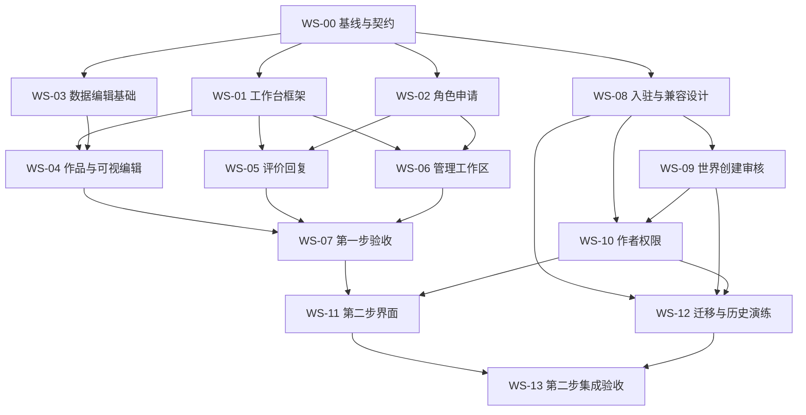

# 可分配的实施任务卡

本卡原于 2026-10-12 设计交接时编写。**当前 WS-00～07 开发已收口并部署、完成技术验证，世界管理逐项体验及旧后台退役另行跟踪；WS-08～13 未启动。** 第一阶段当前入口、能力和人工清单见[实现记录](phase-one-implementation.md)。以下保留原任务范围与验收门槛，作为回归对照；状态不再按编写当日的“尚未开工”理解。

## 执行约定

所有执行者先读 `AGENTS.md`、[operations](../operations.md)、[development-status](../development-status.md)、[产品方案](../user-workspace-redesign.md)和本包。先确认当时 Git 基线及其他人在改的文件，保留无关更改和 `example_pages.zip`。不自动提交推送，不重置数据库或 seed。

任务完成须交付：改动文件／入口、能力和错误状态、必要测试证据、迁移影响、剩余限制、与上下游的契约变化。真实实现经验证后按 operations 默认更新开发域名并核验；多人并行时由集成负责人串行构建／迁移／部署，避免多人互相覆盖构建产物。只有文档和独立草图时不发布。

用户已认可整体方向；世界管理等细部继续人工试用。全部任务遵守[新旧后台并存与人工迁移验收](coexistence.md)，旧版在用户明确同意退役前保持可用；表格按任务追加验收门槛。返回入口和面包屑为 WS-01 的必做项。D01～D03 及正式提交存档要求已于 2026-10-12 确认，见[规则记录](decisions-pending.md)；申请／邀请细节和 D03 具体字段清单仍需在对应任务契约冻结前完成。技术细节由工程负责人处理；不要重复询问已确认的产品关系。

## 顺序与分工

图表记录原始依赖关系。第一步已实现并保持新旧后台并存，技术回归通过后仍需用户体验；第二步契约讨论可提前，但 WS-08～13 及普通作者权限尚未启动。下述负责人和并行分工是当时的交接建议，不代表当前仍在等待第一步开工。

## 第一步：重构已有后台体验

状态：WS-00～07 开发已收口并部署；技术验证已完成，世界管理和完整任务流程的逐项体验记录继续保留。[第一阶段人工操作清单](phase-one-implementation.md#世界管理逐项人工体验)继续有效。技术通过不等于用户认可旧版可退役。

### WS-00｜现状基线、入口清单与共享契约

- **负责人类型：** 集成负责人＋后端。依赖：无。
- **范围：** 将 [入口迁移清单](design-spec.md#5-旧功能迁移清单)扩展到操作级；记录所有 API 的权限、版本与错误语义；核对 `author_id`、旧 provider 的真实语义；确定私有导航 URL、能力 DTO、预览栏目注册表和第二阶段接口命名。
- **主要文件：** `apps/api/src/{app,persona-routes}.ts`、`packages/domain/src/{auth,content,persona-reviews}.ts`、`packages/contracts/src/`、两份既有字段清单；本任务先产出文档／契约提案。
- **交付：** 新旧功能逐项映射、字段覆盖表、角色能力表、公开页面基线清单、可分工的模块边界。
- **验收：** 每项旧功能有新入口或明确保留页；原有前台页面和公开 API 无计划外改动；阶段一不开放普通作者写作品；D01～D03 的状态以最新规则记录为准。
- **不包含：** 权限迁移执行、批量改内容、换框架。

### WS-01｜工作台框架与概览

- **负责人类型：** 后台前端。依赖：WS-00；参考 `#overview/#settings`。
- **范围：** 七项导航按阶段和能力显示；桌面侧栏／手机导航；概览真实待办、最近编辑与空状态；账号设置仅保留现有能力；新旧双入口与切换；旧 account view 和 admin 链接继续进入旧版，不强制重定向。
- **主要文件：** `apps/web/src/pages/[locale]/account.astro`、后台布局及限定作用域样式、现有 account 客户端脚本。真实文件位置先用 `rg --files` 核对。
- **交付：** 可复用页面壳、导航契约、加载／错误／无权限页、真实会话接入。
- **验收：** 普通账号／世界 editor/admin/owner／站点管理员看到正确入口；直接输入 URL 仍需鉴权；中英、390／1440px、键盘可用；前台 CSS 不受影响。
- **不包含：** 新未读通知系统、改密、注册、persona 公开页。

### WS-02｜角色管理与独立送审（BUG-001）

- **负责人类型：** 后端主导＋前端。依赖：WS-00，UI 集成 WS-01；参考 `#personas/#persona`。
- **范围：** 实现原 BUG-001 全部规则：保存不撤销原待审申请，重新提交替代旧待审、重复提交幂等、过期审核拒绝；独立角色队列与联合送审共用逻辑。相关未发布评价／回复需明确更新署名再重提。
- **主要文件：** `persona-reviews.ts`、`settings.ts` 的角色相关入口、`persona-routes.ts`、contracts、必要增量迁移、角色页面。
- **交付：** 角色草稿／当前申请／批准版 UI，网站角色队列，统一 domain 校验。
- **验收：** A 待审→保存 B→A 仍待审→提交 B→A 不能审核；批准 A 与提交 B 竞争一致；跨世界引用 A 的内容不会被批准 B 自动放行；旧署名和凭条不变；世界管理员不能审角色。
- **不包含：** 公开角色主页、任意头像上传或自动改写历史。

### WS-03｜无损字段编辑、双语项目与图标（BUG-002／FEATURE-002）

- **负责人类型：** 数据／表单工程师。依赖：WS-00。
- **范围：** 盘点所有重复项目，建立中英共用 ID／顺序／增删与各语言文案；兼容旧数组的新草稿；完整 schema 往返；图标选项复用实际 SVG，支持键盘与中英名称。
- **主要文件：** `structured-fields.ts`、contracts、三类栏目及共享资料 schema、`components/detail/stay/Icon.astro` 的图形来源；公开输出保持相同。
- **交付：** 栏目可复用字段适配器、稳定项目操作、图标选择器、历史兼容说明。
- **验收：** 添加／删除／排序中英同步，单语清空只缺译；图标和图片随项目移动；隐藏字段／0／空数组／clearedFields 无损；未知旧图标不静默换值；旧公开版和历史不重写。
- **不包含：** 新图标库、公开模板改版、自由布局 schema。

### WS-04｜作品列表与固定模板编辑器（BUG-004／复用 FEATURE-001）

- **负责人类型：** 后台前端＋API 配合。依赖：WS-01、WS-03；参考 `#works/#editor/#returned/#new-work`。
- **范围：** 三类列表筛选分页、编辑定位和返回位置；栏目表单、已保存真实预览、双向栏目定位、中英和宽度切换、版本状态、保存／提交／发布分离。先住宿可审阅，再覆盖活动服务全部字段。
- **主要文件：** `admin.ts`、`structured-fields.ts` 的调用方、私有 preview Astro 路由、`detail.ts`、新增后台专用 bridge／栏目映射；保持公共 renderer 输出。
- **交付：** 真正接入现有保存预览的三类编辑器；差异／历史入口；完整字段覆盖清单。
- **验收：** 无改动预览不新建版本；失败不丢输入；保存期间再次输入仍标未保存；冲突、旧 token、晚到 iframe 消息被正确处理；消息校验全部上下文；图片／图标／排序真实预览一致；手机点击预览返回正确字段；编辑后返回保留筛选。
- **不包含：** 实时逐键预览、自动保存、自由拖页、作者新权限、修改公开页面。

### WS-05｜评价与提供者回复工作区

- **负责人类型：** 后台前端／domain 配合。依赖：WS-01、WS-02；参考 `#interactions`。
- **范围：** 本人评价与作品收到的评价分组，查看回复、修改、保存、送审、退回、明确署名和资料审核；保留单条提供者回复。记录 [多轮扩展边界](contracts.md#5-多轮回复的扩展边界)并隔离现有单条 DTO 适配。
- **主要文件：** account 客户端、`persona-routes.ts`、`persona-reviews.ts`、ReviewCard 的私有预览调用方。
- **交付：** 中英发言表单、列表分页和筛选、回复资格提示、未来接口适配说明。
- **验收：** 同角色同条目仍一篇评价；回复 API 参数的评价 ID 不误用；绑定 persona 所属账号才可回复；管理员不冒充；资料过期、审核退回、保存失败不丢正文；旧公开发言和署名保持。
- **不包含：** 多轮聊天、游客身份改为账号绑定、公开评价 UI 改造。

### WS-06｜世界与网站管理界面

- **负责人类型：** 管理后台工程师。依赖：WS-01、WS-02；与 WS-04 共享审核／预览组件。
- **范围：** 世界审核／内容／设定／成员分区，网站角色审核及账号管理；固定版本差异与退回原因。迁移下架、恢复、站点限制、提供者绑定、共享资料、导入预演／执行、翻译／任务重试等入口。
- **主要文件：** admin/account 页面及客户端、settings-editor、已有管理 API 的 UI 调用方。
- **交付：** 世界／站点工作区、完整旧功能去向清单；并存期全部旧工具保留且新导航可达；世界管理按人工清单逐项确认迁移方式。
- **验收：** 逐项执行 WS-00 清单；跨世界不能读写；世界 editor 不出现审核权；站点封禁不能被世界恢复绕过；审核明确固定版本；共享资料不能扩大为所有世界成员可改。
- **不包含：** 第一阶段开放世界创建／入驻，新增成员邀请产品或所有权转移。

### WS-07｜第一步集成与前台保持现状验收

- **负责人类型：** 集成负责人＋测试。依赖：WS-02 至 WS-06。
- **范围：** 串联角色→评价→审核→回复；三类作品编辑→保存预览→送审／发布→下架／恢复；覆盖语言、设备、权限、旧链接和管理工具；双向编辑、新旧冲突、返回与面包屑上下文恢复。
- **交付：** 验收矩阵、前台对照、已部署版本及线上证据、用户审阅说明。
- **验收：** 必要 domain／API／E2E 通过；同一已发布数据下首页、列表、三类详情、评价、预订、凭条的布局／字体／文案／交互／URL 未变；公开资源没有编辑器脚本；Basic Auth、应用会话和 noindex／robots 均保持；按 operations 构建发布并验证。
- **不包含：** 把原 BUG-003 前台部分当作已完成、阶段 6 正式文案填充。

## 第二步：世界、入驻与普通作者

状态：WS-08～13 未启动；D01～D03 及正式提交存档要求已确认。世界创建、入驻资格与普通作者作品权限不得从第一阶段界面推断为已开放。

### WS-08｜入驻申请、邀请与既有权限兼容

- **负责人类型：** 后端／数据库。依赖：WS-00，按已确认 D01、D02 冻结契约，并审阅申请／邀请细则。
- **范围：** 账号＋世界资格、申请与事件历史；开放申请／邀请；审核、撤回、拒绝重申、取消和接受邀请；能力接口。形成旧成员／作者／provider 的兼容映射。
- **主要文件：** 新 admission domain、auth、contracts、API、增量 migrations；不将普通作者写入 world_members。
- **交付：** 契约、状态图、迁移与只读预演报告、资格 API、并发测试。
- **验收：** 多 persona 共用账号资格；一次入驻覆盖三类作品送审；不能重复批准旧申请或接受撤销邀请；取消不下架旧公开内容，不禁普通游客发言；旧合法使用者不被无意锁死，归属不确定者列出人工核对。
- **补充验收：** 未入驻与资格被取消须明确区分；申请正式提交形成存档，拒绝、撤回及重新申请不覆盖原提交与审核记录；取消资格使未完成作品送审失效，恢复后须明确重提。
- **不包含：** 公开注册、作品转移、扩大编辑者到全世界权限。

### WS-09｜世界草稿与网站审核

- **负责人类型：** 后端。依赖：WS-08 的权限／迁移契约，按已确认 D03 提供具体身份字段清单供审阅并冻结契约。
- **范围：** 创建者成为 owner，世界草稿／固定送审／批准公开／退回；既有世界批准状态衔接；私有世界读取和预览上下文。
- **主要文件：** world domain、`home.ts`／`settings.ts` 关联模型、`detail.ts` 私有预览、API／contracts／migration；公开读契约保持。
- **交付：** 世界审核服务、站点队列接口、私有世界预览、对外字段变更清单。
- **验收：** 草稿世界可准备内容和私有预览，公开查询／搜索／详情均不可见；世界批准不自动发布待审作品；世界未公开或被封禁时任何发布／恢复路径均拒绝；已公开世界及历史 URL 不受迁移影响。
- **补充验收：** 首次世界审核不强制示例作品；公开后的身份资料修改须网站审核，旧批准版继续公开，普通运营内容按世界权限处理；被拒绝的世界提交仍可按权限查看当次内容及审核记录。
- **不包含：** 新的公开世界主页／导航，重做前台发现结构。

### WS-10｜作者自己的作品与经营者回复授权

- **负责人类型：** 后端＋权限测试。依赖：WS-08、WS-09。
- **范围：** 作者列表／创建／编辑／送审／私有预览；未入驻可准备本人草稿，获批后才可送审；世界审核复用同一 domain；经营资格取消时停止草稿写入、送审和提供者回复；普通游客发言单独保留。
- **主要文件：** `content.ts`、`auth.ts`、`detail.ts`、`persona-reviews.ts`、新 me/works API 与 contracts。
- **交付：** 细粒度能力策略和错误原因、归属查询、各发布入口统一门槛。
- **验收：** A 不能读写 B 私有草稿；已入驻也不能改别人作品；persona 绑定不授予编辑权；取消资格与送审／回复／管理员审核竞争时按已定规则拒绝旧请求；公开作品下架独立；历史恢复不能绕过世界或网站限制。
- **补充验收：** 入驻前及待审时可保存本人目标世界草稿，但送审被服务端拒绝；获批后可送审；资格取消后不能借“未入驻可写草稿”绕过停写。每次作品送审固定版本，拒绝后保留存档，修改重提追加记录，不能批准已失效的旧记录。
- **不包含：** 内容协作授权、跨账号 persona 发言、删除旧历史。

### WS-11｜第二步用户及管理流程界面

- **负责人类型：** 后台前端。依赖：WS-07 至 WS-10 的稳定接口。
- **范围：** 入驻列表／申请／邀请、世界创建与进度、网站世界审核、入驻审核、创作者管理、作品新建及本人列表；所有第二阶段入口接真实能力。
- **主要文件：** 后台页面与客户端模块；沿用第一步壳／字段／状态组件。
- **交付：** 入驻前准备草稿→申请／获准→作品送审→公开，以及创建世界→网站审核两条完整路径；申请与草稿准备无强制先后顺序。提供按权限查看提交存档、拒绝理由及修改重提的入口。
- **验收：** 待审／拒绝／取消／仅邀请／世界未公开均有解释与下一步；按钮与服务端能力一致；旧稿可读、受限写入明确；匿名和越权直达正确拒绝；中英及手机可操作。
- **不包含：** 前台申请入口、角色公开主页、未来多轮回复界面。

### WS-12｜迁移、并发和历史保护演练

- **负责人类型：** 数据库／测试。依赖：WS-08 至 WS-10，可与 WS-11 并行。
- **范围：** 在隔离数据库／schema 演练增量迁移、重复运行行为、旧世界／成员／内容／provider 的兼容；多角色、多世界及旧版稿件的授权检查；迁移失败恢复方案。
- **交付：** 前后数量及关键历史摘要、权限映射差异、异常清单、发布迁移顺序、可执行恢复步骤。生产／开发现用库不拿来做破坏性测试。
- **验收：** 无 seed/reset、无历史修改；未知归属不误授权；并发取消／批准／重提一致；旧版本应用是否兼容新增 schema 已明确，不以代码回滚代替数据恢复方案。
- **补充验收：** 入驻前草稿及拒绝／失效存档在迁移前后保留；草稿更新不改写当次正式提交；资格取消与保存、送审、审核竞争时遵守 D02。
- **不包含：** 自动清理看似无主数据、批量修正文案、无审阅的作品归属转移。

### WS-13｜第二步集成、发布和交接

- **负责人类型：** 集成负责人。依赖：WS-11、WS-12。
- **范围：** 完整角色矩阵／三类作品／两语言／桌面手机链路；重新核验私有预览、所有发布恢复路径、旧功能迁移和前台一致性。
- **交付：** 对照产品规则的验收报告、数据兼容报告、当前线上版本、operations 更新、遗留项及用户验收入口。
- **验收：** 必需检查通过后执行增量迁移、构建、串行发布及线上核验；Basic Auth/noindex/no-store/robots 保持；用户可从旧 account 内主动切换新版，旧入口继续可用；前台无计划外变化。
- **不包含：** 自动进入阶段 6、公开注册、多轮讨论或新前台。

## 原问题清单如何归属

| 原编号 | 新任务／处理 |
| --- | --- |
| BUG-001 | WS-02 全量实现，WS-05／06／07 联动验收 |
| BUG-002 | WS-03 数据与表单，WS-04 三类真实预览，WS-07 验收 |
| BUG-003 | WS-04／06 后台明确单篇评分、自动汇总、叙事统计来源；**前台标示仍待单独授权**，不能因此宣布全项关闭 |
| BUG-004 | WS-04 列表、编辑定位和返回恢复，WS-07 验收 |
| FEATURE-001 | 复用已部署实现，WS-04 接入；此前用户验收仍需完成 |
| FEATURE-002 | WS-03，WS-04／07 验收 |

四项 bug／两项 feature 在正式内容填充前完成并验收的旧门槛保持。后台两阶段完成不自动满足 BUG-003 的前台剩余项，也不自动启动正式内容填充。

## 给执行者的任务开场模板

> 你负责 Plotstay 后台重构的 WS-XX。先阅读 AGENTS.md、operations、development-status、user-workspace-redesign 和 workspace-handoff 中的本任务及依赖。只实施已指派范围；现有前台呈现和公开交互保持不变。核对上游契约及当前分支后执行，记录必要验证；增量迁移保留原库，禁止 seed/reset。发现产品规则冲突时先指出具体冲突，继续不受影响的工作。完成后交付改动、验证和限制，由集成负责人按既有授权统一部署；不自动 commit/push，不把尚未完成的依赖说成已验收。
