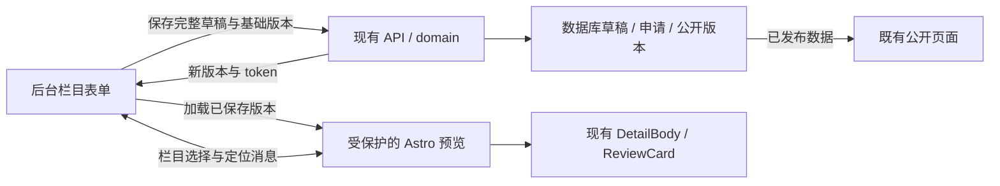

# 技术选型与可行性验证

评估日期：2026-10-12。结论：**首版沿用 Astro／TypeScript、现有结构化表单和私有真实页面预览，增加栏目定位桥接。** 不引入新的 CMS 或 React 管理框架。此为工程建议；未安装候选依赖，未改应用代码。

## 1. 工程现状与接入点

盘点基线 `0ac917d`：Astro 7.3.5、@astrojs/node 11.1.6、TypeScript 6.0.3、Fastify 5.12.5、Zod 4.6.5，数据库沿用 PostgreSQL 18。`apps/web/package.json` 没有 React。版本仅记录本次本地依赖，不表示要求升级到这些版本。

| 现有文件 | 已有能力／本次发现 | 接入建议 |
| --- | --- | --- |
| `apps/web/src/lib/admin.ts` | 保存、内嵌预览、语言／宽度、版本冲突和未保存提示 | 拆出后台页控制与状态，复用请求和错误语义 |
| `apps/web/src/lib/structured-fields.ts` | 按 schema 与 keys 渲染；从完整对象克隆；中英数组仍各自编辑 | 包装栏目，完整对象往返；BUG-002 单独修复 |
| `packages/contracts/src/base.ts` | `textSchema`、`editContentSchema`、`baseRevisionId`、`baseDraftToken` | 不另造一套与服务端不一致的字段模型 |
| `apps/web/src/pages/api/admin/preview/[locale]/[id].astro` | 已保存版本预览，复用 DetailBody／ReviewCard，私有响应，无预订动作 | 仅此私有环境装载桥接脚本与高亮 |
| `apps/web/src/components/DetailBody.astro` | 三类正式详情，已有稳定栏目 id／class | 通过私有映射定位；公共页面不注入编辑脚本 |
| `packages/domain/src/detail.ts` → `previewDetail` | 后台权限＋草稿 head/token 校验；世界信息经公开 `listWorlds` 查找 | 第二阶段需私有世界解析，否则未公开世界不能正确预览 |
| `packages/domain/src/auth.ts`／`content.ts` | 世界成员有世界范围能力；内容写入用 `requireWorld`／锁定校验 | 增加作品归属与入驻能力；不要把作者塞进 editor 成员组 |
| `packages/domain/src/read.ts` | 公开查询检查世界 visible/site_blocked 与内容限制 | 保持公开读取契约；所有发布／恢复入口统一新门槛 |
| `packages/domain/src/persona-reviews.ts` | 角色、固定署名版本、评价与单条回复、提供者绑定 | 保留原历史；BUG-001 统一申请指针；第二阶段加经营资格限制 |

## 2. 推荐结构

父页面拥有编辑状态，iframe 只展示已保存数据。消息只表达“选中栏目／聚焦栏目”，不承担保存、批准或发布。服务端重新验证每个读取和写入请求的权限。固定模板和既有内容 schema 是数据源，预览不另存一套页面搭建 JSON。

### 私有桥接约定

概念消息：`{channel, type, previewSession, contentId, revisionId, draftToken, locale, sectionId, itemId?}`。草图使用简化的 session/revision/section 字段；正式实现须补足实体及语言上下文。

- 发送时指定确切 `targetOrigin`；接收时核对 origin、`event.source === iframe.contentWindow`／parent、当前会话、版本、语言、消息类型和栏目白名单。
- 换实体、换语言、保存、iframe 重载时更换会话并销毁旧监听；忽略晚到的旧消息。版本号不能单独充当授权凭证。
- token 沿用服务端的过期校验，不放持久存储或日志。iframe 能加载不表示获得其他写入权。
- 高亮样式限定在私有预览；正式页无桥接包、编辑边框或点击拦截。预览禁用预订等副作用，外链按预览已有规则处理。
- 不依赖用户正文中的 selector、HTML 或事件。映射来自受控栏目注册表；缺失目标退回字段导航，不抛弃字段。
- 可选区块和重复项定位是增量增强；真实图片列表、寝具、价格侧栏等未在本次逐项验证，WS-04 必须补齐。

## 3. 实际验证证据

脚本：[verify.mjs](verify.mjs)；结果：[verification.json](verification.json)，返回导航修订后最终 20 项检查通过。执行 `HANDOFF_LIVE_SPIKE=1 node docs/workspace-handoff/verify.mjs`。使用现有 Playwright 与 esbuild，临时服务器只接受 GET，结束后关闭。

| 验证 | 结果及能说明什么 | 不能据此声称什么 |
| --- | --- | --- |
| 17 个主要草图页面 × 1440／390px | 没有整页横向溢出；保存 8 张截图，并人工看过桌面编辑、手机概览和手机编辑 | 不是完整视觉验收、完整可访问性或所有屏宽验证 |
| 世界管理返回和面包屑 | 桌面／手机可从五个子页逐级返回，直接深链接可用；世界内容进入编辑后返回原列表，取消离开保留输入 | 世界设定等占位表单的完整持久化、跨界面上下文恢复尚未实现 |
| 草图保存／预览、语言切换、返回筛选 | 保留本地输入；公开版、保存版、未保存内容分开 | 没有调用真实保存、提交或发布 API |
| 网络／会话／冲突模拟 | 三类失败都保留输入与旧预览，显示失败信息 | 不是实际断网、会话恢复或数据库并发测试 |
| 栏目双向定位 | 编辑面板定位预览；预览点击／Enter 定位字段 | 不是任意文本或所有重复项可编辑 |
| 消息拒绝 | 错 origin/source/session/revision/section/action 不进入选择回调 | 不是整个后台安全审计 |
| 真实 schema 表单实验 | 内存打包现有 `structuredFields + textSchema`，只渲染并改 title，summary/tags/hostName/imageAlts/clearedFields 等未显示字段仍完整 | 不代表全 schema、排序、清空或媒体关联已覆盖 |
| 已部署页面只读试验 | GET 中英住宿／活动／服务共 6 页，校验 5 个栏目目标；在住宿 HTML 临时浏览器副本中加定位，点击可聚焦后台字段，正文没被改写 | 未认证进入真实草稿预览；未验证未公开世界、真实权限或 Nginx 全链路 |
| 源文件校验 | 关键模板、表单与依赖文件前后 hash 相同；改动范围限定在 docs | 不是新后台的应用回归测试 |

只读试验将现有公开页 HTML 去掉脚本后装入独立 iframe，使用现有 CSS；定位监听仅加入浏览器临时 DOM。正式实现仍必须走现有认证预览端点，不能用抓取公开页来模拟草稿。现场未改数据库、配置、依赖、已发布内容或历史。

已验证目标：住宿 `.detail-heading h1`、`#about`、`#facilities`、`#host`、`#rules`；活动 `.experience-introduction h1`、`#about`、`#itinerary`、`#host`、`#rules`；服务 `.service-introduction h1`、`#service-items`、`#service-gallery`、`#host`、`#rules`。现有结构未来变化时，栏目映射测试应及时报错，避免静默点不中。

## 4. 开源候选比较

以“保持公开模板、固定结构、现有版本审核、多语言及权限模型”为必要条件；不按 stars 排名决定。下表为官方资料和仓库元数据评估，**没有安装运行这些候选，只有推荐的现有技术路径完成局部浏览器试验**。

| 方案 | 与当前项目的适配成本 | 本轮结论与依据 |
| --- | --- | --- |
| 现有表单＋Astro 预览桥接 | 要写栏目适配、状态控制和交互；保留原数据、渲染与权限 | 推荐。最少引入平行数据结构；局部实测见上 |
| Puck | 核心围绕 React 组件与其数据／Render；本项目正文由 Astro 渲染，要做额外适配或重复 renderer。Astro 可集成 React，但仅能集成并不意味着免费复用 Astro 模板 | 留作未来自由组件搭建候选。本轮固定栏目不需要引入整个搭建器。[官方文档](https://puckeditor.com/docs)、[组件配置](https://puckeditor.com/docs/integrating-puck/component-configuration)、[Astro 框架组件](https://docs.astro.build/en/guides/framework-components/) |
| Payload | iframe 实际前端预览值得借鉴；整体采用涉及 CMS、数据模型和运行结构接入，重叠现有版本和权限系统 | 借鉴预览机制，不迁移。[Live Preview](https://payloadcms.com/docs/live-preview/overview)、[安装要求](https://payloadcms.com/docs/getting-started/installation) |
| ApostropheCMS | areas/widgets 的内容块编辑可参考；整套 CMS 需适配已有模板和业务 | 留参考，不引入。[Areas and widgets](https://apostrophecms.com/docs/guide/areas-and-widgets.html) |
| Wagtail | 编辑团队权限有参考价值；采用 CMS 会增加 Python/Django 系统及数据整合 | 参考审核分工，不迁移。[权限说明](https://docs.wagtail.org/en/stable/topics/permissions.html) |
| react-admin | 适合管理列表和表单，需 React 与 Data Provider 对接；不直接解决本项目三类页面视觉定位和复杂版本语义 | 后续大规模管理 CRUD 可复评；本轮不增加第二套 UI 框架。[Data Providers](https://marmelab.com/react-admin/DataProviders.html) |
| HivePress | WordPress listing 系统与现有 Astro/Fastify 架构差异大 | 参考投稿与目录任务组织，不作为直接接入方案。[官方站](https://hivepress.io/) |

Puck 的 [permissions](https://puckeditor.com/docs/api-reference/permissions) 控制编辑器内的可用操作，不能替代 Plotstay 服务端鉴权；同理任何组件库的隐藏按钮都不等于安全边界。

2026-10-12 GitHub API 快照（规模会变化；最近 push 不等于已发布稳定版本）：

| 仓库 | Stars | 最近 push（UTC 日期） | GitHub 返回许可标识 |
| --- | ---: | --- | --- |
| [puckeditor/puck](https://github.com/puckeditor/puck) | 13,461 | 2026-10-09 | MIT |
| [payloadcms/payload](https://github.com/payloadcms/payload) | 45,197 | 2026-10-10 | MIT |
| [apostrophecms/apostrophe](https://github.com/apostrophecms/apostrophe) | 4,644 | 2026-10-10 | 未返回；采用前需查具体 LICENSE |
| [wagtail/wagtail](https://github.com/wagtail/wagtail) | 20,543 | 2026-10-09 | BSD-3-Clause |
| [marmelab/react-admin](https://github.com/marmelab/react-admin) | 26,960 | 2026-10-11 | MIT |
| [hivepress/hivepress](https://github.com/hivepress/hivepress) | 69 | 2026-10-08 | GPL-3.0 |

六个仓库当次均未归档。许可标识只针对所查询仓库，不代表所有插件、商业功能和依赖；HivePress 的 GitHub stars 也不能代表 WordPress 用户规模。由于本轮不引入它们，不进行完整依赖许可或商业版能力审计。若工程师提出更换方案，应先以同一业务链完成安装试验和字段无损往返，并说明保持前台的方式。

## 5. 实施时必须解决的风险

1. **权限范围。** 入驻是账号＋世界资格，作品编辑仍需归属；不能复用世界 editor 作为创作者权限。提供者绑定、发言资格另行判断。
2. **未公开世界预览。** 当前公开世界查询不够，需要在私有权限域读取世界草稿。公开 API 不得因此能读到未公开世界。
3. **发布与恢复。** 新门槛必须覆盖审核、管理员直接发布、历史恢复及其他可能改变公开指针的入口，不能只改主按钮。
4. **数据无损。** 部分栏目编辑要带回完整草稿；区分 `0`、空串、空数组、未提供与 `clearedFields`。中英稳定项目 ID、媒体引用随项目移动，旧历史不能重写。
5. **保存竞争。** 编辑中的新输入、翻译 token 变化、旧预览 load 回调、过期审核窗口分别处理，不用简单布尔 dirty 标记覆盖全部场景。
6. **身份与历史。** 角色改名不改旧署名；管理员不代替 persona 作者发言。不能从提供者 persona 倒推出旧作品所有者。

这些是 WS-00 至 WS-13 的工程验收点，不要求用户决定数据库锁或框架细节。
